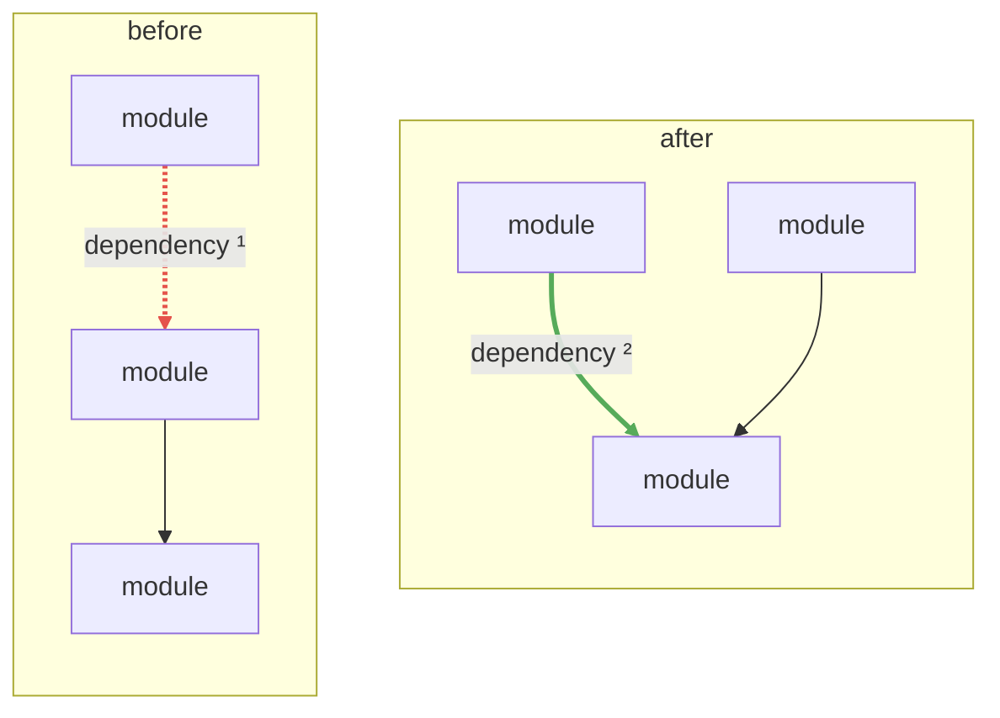
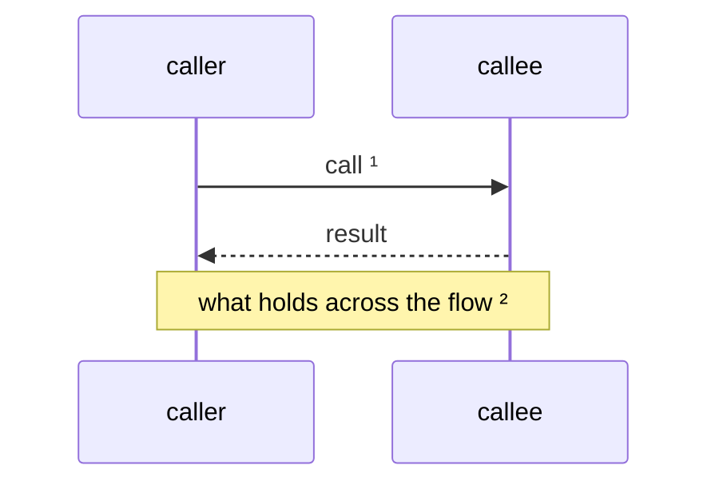
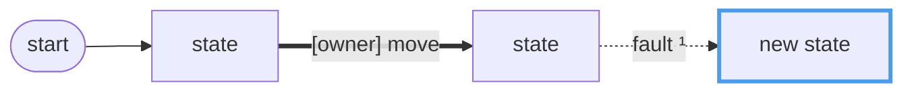
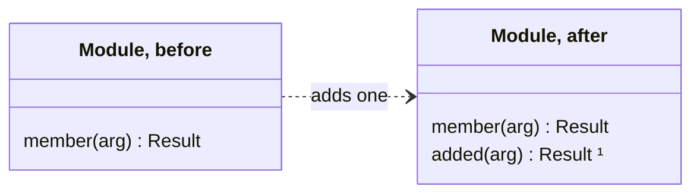
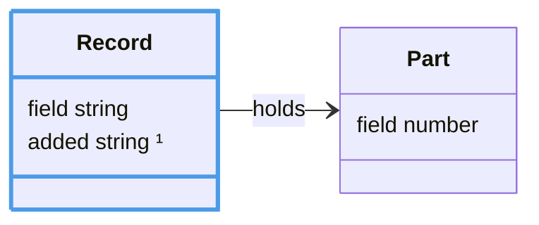
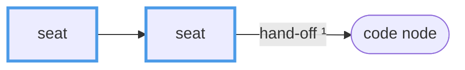

## Figures

A figure draws the change's shape. Its notes are the design calls it shows, each pointed at by a superscript (`¹`, `²`)
in a label. Draw first, then write: a call a figure shows is a note on it, not prose beside it. The owner reads the
rendered figure; agents read its source and notes as text, so a figure says in a few lines what a paragraph would.

Pick the kind by what the change does to the system. Most changes need one figure or none, and none needs more than two.

| Kind          | Source            | Draw when                                                                 |
| ------------- | ----------------- | ------------------------------------------------------------------------- |
| `seams`       | `flowchart`       | modules gain, lose or move a dependency: before and after                 |
| `sequence`    | `sequenceDiagram` | a flow across seams is new or changes order                               |
| `state`       | `flowchart`       | a lifecycle gains or changes a state or a move                            |
| `interface`   | `classDiagram`    | a module's public interface grows or shrinks: its depth, before and after |
| `contract`    | `classDiagram`    | the change sets or changes a one-way door: its shape after                |
| `composition` | `flowchart`       | a concert gains, drops or rewires a seat                                  |
| `call-tree`   | `diff`            | no template fits, and the point is a call added, dropped or moved         |
| `file-tree`   | `diff`            | no template fits, and the point is files added, moved or split            |
| `pseudocode`  | `diff`            | no template fits, and the point is logic in one place                     |

When no sketch says it faster than a sentence, draw nothing. Never write Mermaid outside these skeletons.

### Figure rules

1. **Text stays complete.** Every fact a figure shows is in a label or a note, so the spec reads whole unrendered.
   Colour, bold and dotted lines never carry a fact alone; the caption says what each styling means, or is empty.
2. **Labels are tags.** A node is a name (`route.ts`), an edge one to three words (`[tick] PR`). Detail goes in a note.
3. **Notes.** Superscripts run `¹` on in source order; the notes give each its note, in order, one fact each, a
   reference as a plain last note "In <path>".
4. **One idea per figure,** a dozen nodes at most. Draw only the modules, calls and states the change touches.
5. **Parse-safe labels.** Quote any flowchart label with spaces or punctuation; a `classDiagram` relation label stays
   bare. No `;`, no second `:`, no `/` outside quotes, no `<n>`.
6. **No fills.** The forge sets fill and text colour per theme. Highlight with a stroke from the palette only.

| Role  | Meaning                    | Node                                             | Edge                                            |
| ----- | -------------------------- | ------------------------------------------------ | ----------------------------------------------- |
| owner | waits on, or is, the human | `classDef owner stroke:#d4a72c,stroke-width:3px` |                                                 |
| agent | an agent acts, or new      | `classDef agent stroke:#4c9be8,stroke-width:3px` |                                                 |
| fault | a fault, or removed        | `classDef fault stroke:#e5534b,stroke-width:3px` | `linkStyle <i> stroke:#e5534b,stroke-width:3px` |
| done  | a success, or added        | `classDef done stroke:#57ab5a,stroke-width:3px`  | `linkStyle <i> stroke:#57ab5a,stroke-width:3px` |

`linkStyle` counts the links from 0 in source order, `~~~` included. Shapes: `["x"]` a step or state, `(["x"])` a start,
end or outside system, `{"x?"}` a decision. Edges: `-->` the normal move, `==>` the owner's move, `-.->` an exception, a
side effect or a dependency that goes.

### Skeletons

`seams`; keep `before ~~~ after` after every edge, or Mermaid may stack "after" above "before":



`sequence`:



`state`:



`interface`, the public members only:



`contract`, the shape after the change, the field it adds or changes marked:



`composition`, agent seats stroked `agent`, code nodes stadium-shaped:



The sketches are plain text in a `diff`: a leading space for a line that stays, `+` for one added, `-` for one removed,
and a `# ¹` comment on a line a note explains.

```diff
 caller
   step
-    removed(call)
+    added(call)    # ¹
```
