# maestro

[](https://github.com/dvalnn/maestro/actions/workflows/check.yml)
[](https://github.com/dvalnn/maestro/releases)
[](LICENSE)

**Coding agents, orchestrated as code.**



Compose agents, checks and reviews into a typed graph. maestro checks the graph and bounds its spend before a single
model call, performs it in isolated lanes, and hands back a changeset you decide whether to apply.

## How it works

1. **Compose.** You write a composition in TypeScript: who builds, who reviews, which checks must pass, how many repair
   rounds to allow. `maestro compose` builds its graph and checks it: types, config, profiles, and an upper bound on
   agent runs. It spends nothing.
2. **Perform.** `maestro perform` runs the graph as a concert. Each agent and check works in a lane, a versioned working
   copy cut from your repository, inside a bubblewrap sandbox. Every step is recorded, so a failed concert resumes where
   it stopped.
3. **Apply.** A concert's only way out is its changeset: patches you show, then apply or drop.

## Why maestro

- **No spend before pre-flight.** The plan names its bound, such as `up to 7 repo.agent`, before anything runs.
- **Your checkout stays yours.** Agents and checks work in lanes; applying the result is your call.
- **Bounded loops.** Repair rounds, fan-outs and escalations are capped in the composition, not by hope.
- **Mix model families.** Each profile picks its harness and model, Claude Code or pi, so a skeptic can challenge a
  reviewer from another family.
- **Ready-made compositions.** The `classics` pack ships `build_then_repair`, `build_then_review`, `panel_review` and
  `review_change`.
- **Agents can drive it.** A release installs a `maestro` skill for Claude Code, Codex and pi.

## Install

maestro runs on Linux x64 with glibc, and needs bubblewrap, bash, git 2.40 or newer, and a harness: Claude Code or pi.

```sh
curl -fsSL https://raw.githubusercontent.com/dvalnn/maestro/next/install.sh | sh
```

[INSTALL.md](INSTALL.md) has the full requirements, pre-releases, pinning a version, and the first run.

## Quick start

Two small config files come first, both in [INSTALL.md: Configure](INSTALL.md#4-configure): one gives each `classics`
profile a model, the other names your repository's checks. Then, in that repository:

```sh
maestro compose classics.build_then_repair --request "Add a --verbose flag"
maestro perform classics.build_then_repair --request "Add a --verbose flag" --detach
maestro watch <concert>
maestro cs show <concert> --stat
maestro cs apply <concert> --commit
```

`--preset stub` swaps every agent for one that changes nothing, to rehearse a composition for free. To review commits
instead, run `classics.panel_review` with `--revs main..HEAD`.

## Write a composition

A composition is a typed function from params to a graph. This one builds a task in a fresh lane, runs the `test` check
on the result and returns the changeset:

```ts
import { changeset, check, extend, fresh, seat } from "@maestro/host-repo-sdk";
import { composition, Text } from "@maestro/sdk";

const builder = seat("builder", { profile: "classics/builder" });

export const buildAndTest = composition(
  "build_and_test",
  { params: { task: Text() }, examples: [{ task: "Add a greeting to a.txt." }] },
  ({ task }) => {
    const built = builder({ label: "build", task, lane: fresh() });
    const tested = check(extend(built.out.lane), "test");
    return changeset(tested.out.lane, { label: "result" });
  },
);
```

Its params become flags: `maestro perform build_and_test.ts --task "Add a greeting to a.txt."`. Loops, fan-out and
reviews are in [the SDK spec](docs/sdk-spec.md).

## Documentation

| Read                                 | For                                                  |
| ------------------------------------ | ---------------------------------------------------- |
| [INSTALL.md](INSTALL.md)             | Install, first run, upgrade, uninstall               |
| [classics](packs/classics/README.md) | The shipped compositions, their profiles and params  |
| [CLI](packages/cli/README.md)        | What each verb does beyond `maestro <verb> --help`   |
| [SDK spec](docs/sdk-spec.md)         | Writing compositions, code nodes and subcompositions |
| [Architecture](docs/architecture.md) | How a concert runs, is recorded and resumes          |
| [Glossary](GLOSSARY.md)              | Every term: concert, lane, seat, profile, changeset  |
| [Docs map](docs/README.md)           | Where each topic lives                               |

## Contributing

maestro is developed on its own forge and published here. Pull requests are welcome against `next`; see
[CONTRIBUTING.md](CONTRIBUTING.md).

## License

[MIT](LICENSE)
