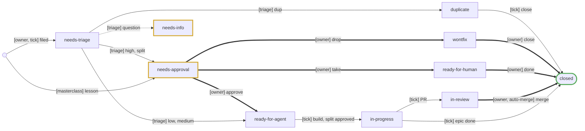
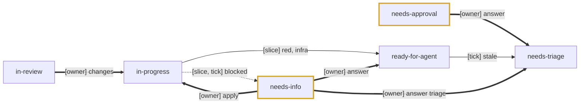
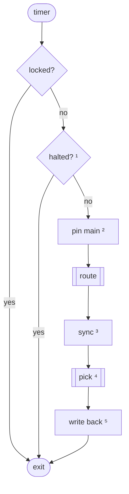
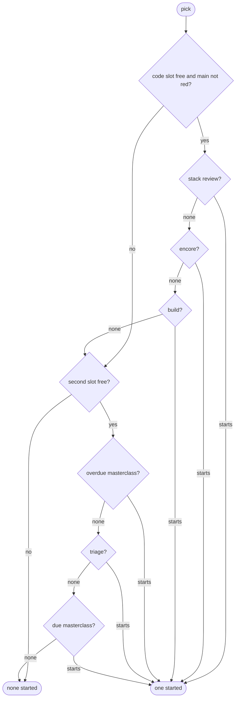
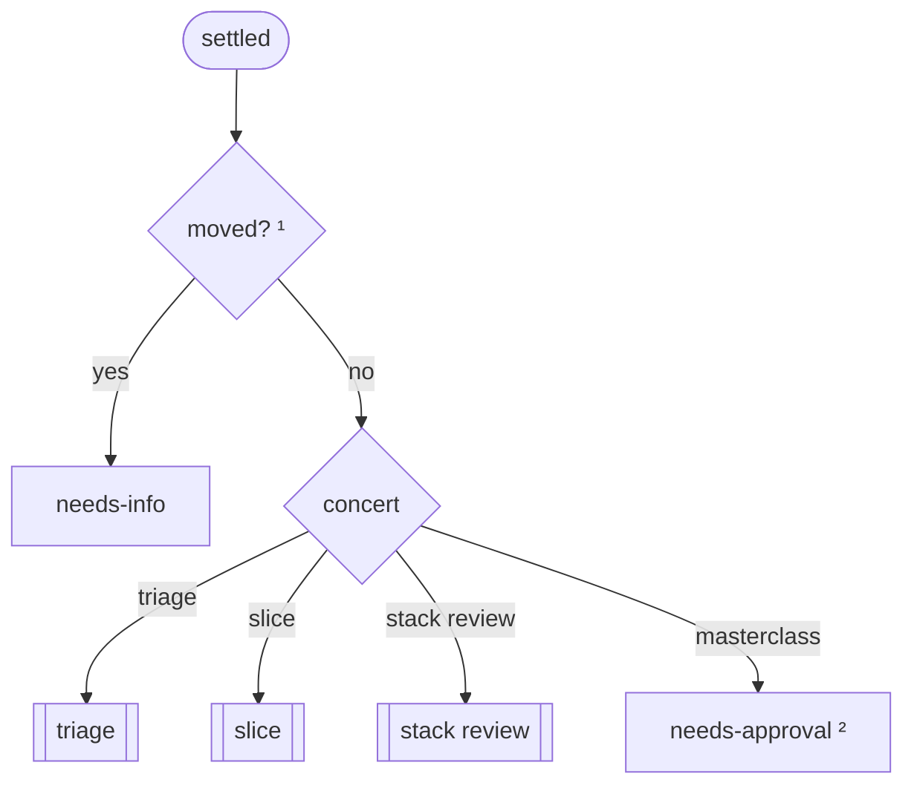
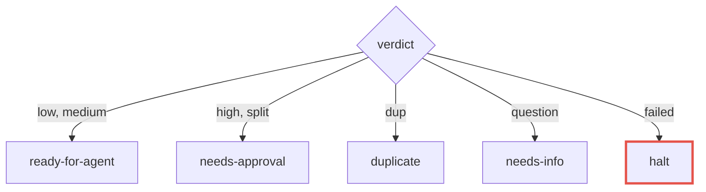
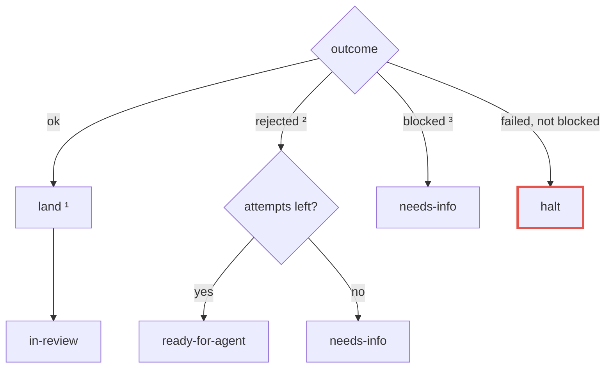
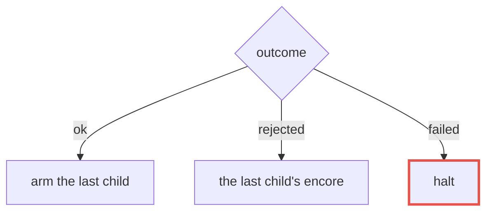
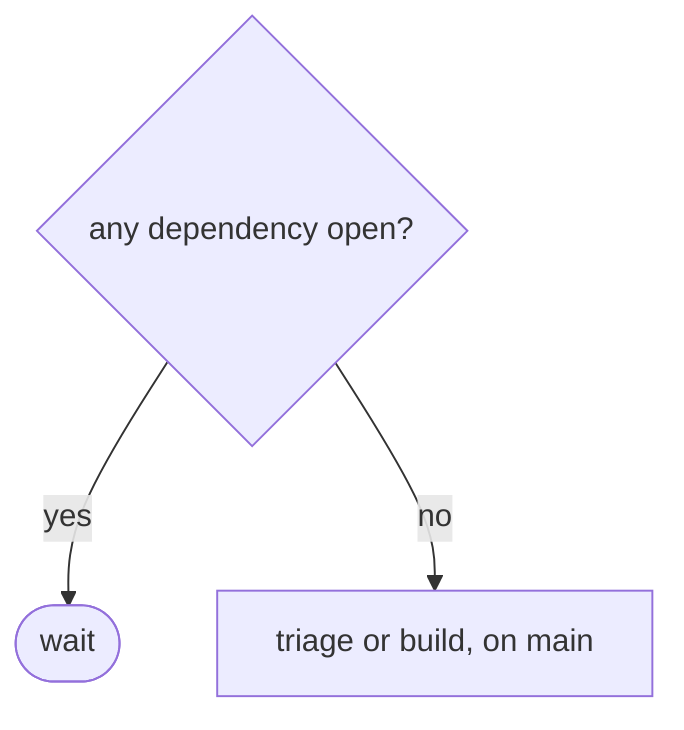

# Tour manager

For the owner and agents looking up how the tour manager moves a ticket and what it writes on the forge.

The Maestro Tour Manager ("tour manager") is maestro in factory mode, and the name it signs on a ticket. A **tick**, one
run of `scripts/factory` (install and flags in its `README.md`), reads the forge, routes whatever a finished concert
left, and starts at most one next action. A concert that has finished and awaits routing is a **settle**. A **slice** is
the concert that builds one ticket's change (`.maestro/slice.ts`); a **stack review** reviews a split epic's children as
one change (`.maestro/review.ts`); a **masterclass** is the concert that gathers lessons from settled concerts.

## State machine

A ticket's state is its `state/` label (meanings in `triage-labels.md`); a move replaces it, since the scope is
exclusive. An edge names the actor that causes the move, and the tick sets the label unless the owner does it by hand.
The actors:

- **owner**: the human, or forge-bot acting for them.
- **tick**: the script, as its own account `maestro-tm`, apart from forge-bot, the sessions' account.
- **triage**, **slice**, **masterclass**: the concerts the tick performs; the tick routes their outcome.
- **auto-merge**: the forge, on a low-risk PR the tick armed.

Bold edges are the owner's moves, dashed ones park a ticket for an answer, gold states wait on the owner, green is done.
The transition table in `scripts/factory/transitions.ts` holds the same machine, and a test checks these diagrams
against it. Forward moves:



Moves back, to an earlier state or aside to wait for an answer:



The owner may move any open issue to `ready-for-human` or `wontfix`; the diagram draws it from `needs-approval` only. A
closed issue is no label: the forge's closed state.

## One tick

`route` is zoomed under Routing a settle, and `pick` below the notes.



1. Until the `maestro-tm:halt` issue closes (Rules, Policy: Halt).
2. Read the forge's `main` commit, then fetch `origin`; a failed fetch ends the tick as failed (Rules, Landing and PRs:
   Tick base).
3. A merged PR closes its issue through its `Closes #N`; closed dependencies free tickets; an approved split files its
   children (Rules, Triage: Splits) and its last closed child closes the epic.
4. Zoomed below. It starts at most one concert, in a free slot (Rules, Policy: Pick order and One concert per slot).
   `--route-only` routes and syncs but starts nothing.
5. Set the labels, edit the spec comment, post any question comment, and rewrite the closing line on a new version
   (Forge surfaces).

The pick step. The first step that starts a concert ends the pick; one that starts none passes on, along `none`:



## Routing a settle

By the kind of concert that settled, each zoomed below. Red marks the halt.



1. The owner moved the ticket during the run: a slice is parked, a triage's verdict dropped (Rules, Triage: Moved during
   a run).
2. One issue per proposal, a slice's obstacles and sightings among what it merges (Rules, Masterclass).

A triage:



A slice:



1. Rules, Landing and PRs: Landing.
2. A slice whose last reviewed lane holds no patch settles `rejected` with `the slice changed nothing` (Rules, Build:
   Attempts).
3. Rules, Build: Blocked.

A stack review (Rules, Build: Stack review):



## Rules

### Policy

- **Risk.** The risk names the slice's preset, `.maestro/presets/{low,medium,high}.yaml`, which sets whether tests come
  first, the review's floor and the runtimes; the review's depth otherwise follows the change's size. Risk gates the
  owner's approval too. Low builds, opens a PR and merges itself: once its PR to `main` is open, the tick arms the
  forge's auto-merge on it, fast-forward only, which waits on the required `check` status, unless the PR is a draft
  (Landing and PRs: PRs). Medium builds and waits for the owner to merge its PR. High waits in `needs-approval` for the
  owner to approve the spec, unless a stale spec's re-triage keeps the approved spec (Rules, Build: Stale spec), then
  merges as medium does. The owner merges by fast-forward, as `main` takes signed commits only. An epic's last child
  arms only once its stack review clears it (Rules, Build: Stack review).
- **One concert per slot.** The code slot holds a slice, its encore or a stack review; the second slot holds a triage,
  its encore or a masterclass. The tick routes and syncs on every run unless a status read fails (Red `main`), then
  starts a concert only in a free slot. A running concert holds its slot however many newer concerts of other kinds
  there are. A busy code slot skips the whole build step, Stale spec bounces and dependency queueing included; a busy
  second slot skips triage and masterclass. An issue whose own concert runs is neither triaged nor built, and that
  concert is routed once it settles. A masterclass is routed and retried as Masterclass says.
- **Red `main`.** `main` is red when the `check / check (push)` status of its commit is `failure` or `error`; a
  `pending` or absent one is not. A red `main` skips the whole build step, Stale spec bounces and stack reviews
  included, and the tick says `main <sha> fails check: no build starts until it is green`. A status read the forge fails
  stops the tick, and `--route-only` reads none.
- **Pick order.** Finish work first: a stack review, then an encore of a PR with changes requested, then a build, then
  an overdue masterclass, then triage, then a due masterclass (Rules, Masterclass). A tick that routes a settle still
  starts one concert in a free slot; the next run fills the other slot. Within builds and within triage, an issue the
  owner pinned on the forge comes first, in pinned order, then the rest oldest first. A build or a triage skips a ticket
  with an open dependency, a pinned one included (Rules, Build: Dependencies).
- **Halt.** These stop the tick with an open `maestro-tm:halt` issue naming the cause; closing it resumes:
  - a triage that fails, does not start or gives a malformed output: the ticket keeps its state and is triaged again;
  - a build, a stack review or a masterclass that does not start;
  - a stack review that settles neither `ok` nor `rejected`, or rejects because no lens delivered a review: the review
    runs again once the halt closes;
  - a slice that settles `failed` without a `blocked:` reason, an infra fault: the issue names the concert, and the
    ticket is requeued to `ready-for-agent` with its attempts kept, and builds again;
  - a landing that fails: the workspace is kept, and the work is redone in a fresh one;
  - an encore with nothing changed, which is refused;
  - a spec comment's data line the tick cannot read.
- **Tour and title.** A ticket's concerts run on tour `<version>.i<n>`, such as `v0.1.0.i142`, titled
  `factory: <issue title>`, cut with an ellipsis past 60 characters. A masterclass runs on tour `<version>.masterclass`,
  titled `factory: masterclass`.

### Triage

Routes and the spec format are in `.maestro/triage/prompts/` (`triager.md`, `planner.md`, `checker.md`, `revise.md`,
`designer-minimal.md`, `designer-common.md`, `merge.md`).

- **Routes.** The triager runs first and rules alone: a duplicate settles there, and it asks the owner, with a
  `needs-info` verdict. A `direct` ticket goes straight to the build on a brief: the triager's `what`, only what the ask
  leaves open, one to three requirements and `subject`; a `plan` ticket goes on to the scouts, the planner and the spec
  checker. Either spec is gated by risk as any other.
- **Bugs.** The triager never rules `direct` on an issue that reports broken behaviour: it plans one, with a diagnose
  group first. That group's scout reproduces the bug and reports the command, its failing output, each file it wrote and
  the cause as `file:line`, or marks the answer `unsure` and names what is missing. The planner then names the command
  and the cause in the spec; for an `unsure` or unanswered diagnose group it asks the owner, so the ticket settles
  `needs-info`.
- **Sightings.** Before every triage start the tick rewrites `sightings-i<n>.md`, one bullet per distinct sighting, as
  `path · cites · text`, of the runs the next masterclass reads as unread (Rules, Masterclass), or a line saying there
  are none. A fresh triage takes it as `--sightings` and hands it to the planner alone, which reports what it sees past
  its change under its report's `sightings`, for the next masterclass. An encore takes no `--sightings`: it rereads the
  path its first triage recorded, so a triage started without one runs on without it. A triage moves no watermark.
- **Spec check.** On findings, the planner revises its spec once in the same session; the revised spec is not checked
  again. A requirement off the EARS shape is a finding too, found by code beside the checker's; the planner can run the
  same rule as `check ears` before it finishes. A finding only the owner can rule on becomes a question, as does a check
  or revision that failed to run. The builder never sees the findings. A split is not checked.
- **Designs.** With `--designs`, off by default and never passed by the tick, two designers on the `designer` profile
  sketch the change's contract beside the planner. Each works under its own constraint, from the issue, the scouts'
  answers and the cut backlog. The planner then merges the sketches in its own session, and a failed designer's sketch
  is marked missing. The merged plan is the one checked, revised and settled. An encore starts the designers fresh.
- **Scout-deep.** With `--scout-deep`, off by default and never passed by the tick, each group whose scout marks an
  answer `unsure` gets one `scout-deep` seat on the `classics/scout-deep` profile. It is asked only those questions,
  with each one's `missing` note, the issue and the cut backlog. A grounded deep answer takes the unsure one's place in
  the answers the planner and the spec checker read. An answer still unsure, left out of the deep reply, or whose
  `scout-deep` failed is marked exhausted with a key such as `G2.1`. Settle asks the owner each one, so the ticket goes
  to `needs-info` with its spec kept. On a re-triage the planner names the keys an owner's reply answers, and settle
  asks only the others.
- **Answers.** Any verdict that asks the owner a question goes to `needs-info`, whatever its risk, never to
  `needs-approval`. The owner answers by replying in a comment that mentions `@<login>`, such as
  `@forge-bot Q1: no, ok results only`, then moving the ticket to `needs-triage` (to `ready-for-agent` to continue a
  blocked build). A waiting spec in `needs-approval` is answered or redirected the same way. A reply is final: a
  re-triage does not ask again what it settled, and rules `direct` when it leaves the change small and clear and the
  issue reports no broken behaviour, unless the last spec is not a brief: the tick then passes `--respec`, and a
  `direct` ruling goes to the planner to revise that spec.
- **Feeding comments.** A triage, first or encore, considers each comment but the spec comment whose id is above `read`,
  in id order. It is fed as `--issue` the ask, then on an encore the spec under the heading
  `The spec the last triage proposed`, then only these:
  - a question comment, headed `## Question by the tour manager`;
  - any other comment mentioning `@<login>` as a whole word in any case, headed `## Reply by <author>`.

  An encore continues the triager's and scouts' sessions but starts the planner and the spec checker fresh. It records
  the newest comment it considered as `read`, so a comment it ignored is never fed later; a failed triage clears `read`.
  A re-triage with nothing new to feed starts nothing: the tick asks for a reply mentioning `@<login>`, moves the ticket
  to `needs-info` and moves `read` past its ask.

- **Splits.** Triage records its verdict in the spec comment: a spec, or a split with its child list. On the owner's
  approval of a split the tick files the children as `needs-triage`, in the epic's milestone with `Part of #N`, and
  moves the epic to `in-progress`. The epic closes when its last child does.
- **Duplicates and related issues.** A duplicate is closed at once as `state/duplicate` with a back-reference, when its
  original is open or closed as completed; an original that does not exist, or is closed as `state/wontfix` or
  `state/duplicate`, tracks nothing, so the ticket goes to `needs-info` with a question. A related issue gets
  `Relates to #N` in the spec comment and the PR body.
- **Moved during a run.** A settle whose ticket is no longer where the run expects it (`in-progress` or
  `ready-for-agent` for a slice, `needs-triage` for a triage) is not applied. A closed ticket is left alone. Otherwise
  the ticket moves to `needs-info`, the concert is marked routed, and a question comment asks which way:
  - A slice is kept as `parked`; the question offers `in-progress` (apply the parked result), `ready-for-agent` (build
    again) or `needs-triage`. The next tick that finds the ticket in `in-progress` routes it as its settle; any other
    move clears `parked`.
  - A triage's verdict is dropped as stale, and the question offers only `needs-triage`.

### Build

- **Build.** A ready ticket is built when its triage left a spec and it is no split's epic: `.maestro/slice.ts` with the
  spec and the ask as `--request`, and its risk (Rules, Policy: Risk) as `--preset`, then the preset `area-<area>` when
  the ticket has an `area/<area>` label and `.maestro/presets/area-<area>.yaml` exists, then the tick's own `--preset`s.
  The ticket moves to `in-progress` as the perform starts.
- **Tests first.** At medium and high risk, a `tester` on another model family first writes the tests that pin the
  spec's requirements at its public seam, mapping each requirement to its test, with what that test misses, or marking
  it deferred or untestable. The builder extends the tester's lane with the map relayed into its task, makes the tests
  pass, and writes the tests for the deferred requirements and what each pin misses; it changes a tester's test only
  where it contradicts the spec or the interface it builds, naming that test and why in its `overrules` reply. The
  review judges the tests like any other, and the writer's Evidence table names the map's tests. An encore runs with no
  tester, `-c classics.build.testFirst=false`, as the change it continues already holds the tests: its builder continues
  the last one's session.
- **Dependencies.** A dependency is a forge "blocked by" link, a split's children or not, that sets triage and build
  order: a spec is written, and built, against real `main`. Triage skips an intake ticket while any of its dependencies
  is open, and a build skips a ready ticket while any is open. A dependency is freed when it closes, merged or not, or
  when its link is removed; triage rules `needs-info` itself if the ask no longer stands. A ready ticket waiting on open
  dependencies says so in its spec comment's last line, as `queued, waiting on #12, #14`, rewritten only when that set
  changes. Once freed, the Stale spec check decides between a build and a re-triage.



- **Stale spec.** A fresh build of a ready ticket first asks whether `main` changed any of its spec's `touches` since
  `specBase`, the commit its triage was cut from. A ticket whose data holds no `specBase` is never bounced. Tickets
  still in flight do not count: only what landed on `main` dates a spec. On a changed file the ticket is not built: the
  tick posts a question comment,
  ``The spec was written on main at <commit>; main has since changed `<file>`. Re-triaging against current main.``,
  naming each changed file (unless one above `read` holds it already), moves the ticket to `needs-triage`, and goes on
  to the next buildable ticket. The bounce records the spec's version as `approved`, and triage re-triages it as an
  encore, cut from current `main`, shown the spec as the one the owner approved. When the planner finds it still holds
  as written, it sets `kept`, and the tick routes the approved triage itself, word for word, to `ready-for-agent`, with
  a question comment saying it is approved again. Any other re-triage routes as usual, and a gated one waits in
  `needs-approval`. An encore of a running or landed build is not compared.
- **Encore.** A ticket continues its last slice concert, so the builder keeps what it learned and is told only what
  changed: `encore <id>` with a fresh build's tour, title and base, its presets kept in the concert's recorded config,
  and a `--request` of the spec and the ask followed by what changed, each part under its heading:
  - a `ready-for-agent` ticket whose `encore` is set: each comment mentioning `@<login>` above `read`, a question
    comment excepted, headed `## Reply by <author>`; `read` moves to the newest comment it considered;
  - an `in-review` ticket whose PR holds an official review requesting changes, not dismissed, above `review`, whose PR
    to `main` conflicts with the tick's `main`, or whose `findings` name a stack review: its landed concert, fed each
    such review headed `## Review by <author>`, its body then its inline comments as `path:line` items, then the
    conflict under `## Conflict with main`, then the stack review's under `## Stack review`. The ticket moves to
    `in-progress`, `review` moves to the newest, and the build is cut at, and the settle lands folded into, its
    `revisionBase`, so the PR keeps one commit per ticket: the PR's head, or under Conflict its merge onto `main`. The
    build passes `--revises <revisionBase>^!`, so the writer's body covers that commit and the revision as one change.
  - **Conflict.** A conflicting PR's `revisionBase` is the PR merged onto the tick's `main` with git's conflict markers
    left in, `main` its parent, and its conflicted paths are recorded as `conflicted`. The request names the paths
    holding markers and which side each marker opens, and apart the paths one side deleted while the other changed,
    which hold the changed version and no marker. `just lint` fails while a marker of such a merge is left, so the gate
    holds the build until each is resolved; a deleted path is the builder's call. The landed PR is one commit on `main`.
    A conflict no build can be told, a binary file both sides changed or a file both renamed apart, starts nothing: each
    tick says so, and the PR waits for a rebase by hand. A PR whose base moved without a conflict is left as it is.

  With nothing changed the build is a fresh perform, since an encore with nothing changed is refused.

- **Stack review.** An epic's children are reviewed as one change once every child but its last is closed and the last
  is `in-review` on a PR to `main`, so the range runs along `main`. Earlier children land as usual; the review catches
  the seams between them before the epic closes.
  - It performs `.maestro/review.ts` once per epic, on the epic's tour and title, with `--preset high`, then the tick's
    own `--preset`s, `--revs <base>..<last PR head>`, `base` being `main`'s head when the split's children were filed,
    `-c target.base=<base>`, and a `--request` of the epic's ask and children, naming their commits by `Refs: #N`. Other
    tickets' commits in the range are context only. An epic filed before stack reviews holds no `base` and gets none.
  - An `ok` review arms the last child when low. A `rejected` one posts its review on the epic as a stack review comment
    and feeds it to the last child's next encore, as a review requesting changes is; the child arms once that encore
    lands. With no one child open by then, each blocking finding is filed as `needs-triage` `kind/bug` in the milestone,
    with `Found by #<epic>` and a `<!-- factory-fingerprint <hex> -->` line, a fingerprint of the text; a finding whose
    line an open issue carries is not filed again.
  - The encore's own slice review covers the fix; the stack review does not run again.
- **Attempts.** A `rejected` slice, an empty one included, spends an attempt and is retried with a fresh perform. After
  2 attempts the ticket goes to `needs-info`. An answer does not reset them: an answered ticket out of attempts gets one
  encore, and a rejected one goes back to `needs-info`.
- **Blocked.** A blocked agent moves its ticket to `needs-info` and spends no attempt. Its reason shows once, under the
  spec comment's Last failure, and a question comment asks how to go on, offering `ready-for-agent` (continue with my
  answer) or `needs-triage`, answered as under Triage: Answers; on `ready-for-agent` the slice continues as an encore.
  Obstacles never block a ticket.
- **Reports.** A settled slice files no issue for its obstacles or sightings, whatever its outcome: the next masterclass
  reads them beside its lessons and proposes one issue per cause (Rules, Masterclass). Gaps are not filed: the writer
  lists the builder's under Gaps, for the reviewer to file the ones worth a ticket.

### Landing and PRs

- **Tick base.** After its guards a tick reads the commit the forge holds as `main`, then fetches `origin` once; a
  failed fetch fails the tick. Every triage, fresh build, masterclass, landing and split base uses that commit
  (`-c target.base=<commit>` for a start), never the local `main`. A revision keeps its PR's commit, or its merge onto
  that commit when they conflict, and a stack review pins its epic's `base`.
- **Compositions.** Only what is approved on `main` runs. A fresh concert performs from a jj workspace of the tick's
  repository at the tick's `main` commit, with its own installed dependencies, so the graph, config, presets, profiles
  and packs all come from `main`; its lane is still cut at its own base, the `revisionBase` for a revision or the epic's
  `base` for a stack review. An encore runs in the tree of its first concert's commit, rebuilt when removed; one whose
  tree names no commit the repository has halts as a failed start does. Each start removes the other trees, except those
  a running factory concert performs in, whatever its milestone. A tree that cannot be made fails the tick without a
  halt issue.
- **Trees kept.** A tree outside the trees root saves none under it. When a running concert's tree cannot be read, the
  tick logs that concert and the reason. It removes no tree but the one it makes, and still starts. Landing rebuilds
  that tree when it is no workspace. An encore whose own concert's tree cannot be read halts as a failed start does.
  Running concerts that cannot be listed fail the tick without a halt issue.
- **Landing.** An ok slice lands in a fresh jj workspace on the tick's `main` commit, or on its `revisionBase` for a
  revision: `maestro cs apply`, then `jj describe` with the spec's subject and `Refs: #N`, or for a revision `jj squash`
  into the `revisionBase` with that description. It runs no check of its own: the slice's gate passed in its lane, and
  CI checks the PR against its base. Once the PR is open the ticket moves to `in-review` and the workspace is removed.
- **PRs.** One change per ticket, pushed by `maestro-tm` over HTTPS as `maestro-tm/i<n>`, replacing what the branch
  held, titled with the spec's subject, to `main`. The slice's writer writes the body in the form
  `.maestro/slice/prompts/writer.md` gives, with `Unresolved review` for the findings the review left upheld after its
  last fix round and `Gaps` for the builder's; below it the tick adds one line of risk and area with the planner's
  contract as the one-way door, the spend (a row per slice concert of the ticket's tour, a build or an encore as its
  record says, then a total) and `Closes #N` with the `Relates to` links last. A change that moved a transcript opens
  its body, after any draft notice, with "What the user sees". The slice's `seen` step, not the writer, runs
  `just pictures` in the review's sandbox, against the PR's base on a revision too. The tick attaches each picture and
  shows the diffs. A writer that fails costs the build nothing: the tick builds the body from its data alone, with the
  upheld findings counted under `Unresolved review` and no gaps. A PR is a draft, opened with the `WIP: ` title prefix,
  which Forgejo treats as a draft and refuses to merge, when the review left findings upheld, no lens delivered a
  review, or the change, or an earlier round of the same PR, edits `docs/rulings.md` or `docs/adr/`. The slice's result
  node decides it and writes the notice that opens the body, a line per reason, which the writer does not write. A draft
  is never armed, a last child's after its stack review clears included: the owner merges it. Every landing, an encore's
  included, rewrites the title and body of the PR already open on the branch, so an encore that clears the draft drops
  the prefix. A revision's landing then comments on the PR that it was revised, by which concert, with the conflicts it
  resolved, and asks each official reviewer who requested changes on the PR to review it again, before the ticket moves
  to `in-review`, so a tick cut in between lands and answers again.

### Masterclass

A masterclass performs `.maestro/masterclass.ts` on the lessons and reports of the factory runs, the slice and triage
concerts settled on `<milestone>.i<n>` tours, and proposes issues from them.

- **Listing.** The step lists the milestone and the `release` and `trial` tours back to the start of maestro's record,
  widening its limit on the `concerts` port until a listing comes back shorter than asked, so a run is unread however
  early it started.
- **Watermark.** The newest ok masterclass concert in maestro's record, by start time, not state the tick keeps. A run
  is unread when it settled at or after the watermark began, or when there is no ok masterclass. A run that settles in
  the seconds between the listing and the masterclass start is not in the inputs and counts as read: a known gap.
- **Due.** At least 10 unread factory runs, and no masterclass running; a running slice does not hold it. If the newest
  masterclass did not settle ok, a factory run must also have settled after it, so a masterclass that settles non-ok is
  reported, does not halt, and is retried only after another factory run settles. An ok masterclass newest does not
  block the next one, even when its output was malformed.
- **Overdue.** At 20 unread runs it starts ahead of triage, so a busy intake cannot starve it (Policy: Pick order).
- **Inputs.**
  - `--lessons`: the lessons of every unread factory run and of the newest read runs, up to 30 in all, and of the
    settled slices on the `release` and `trial` tours that settled at or after the watermark's start. The factory runs
    are never among those slices. All of them are ordered oldest start first. The slices are read but neither counted
    nor marked. The heading of a run that settled before the watermark started ends in ` · read`.
  - `--reports`: the obstacles and sightings of the same runs under the same headings, a sighting as
    `path · cites · text`.
  - `--backlog`: the backlog snapshot.
- **Proposals.** Each merges at least one lesson or one report, and targets a repo-relative path, or `docs/adr/` for a
  new ADR. Its kind is `bug` for a defect the reports show, or `enhancement` for a promotion of lessons; an older output
  with no kind reads as an enhancement merging no reports. The planner writes each by `_plain.md`. `settle` keeps a
  proposal only when a concert it cites, after dropping ids no heading names, is unread: one citing none, or only read
  ones, is dropped, not refused, so one stale proposal never fails the masterclass.
- **Routing.** A settled masterclass files one `needs-approval` + `kind/<kind>` + `maestro-tm:masterclass` issue per
  proposal (Forge surfaces: Proposal issue) on every tick until a triage or another masterclass starts after it; a
  slice, encore or stack review starting after it does not stop that. A fingerprint over target, title and body, matched
  against open issues and the 20 newest closed ones, files a repeat once.

## Forge surfaces

What the tick writes on an issue. `<login>` is the account it acts as (`maestro-tm`), read once per tick from
`GET /user`. Agent text in any of them is made inert: every `<!--` is broken, so it opens no HTML comment, and a Mermaid
`-->` stays whole.

### Closing line

The tour manager never edits the ask. Below it the issue body holds the marker and one line, written when the spec
comment is created or its version changes.

```markdown
<ask>

<!-- maestro-tm -->

Tracked by Maestro Tour Manager · [spec v<N>](#issuecomment-<id>)
```

### Proposal issue

A settled masterclass files one per proposal. The ask holds the target, the body, the concerts that reported the lessons
and reports, the lessons when it merges any, the obstacles and sightings when it merges any, and the fingerprint, which
sits last so a later masterclass finds it; a triage replaces everything below the marker with the closing line.

```markdown
Target: `<target>`

<body>

Concerts: <count> (<concert id>, <concert id>)

## Lessons

- <lesson>

## Obstacles and sightings

- <obstacle, or path · cites · text>

<!-- factory-fingerprint <hash> -->

<!-- maestro-tm -->

---

**Maintainer's turn · the proposal awaits approval**

- **`needs-triage`**: specify and build it.
- **`wontfix`**: drop it.

---

<sub>Label the issue with the choice.</sub>
```

### Spec comment

One comment per issue, found by the `<!-- maestro-tm -->` marker on its first line, created on the tick's first write
and edited in place after. `N` starts at 1 and rises with each routed triage. The area is left out when triage gave
none, and so is any section with no items. With no result the heading is `### Spec v<N>`, with no risk either. A direct
ruling's spec is marked `brief` and named so: `### Brief v<N>` here, `#### Brief` in place of `#### Context`, and
`[brief v<N>]` in the closing line. A spec with neither the mark nor requirements is a brief too. The tick trusts the
first comment opening with the marker, whoever wrote it, so only maintainers write that marker.

````markdown
<!-- maestro-tm -->

### Spec v<N> · risk <risk> · area <area>

#### Context

<what>

Subject: `<subject>`

#### Requirements

- **R<n>** <requirement, in EARS>

#### Shape

<caption>

```<mermaid or diff>
<source>
```

1. <note>

#### Decisions

- **<lead>**
  - <point>

#### Consequences

<consequences>

#### Left out

- **<lead>**
  - <point>

<details><summary><b>Touches</b> · <n> files</summary>

- `<path>`

</details>

- Attempts: <n> of <max>

#### Last failure

```text
<failure>
```

Slice concert: `<concert id>`

Reasons: <reason>; <reason> · Relates to #<n> · Last concert: `<concert id>`

<turn>

<!-- maestro-tm-data <data> -->
````

- A split shows `#### Children`, a numbered list with a `mermaid` flowchart of their order when one depends on another,
  in place of the sections from Context to Touches; a duplicate shows `Duplicate of #<n>` there.
- `<turn>` is whose turn it is. While the tick owns the next transition, one bold line, with `<what>` the build, triage
  or stack review running or queued:

  ```markdown
  **Tour manager's turn · <what>**
  ```

  Else the owner's moves out of the state, each one the data leaves open:

  ```markdown
  ---
  
  **Maintainer's turn · <what waits>**
  
  - **`<label>`**: <what it does>
  
  ---

  <sub><how to take one></sub>
  ```

### Data

The `<data>` line is one JSON object, the tick's only state. The `read`, `review` and `revisionBase` fields are
positions a later tick resumes from. A line the tick cannot read halts the tour manager.

| Field          | Holds                                              | Set by                             | Cleared by                                                   |
| -------------- | -------------------------------------------------- | ---------------------------------- | ------------------------------------------------------------ |
| `concert`      | The last concert the tick routed                   | a routed settle                    | not cleared                                                  |
| `triage`       | The last ok triage, which a re-triage continues    | a routed or dropped ok triage      | not cleared                                                  |
| `read`         | Id of the newest comment a triage was fed          | a triage or encore, a reply ask    | a failed triage                                              |
| `version`      | The spec's version                                 | a routed triage                    | not cleared                                                  |
| `specBase`     | The `main` commit the routed triage was cut from   | a routed triage                    | not cleared                                                  |
| `approved`     | The spec version a stale bounce took off ready     | a stale bounce                     | a routed triage                                              |
| `result`       | That triage's output; a string is a question's ask | a routed triage                    | the owner moving the ticket in its triage                    |
| `pending`      | A result whose labels are not yet applied          | a routed triage                    | the labels applied                                           |
| `filed`        | An approved split's children                       | the split's approval               | not cleared                                                  |
| `slice`        | The slice concert the last build started           | a build                            | not cleared                                                  |
| `attempts`     | The rejected slices spent                          | a rejected slice                   | not cleared                                                  |
| `failure`      | The reason the last slice failed                   | a slice that does not land         | a landing                                                    |
| `parked`       | A slice concert routed but not applied             | a settle moved during its run      | routing it, or any other move                                |
| `revisionBase` | The commit a revision is cut at and lands on       | an encore of a reviewed PR         | a landing, a fresh build, a re-triage, an infra halt         |
| `conflicted`   | The paths a revision's PR conflicted in with main  | an encore of a conflicting PR      | as `revisionBase` is                                         |
| `encore`       | The slice concert to continue                      | a slice blocked or out of attempts | a retry, a landing, a parked one, a re-triage, an infra halt |
| `review`       | Id of the newest review an encore was fed          | an encore of a reviewed PR         | not cleared                                                  |
| `base`         | An epic's `main` head when its children were filed | an approved split's filing         | not cleared                                                  |
| `stackReview`  | The stack review an epic started                   | a stack review                     | a stack review that failed                                   |
| `findings`     | The stack review whose findings a child awaits     | a rejected stack review            | the encore fed them                                          |

### Stack review comment

A new comment per rejected stack review on its epic, never edited. Agent text in it is made inert.

```markdown
### Stack review · `<concert id>`

<review>

<what became of its findings>
```

### Question comments

A new comment per routed triage with questions, and per question the tick itself asks. It is never edited, and the
thread keeps it. Only a comment by `<login>` counts as one; the marker from anyone else is ordinary text. Each part
after the ask is left out when the question has none. `<ahead>`, what waits for the next round, shows only in a routed
triage's comment that carries one.

```markdown
<!-- maestro-tm-question -->

### Maestro asks · <N> questions

---

**Q<n> · <ask>**

<lead>

- **<option>**: <what it does>

> [!TIP] **Recommended: <option>**, <why>

<details>
<summary>Context</summary>

- **<topic>.** <text>

</details>

<ahead>

---

<sub><how to answer></sub>
```

`<how to answer>` is, by question comment:

- triage's questions: ``Reply `@<login> Q1: …`, then label `needs-triage`.``;
- a blocked slice's: the same, then label your choice;
- a re-triage with nothing to feed: ``Reply `@<login> …`, then label `needs-triage`.``;
- a moved ticket's: `Label the ticket with your choice.`;
- a stale spec's: `No reply needed: the next tick triages it again.`
