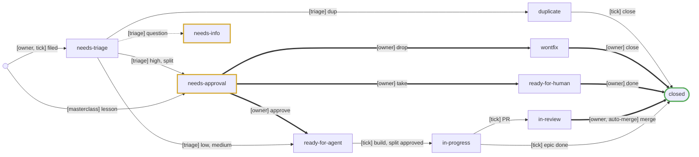
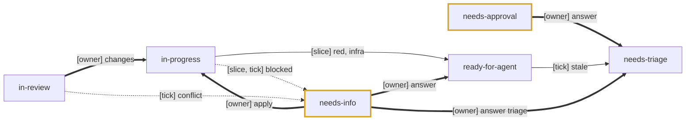
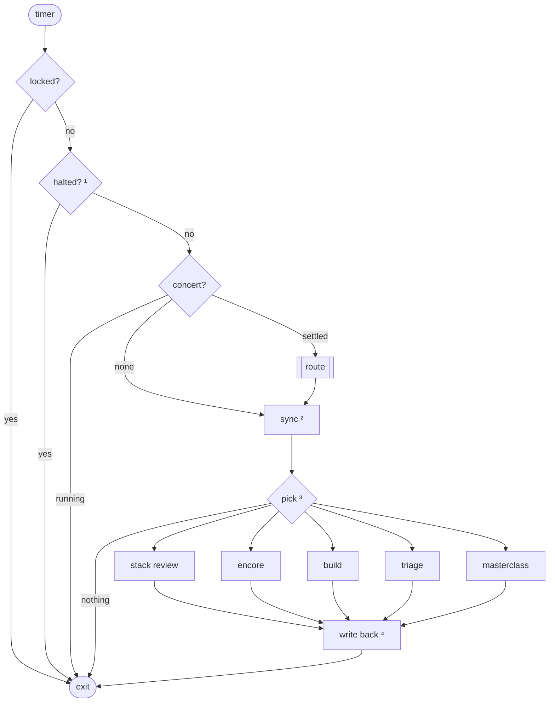
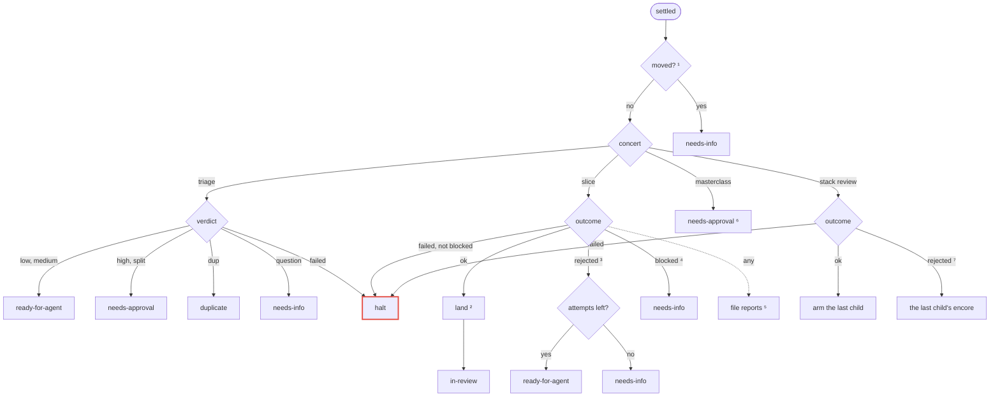
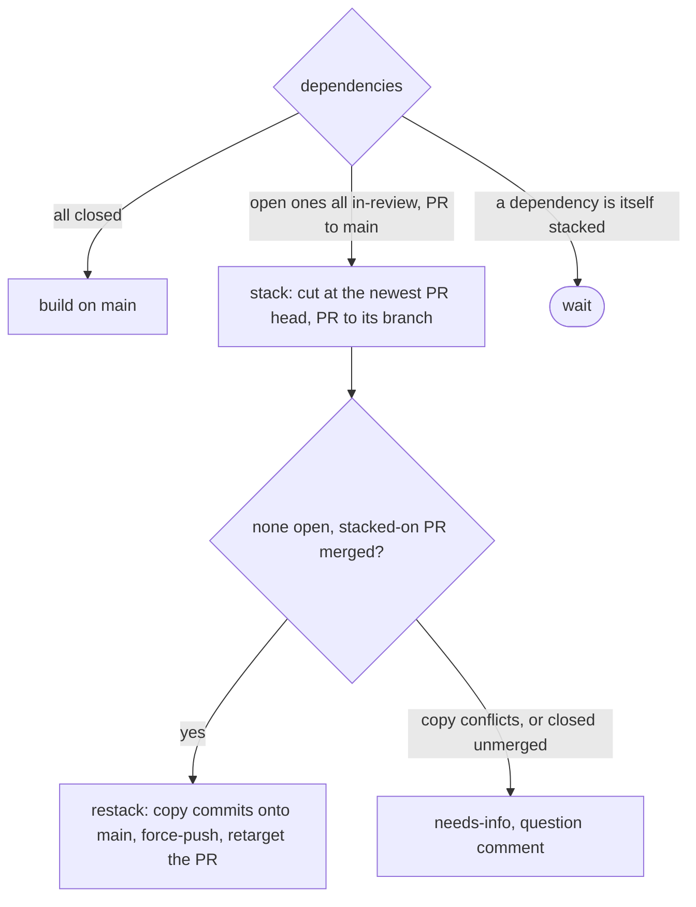

# Tour manager

For the owner and agents looking up how the tour manager moves a ticket and what it writes on the forge.

The Maestro Tour Manager ("tour manager") is maestro in factory mode, and the name it signs on a ticket. A **tick**, one
run of `scripts/factory` (install and flags in its `README.md`), reads the forge, routes whatever a finished concert
left, and starts at most one next action. A concert that has finished and awaits routing is a **settle**. A **slice** is
the concert that builds one ticket's change (`.maestro/slice.ts`); a **stack review** reviews a split epic's children as
one change (`.maestro/review.ts`); a **masterclass** is the concert that gathers lessons from settled concerts.

## State machine

A ticket's state is its `state/` label (meanings in `triage-labels.md`); a move replaces it, since the scope is
exclusive. An edge names the actor that causes the move, and the tick sets the label unless the owner does it by hand.
The actors:

- **owner**: the human, or forge-bot acting for them.
- **tick**: the script, as its own account `maestro-tm`, apart from forge-bot, the sessions' account.
- **triage**, **slice**, **masterclass**: the concerts the tick performs; the tick routes their outcome.
- **auto-merge**: the forge, on a low-risk PR the tick armed.

Bold edges are the owner's moves, dashed ones park a ticket for an answer, gold states wait on the owner, green is done.
The transition table in `scripts/factory/transitions.ts` holds the same machine, and a test checks these diagrams
against it. Forward moves:



Moves back, to an earlier state or aside to wait for an answer:



The owner may move any open issue to `ready-for-human` or `wontfix`; the diagram draws it from `needs-approval` only. A
closed issue is no label: the forge's closed state.

## One tick

The double-bordered step is detailed under Routing a settle.



1. Until the `maestro-tm:halt` issue closes (Rules, Policy: Halt).
2. A merged PR closes its issue through its `Closes #N`; a stacked PR whose dependency merged restacks onto `main`
   (Rules, Build: Restack); closed dependencies free tickets; an approved split files its children (Rules, Triage:
   Splits) and its last closed child closes the epic.
3. First match wins, in the order of the arrows (Rules, Policy: Pick order). `--route-only` routes and syncs but starts
   nothing.
4. Set the labels, edit the spec comment, post any question comment, and rewrite the closing line on a new version
   (Forge surfaces).

## Routing a settle

Red marks the halt.



1. The owner moved the ticket during the run: a slice is parked, a triage's verdict dropped (Rules, Triage: Moved during
   a run).
2. Rules, Landing and PRs: Landing.
3. A slice whose last reviewed lane holds no patch settles `rejected` with `the slice changed nothing` (Rules, Build:
   Attempts).
4. Rules, Build: Blocked.
5. New obstacles, filed as `needs-triage` (Rules, Build: Reports).
6. One issue per proposal (Rules, Masterclass).
7. Rules, Build: Stack review.

## Rules

### Policy

- **Risk and tier.** `risk/low` is the `small` slice tier and `risk/medium` is `ordinary`; `risk/high` is `risky` when
  triage found it wide, else `ordinary`. Risk gates the owner's approval, width sets the review's depth, which
  `.maestro/slice.ts` and `.maestro/presets/{small,ordinary,risky}.yaml` define. Low builds, opens a PR and merges
  itself: once its PR to `main` is open, the tick arms the forge's auto-merge on it, fast-forward only, which waits on
  the required `check` status, unless the review left findings unresolved (Landing and PRs: PRs). Medium builds and
  waits for the owner to merge its PR. High waits in `needs-approval` for the owner to approve the spec, then merges as
  medium does. The owner merges by fast-forward, as `main` takes signed commits only. An epic's last child arms only
  once its stack review clears it (Rules, Build: Stack review).
- **One concert at a time.** The tick starts no second one while a concert of the milestone runs.
- **Pick order.** Finish work first: a stack review, then an encore of a PR with changes requested, then a build, then
  triage, then a masterclass. A tick that routes a settle falls through and starts the next action. Within builds and
  within triage, an issue the owner pinned on the forge comes first, in pinned order, then the rest oldest first.
- **Halt.** These stop the tick with an open `maestro-tm:halt` issue naming the cause; closing it resumes:
  - a triage that fails, does not start or gives a malformed output: the ticket keeps its state and is triaged again;
  - a build, a stack review or a masterclass that does not start;
  - a stack review that settles neither `ok` nor `rejected`: the review runs again once the halt closes;
  - a slice that settles `failed` without a `blocked:` reason, an infra fault: the issue names the concert, and the
    ticket is requeued to `ready-for-agent` with its attempts kept, and builds again;
  - a landing or a restack that fails: the workspace is kept, and the work is redone in a fresh one;
  - an encore with nothing changed, which is refused;
  - a spec comment's data line the tick cannot read.
- **Tour and title.** A ticket's concerts run on tour `<version>.i<n>`, such as `v0.1.0.i142`, titled
  `factory: <issue title>`, cut with an ellipsis past 60 characters. A masterclass runs on tour `<version>.masterclass`,
  titled `factory: masterclass`.

### Triage

Routes and the spec format are in `.maestro/triage/prompts/` (`triager.md`, `planner.md`, `checker.md`, `revise.md`).

- **Routes.** The triager runs first and rules alone: a duplicate settles there, and it asks the owner, with a
  `needs-info` verdict. A `direct` ticket goes straight to the build on a brief: the triager's `what`, only what the ask
  leaves open, and `subject`, with `just check` as acceptance; a `plan` ticket goes on to the scouts, the planner and
  the spec checker. Either spec is gated by risk as any other.
- **Spec check.** On findings, the planner revises its spec once in the same session; the revised spec is not checked
  again. A requirement off the EARS shape is a finding too, found by code beside the checker's; the planner can run the
  same rule as `check ears` before it finishes. A finding only the owner can rule on becomes a question, as does a check
  or revision that failed to run. The builder never sees the findings. A split is not checked.
- **Answers.** Any verdict that asks the owner a question goes to `needs-info`, whatever its risk, never to
  `needs-approval`. The owner answers by replying in a comment that mentions `@<login>`, such as
  `@forge-bot Q1: no, ok results only`, then moving the ticket to `needs-triage` (to `ready-for-agent` to continue a
  blocked build). A waiting spec in `needs-approval` is answered or redirected the same way. A reply is final: a
  re-triage does not ask again what it settled, and rules `direct` when it leaves the change small and clear.
- **Feeding comments.** A triage, first or encore, considers each comment but the spec comment whose id is above `read`,
  in id order. It is fed as `--issue` the ask, then on an encore the spec under the heading
  `The spec the last triage proposed`, then only these:
  - a question comment, headed `## Question by the tour manager`;
  - any other comment mentioning `@<login>` as a whole word in any case, headed `## Reply by <author>`.

  An encore continues the triager's and scouts' sessions but starts the planner and the spec checker fresh. It records
  the newest comment it considered as `read`, so a comment it ignored is never fed later; a failed triage clears `read`.
  A re-triage with nothing new to feed starts nothing: the tick asks for a reply mentioning `@<login>`, moves the ticket
  to `needs-info` and moves `read` past its ask.

- **Splits.** Triage records its verdict in the spec comment: a spec, or a split with its child list. On the owner's
  approval of a split the tick files the children as `needs-triage`, in the epic's milestone with `Part of #N`, and
  moves the epic to `in-progress`. The epic closes when its last child does.
- **Duplicates and related issues.** A duplicate is closed at once as `state/duplicate` with a back-reference, when its
  original is open or closed as completed; an original that does not exist, or is closed as `state/wontfix` or
  `state/duplicate`, tracks nothing, so the ticket goes to `needs-info` with a question. A related issue gets
  `Relates to #N` in the spec comment and the PR body.
- **Moved during a run.** A settle whose ticket is no longer where the run expects it (`in-progress` or
  `ready-for-agent` for a slice, `needs-triage` for a triage) is not applied. A closed ticket is left alone. Otherwise
  the ticket moves to `needs-info`, the concert is marked routed, and a question comment asks which way:
  - A slice is kept as `parked`; the question offers `in-progress` (apply the parked result), `ready-for-agent` (build
    again) or `needs-triage`. The next pass that finds the ticket in `in-progress` routes it as its settle; any other
    move clears `parked`.
  - A triage's verdict is dropped as stale, and the question offers only `needs-triage`.

### Build

- **Build.** A ready ticket is built when its triage left a spec and it is no split's epic: `.maestro/slice.ts` with the
  spec and the ask as `--request`, and its tier (Rules, Policy: Risk and tier) as `--tier` and `--preset`, then the
  preset `area-<area>` when the ticket has an `area/<area>` label and `.maestro/presets/area-<area>.yaml` exists, then
  the tick's own `--preset`s. The ticket moves to `in-progress` as the perform starts.
- **Dependencies.** A dependency is a forge "blocked by" link that sets build order.



- **Restack.** A stacked slice's PR opens against the dependency's branch, unarmed. Sync restacks a ticket in review,
  and a landing restacks straight away when the dependency merged during the build; the PR is opened anew when the forge
  closed it with its base branch, then armed when low. The question comment on a conflict offers `ready-for-agent`
  (build again on `main`) or `needs-triage`. A ready ticket waiting on open dependencies says so in its spec comment's
  last line, as `queued, waiting on #12, #14`, rewritten only when that set changes.
- **Stale spec.** A fresh build of a ready ticket first compares its spec's `touches` with those of every other ticket
  whose spec was approved after its own: one in `ready-for-agent`, `in-progress` or `in-review` whose `specAt` is later,
  or one closed as completed (not `state/wontfix` or `state/duplicate`) after this spec's `specAt`, by the forge's
  `closed_at`. A ticket whose data holds no `specAt` is never bounced and is no overlap source. On a shared file the
  ticket is not built: the tick posts a question comment,
  ``The spec predates #N's, which also touches `<file>`. Re-triaging against current main.``, naming each such ticket
  and its shared files (unless one above `read` holds it already), moves the ticket to `needs-triage`, and goes on to
  the next buildable ticket. Triage then re-triages it as an encore and writes a spec newer than those it overlapped. An
  encore of a running or landed build is not compared.
- **Encore.** A ticket continues its last slice concert, so the builder keeps what it learned and is told only what
  changed: `encore <id>` with a fresh build's presets, tour, title and base, and a `--request` of the spec and the ask
  followed by what changed, each part under its heading:
  - a `ready-for-agent` ticket whose `encore` is set: each comment mentioning `@<login>` above `read`, a question
    comment excepted, headed `## Reply by <author>`; `read` moves to the newest comment it considered;
  - an `in-review` ticket whose PR holds an official review requesting changes, not dismissed, above `review`, or whose
    `findings` name a stack review: its landed concert, fed each such review headed `## Review by <author>`, its body
    then its inline comments as `path:line` items, then the stack review's under `## Stack review`. The ticket moves to
    `in-progress`, `review` moves to the newest, and the settle lands folded into the PR's head, so the PR keeps one
    commit per ticket.

  With nothing changed the build is a fresh perform, since an encore with nothing changed is refused.

- **Stack review.** An epic's children are reviewed as one change once every child but its last is closed and the last
  is `in-review` on a PR to `main`, so the range is linear whatever the stack's shape. Earlier children land as usual;
  the review catches the seams between them before the epic closes.
  - It performs `.maestro/review.ts` once per epic, on the epic's tour and title, with `--preset risky`, then the tick's
    own `--preset`s, `--revs <base>..<last PR head>`, `base` being `main`'s head when the split's children were filed,
    and a `--request` of the epic's ask and children, naming their commits by `Refs: #N`. Other tickets' commits in the
    range are context only. An epic filed before stack reviews holds no `base` and gets none.
  - An `ok` review arms the last child when low. A `rejected` one posts its review on the epic as a stack review comment
    and feeds it to the last child's next encore, as a review requesting changes is; the child arms once that encore
    lands. With no one child open by then, each blocking finding is filed as under Reports, `Found by` the epic.
  - The encore's own slice review covers the fix; the stack review does not run again.
- **Attempts.** A `rejected` slice, an empty one included, spends an attempt and is retried with a fresh perform. After
  2 attempts the ticket goes to `needs-info`. An answer does not reset them: an answered ticket out of attempts gets one
  encore, and a rejected one goes back to `needs-info`.
- **Blocked.** A blocked agent moves its ticket to `needs-info` and spends no attempt. Its reason shows once, under the
  spec comment's Last failure, and a question comment asks how to go on, offering `ready-for-agent` (continue with my
  answer) or `needs-triage`, answered as under Triage: Answers; on `ready-for-agent` the slice continues as an encore.
  Obstacles never block a ticket.
- **Reports.** Each settled slice's obstacles are filed as `needs-triage` `kind/bug` in the milestone, with
  `Found by #N` and a `<!-- factory-fingerprint <hex> -->` line, a fingerprint of the text; a text whose line an open
  issue carries is not filed again. An obstacle never carries a dependency. Gaps are not filed: a landed slice's PR
  lists them, for the reviewer to file the ones worth a ticket.

### Landing and PRs

- **Landing.** An ok slice lands in a fresh jj workspace on `main` as fetched from `origin`, or on the commit it stacked
  on: `maestro cs apply`, then `jj describe` with the spec's subject and `Refs: #N`, or for a revision `jj squash` into
  the PR head with that description. It runs no check of its own: the slice's gate passed in its lane, and CI checks the
  PR against its base. Once the PR is open the ticket moves to `in-review` and the workspace is removed.
- **PRs.** One change per ticket, pushed by `maestro-tm` over HTTPS as `maestro-tm/i<n>`, replacing what the branch
  held, titled with the spec's subject, to `main` or to the dependency's branch while stacked. The slice's writer writes
  the body in the form `.maestro/slice/prompts/writer.md` gives; below it the tick adds the findings the review left
  upheld after its last fix round, counted, under `Unresolved review` (none when it left none), the agents' gaps, one
  line of risk, area and review tier with the planner's contract as the one-way door, the spend (a row per slice concert
  of the ticket's tour, a build or an encore as its record says, then a total) and `Closes #N` with the `Relates to`
  links last. A writer that fails costs the build nothing: the tick builds the body from its data alone. A PR whose
  review left findings upheld is never armed, a last child's after its stack review clears included: the owner merges
  it. Every landing, an encore's included, rewrites the body of the PR already open on the branch.

### Masterclass

A masterclass is due when the newest concert is not a masterclass and at least 10 settled slice or triage concerts on
`<milestone>.i<n>` tours are newer than the watermark, within the milestone's newest 200 concerts. It performs
`.maestro/masterclass.ts` with `--lessons`, the lessons of those concerts oldest first and of settled slices on the
`release` and `trial` tours since the watermark, which are read but not counted, and `--backlog`, the backlog snapshot.
The **watermark** is the newest ok masterclass concert in maestro's record, not state the tick keeps. A failed
masterclass is retried only after another factory run settles; a non-ok or malformed one is reported and does not halt.

A settled masterclass files one `needs-approval` + `kind/enhancement` + `maestro-tm:masterclass` issue per proposal,
only while the masterclass is the newest concert, deduplicated by a fingerprint over target, title and body against open
issues and the 20 newest closed ones. The planner writes each proposal by `_plain.md`. Forge surfaces: Proposal issue
shows the issue.

## Forge surfaces

What the tick writes on an issue. `<login>` is the account it acts as (`maestro-tm`), read once per pass from
`GET /user`. Agent text in any of them is made inert: every `<!--` is broken, so it opens no HTML comment, and a Mermaid
`-->` stays whole.

### Closing line

The tour manager never edits the ask. Below it the issue body holds the marker and one line, written when the spec
comment is created or its version changes.

```markdown
<ask>

<!-- maestro-tm -->

Tracked by Maestro Tour Manager · [spec v<N>](#issuecomment-<id>)
```

### Proposal issue

A settled masterclass files one per proposal. The ask holds the target, the body, the lessons and the fingerprint, which
sits last so a later masterclass finds it; a triage replaces everything below the marker with the closing line.

```markdown
Target: `<target>`

<body>

## Lessons

- <lesson>

<!-- factory-fingerprint <hash> -->

<!-- maestro-tm -->

---

**Maintainer's turn · the proposal awaits approval**

- **`needs-triage`**: specify and build it.
- **`wontfix`**: drop it.

---

<sub>Label the issue with the choice.</sub>
```

### Spec comment

One comment per issue, found by the `<!-- maestro-tm -->` marker on its first line, created on the tick's first write
and edited in place after. `N` starts at 1 and rises with each routed triage. The area is left out when triage gave
none, and so is any section with no items. With no result the heading is `### Spec v<N>`, with no risk either. A direct
ruling's spec has no requirements and is named a brief: `### Brief v<N>` here, and `[brief v<N>]` in the closing line.
The tick trusts the first comment opening with the marker, whoever wrote it, so only maintainers write that marker.

````markdown
<!-- maestro-tm -->

### Spec v<N> · risk <risk> · area <area>

#### Context

<what>

Subject: `<subject>`

#### Requirements

- **R<n>** <requirement, in EARS>

#### Shape

<caption>

```<mermaid or diff>
<source>
```

1. <note>

#### Decisions

- **<lead>**
  - <point>

#### Consequences

<consequences>

#### Left out

- **<lead>**
  - <point>

#### Acceptance

- [ ] <item naming the requirements it proves>

<details><summary><b>Touches</b> · <n> files</summary>

- `<path>`

</details>

- Attempts: <n> of <max>

#### Last failure

```text
<failure>
```

Slice concert: `<concert id>`

Reasons: <reason>; <reason> · Relates to #<n> · Last concert: `<concert id>`

<turn>

<!-- maestro-tm-data <data> -->
````

- A split shows `#### Children`, a numbered list with a `mermaid` flowchart of their order when one depends on another,
  in place of the sections from Context to Touches; a duplicate shows `Duplicate of #<n>` there.
- `<turn>` is whose turn it is. While the tick owns the next transition, one bold line, with `<what>` the build, triage
  or stack review running or queued:

  ```markdown
  **Tour manager's turn · <what>**
  ```

  Else the owner's moves out of the state, each one the data leaves open:

  ```markdown
  ---
  
  **Maintainer's turn · <what waits>**
  
  - **`<label>`**: <what it does>
  
  ---

  <sub><how to take one></sub>
  ```

### Data

The `<data>` line is one JSON object, the tick's only state. The `read`, `review` and `revisionBase` fields are
positions a later pass resumes from. A line the tick cannot read halts the tour manager.

| Field          | Holds                                              | Set by                             | Cleared by                                                   |
| -------------- | -------------------------------------------------- | ---------------------------------- | ------------------------------------------------------------ |
| `concert`      | The last concert the tick routed                   | a routed settle                    | not cleared                                                  |
| `triage`       | The last ok triage, which a re-triage continues    | a routed or dropped ok triage      | not cleared                                                  |
| `read`         | Id of the newest comment a triage was fed          | a triage or encore, a reply ask    | a failed triage                                              |
| `version`      | The spec's version                                 | a routed triage                    | not cleared                                                  |
| `specAt`       | When a routed triage wrote the spec, in ms         | a routed triage                    | not cleared                                                  |
| `result`       | That triage's output; a string is a question's ask | a routed triage                    | the owner moving the ticket in its triage                    |
| `pending`      | A result whose labels are not yet applied          | a routed triage                    | the labels applied                                           |
| `filed`        | An approved split's children                       | the split's approval               | not cleared                                                  |
| `slice`        | The slice concert the last build started           | a build                            | not cleared                                                  |
| `attempts`     | The rejected slices spent                          | a rejected slice                   | not cleared                                                  |
| `failure`      | The reason the last slice failed                   | a slice that does not land         | a landing                                                    |
| `parked`       | A slice concert routed but not applied             | a settle moved during its run      | routing it, or any other move                                |
| `stack`        | The dependency the last build stacked on           | a stacked build                    | a restack, conflicting or not; an unstacked build            |
| `revisionBase` | The PR head a revision is cut at and lands on      | an encore of a reviewed PR         | a landing, a fresh build, a re-triage, an infra halt         |
| `encore`       | The slice concert to continue                      | a slice blocked or out of attempts | a retry, a landing, a parked one, a re-triage, an infra halt |
| `review`       | Id of the newest review an encore was fed          | an encore of a reviewed PR         | not cleared                                                  |
| `base`         | An epic's `main` head when its children were filed | an approved split's filing         | not cleared                                                  |
| `stackReview`  | The stack review an epic started                   | a stack review                     | a stack review that failed                                   |
| `findings`     | The stack review whose findings a child awaits     | a rejected stack review            | the encore fed them                                          |

### Stack review comment

A new comment per rejected stack review on its epic, never edited. Agent text in it is made inert.

```markdown
### Stack review · `<concert id>`

<review>

<what became of its findings>
```

### Question comments

A new comment per routed triage with questions, and per question the tick itself asks. It is never edited, and the
thread keeps it. Only a comment by `<login>` counts as one; the marker from anyone else is ordinary text. Each part
after the ask is left out when the question has none.

```markdown
<!-- maestro-tm-question -->

### Maestro asks · <N> questions

---

**Q<n> · <ask>**

<lead>

- **<option>**: <what it does>

> [!TIP] **Recommended: <option>**, <why>

<details>
<summary>Context</summary>

- **<topic>.** <text>

</details>

---

<sub><how to answer></sub>
```

`<how to answer>` is, by question comment:

- triage's questions: ``Reply `@<login> Q1: …`, then label `needs-triage`.``;
- a blocked slice's: the same, then label your choice;
- a re-triage with nothing to feed: ``Reply `@<login> …`, then label `needs-triage`.``;
- a moved ticket's, or a restack's on a conflict or a dependency closed unmerged: `Label the ticket with your choice.`;
- a stale spec's: `No reply needed: the next tick triages it again.`
