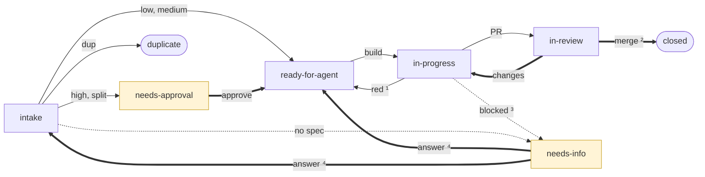
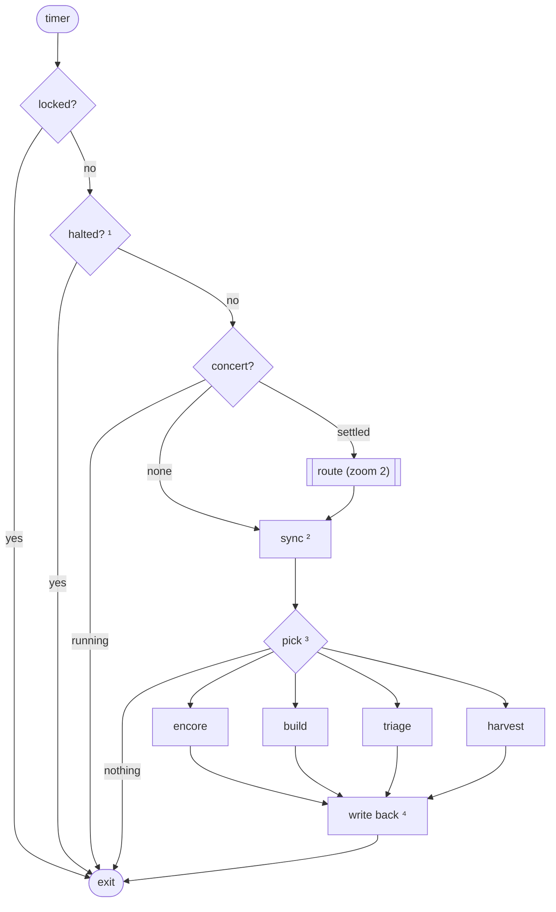
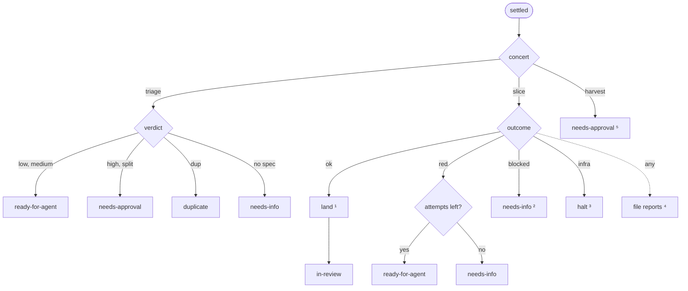
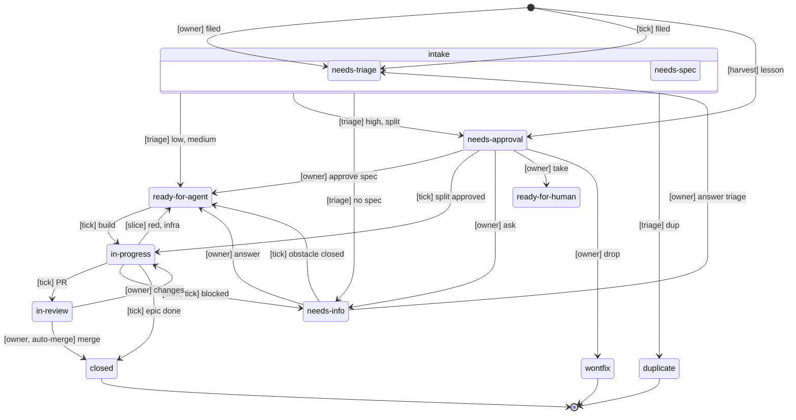

# Factory

How the factory takes a ticket from the forge to a merged PR. A tick script drives it: each run reads the forge, routes
whatever a finished concert left, and starts at most one next action. The states are `state/` labels
(`triage-labels.md`), and the tick's transition table holds the same machine as data.

## Overview

A ticket's path. Bold edges are the owner's, shaded states wait on the owner.

1. With attempts left, or an infra fault.
2. By the owner, or by auto-merge on low risk.
3. Or out of attempts.
4. An answer to triage's questions goes back to intake; any other answer, or a closed obstacle, goes to the queue.

## Zoom 1: one tick

1. Halted by an infra fault, until its obstacle closes.
2. Merged PRs close issues, stacks rebase, closed blockers free tickets, an answer or a closed obstacle requeues a
   ticket, an approved split files its children, and an epic's last closed child closes it.
3. First match wins, in the order of the arrows: a concert to continue, a ready ticket whose blockers allow it, an
   intake issue, a harvest due.
4. Set the labels, rewrite the factory block.

## Zoom 2: routing a settle

1. In a workspace: apply, check, describe, push `factory/i<n>`, open the PR, arm auto-merge on low risk.
2. With the agent's question, blocked by its obstacle issue.
3. File the obstacle and requeue the ticket; the attempt is kept.
4. New obstacles and gaps, as `needs-triage`.
5. One issue per lesson promotion.

## Label reference

Each state is a `state/` label. A move replaces the label, since the scope is exclusive. The actors:

- **owner**: the human, or forge-bot acting for them.
- **tick**: the script, through forge-bot.
- **triage**, **slice**, **harvest**: the concerts the tick performs. The tick routes their outcome.

An edge in the diagrams names who causes the move; the tick sets the label unless the owner does it by hand.

| State             | Meaning                                             | Moved in by                         | Next                                                                                |
| ----------------- | --------------------------------------------------- | ----------------------------------- | ----------------------------------------------------------------------------------- |
| `needs-triage`    | Filed, not yet evaluated                            | owner, tick[^new], owner[^answer]   | `ready-for-agent`, `needs-approval`, `needs-info`, `duplicate`                      |
| `needs-spec`      | Wanted, needs design before work                    | owner                               | `ready-for-agent`, `needs-approval`, `needs-info`, `duplicate`                      |
| `needs-approval`  | Spec or split waits for the owner's go              | triage, harvest                     | `ready-for-agent`, `in-progress`[^epic], `needs-info`, `ready-for-human`, `wontfix` |
| `ready-for-agent` | Specified and queued for a slice concert            | triage, owner[^approve], tick[^red] | `in-progress`                                                                       |
| `in-progress`     | Being built: a slice concert, or an epic's children | tick, owner[^changes]               | `in-review`, `ready-for-agent`, `needs-info`, closed[^epic]                         |
| `in-review`       | PR open, waiting on CI and review                   | tick                                | `in-progress`, closed                                                               |
| `needs-info`      | Waiting on an answer                                | triage, slice, tick, owner          | `ready-for-agent`[^answer], `needs-triage`[^answer]                                 |
| `ready-for-human` | Owner implements it, the factory never picks it up  | owner                               | closed                                                                              |
| `wontfix`         | Will not be actioned                                | owner                               | closed                                                                              |
| `duplicate`       | Repeats another issue, closed with a link           | triage                              | closed                                                                              |

[^new]: The tick files obstacles, gaps and an approved split's children as `needs-triage`.

[^approve]: On approving a spec (`needs-approval`) or answering (`needs-info`).

[^epic]: On a split's approval the tick files the children and moves the epic here. It closes when its last child does.

[^red]: A red run with attempts left or an infra fault, or a closed obstacle (`needs-info`).

[^changes]: The owner requesting changes on the PR moves `in-review` back here. The tick then runs an encore.

[^answer]:
    The owner answering triage's questions sends the ticket to `needs-triage`, since no spec exists yet. Any other
    answer by the owner, or the tick seeing its obstacle closed, sends it to `ready-for-agent` with the concert to
    continue.

The owner may move any open issue to `ready-for-human` or `wontfix`; the diagram draws it from `needs-approval` only.

Beside the state, an issue carries `kind/`, `risk/` and `area/` labels (`triage-labels.md`).

## Rules

- **Risk and tier.** `risk/low` is the `small` slice tier, `risk/medium` is `ordinary`, `risk/high` is `risky` (it sets
  a contract). Low builds, opens a PR and merges on CI and the slice's panel. Medium builds and waits for the owner's PR
  approval. High waits in `needs-approval` for the owner to approve the spec. Medium and high merge by rebase or
  fast-forward.
- **One concert at a time.** Parallel waves wait for 10 to 15 good runs.
- **Pick order.** Finish work first: an encore, then a build, then triage, then a harvest. A tick that routes a settle
  falls through and starts the next action.
- **Factory block.** It records the ticket's last slice concert id. An answered `needs-info` or a closed blocking
  obstacle sets the concert to continue, and a red retry clears it.
- **Encore.** A PR with changes requested, or a `ready-for-agent` ticket whose block names a concert to continue, runs
  an encore of that concert. With no concert to continue the build is a fresh perform.
- **Blockers.** A ticket is picked when every blocker (a forge dependency) is closed, or is `in-review`, in which case
  it stacks on that blocker's PR, two deep at most.
- **Attempts.** A red run spends an attempt and is retried with a fresh perform. After 2 attempts the ticket goes to
  `needs-info`.
- **Blocked.** A blocked agent moves its ticket to `needs-info` with its question and spends no attempt. An obstacle
  becomes a `needs-triage` issue that blocks the ticket, and its closing frees the ticket. An infra fault halts the
  factory until its obstacle closes.
- **Splits.** Triage records its verdict in the factory block: a spec, or a split with its child list. On the owner's
  approval of a split the tick files the children as `needs-triage`, in the epic's milestone with `Part of #N`, and
  moves the epic to `in-progress`. The epic closes when its last child does.
- **Duplicates and related issues.** A duplicate is closed at once as `state/duplicate` with a back-reference. A related
  issue gets `Relates to #N` in the factory block and the PR body.
- **Tour.** `<version>.i<n>`, such as `v0.1.0.i142`.
- **PRs.** One change per ticket, pushed by forge-bot as `factory/i<n>`, with the subject from the spec and `Closes #N`.

## Setting up

A new environment starts with manual shakedown runs: first with the stub harness, then with a cheap model, each watched
by hand. The tick does not enforce them.
