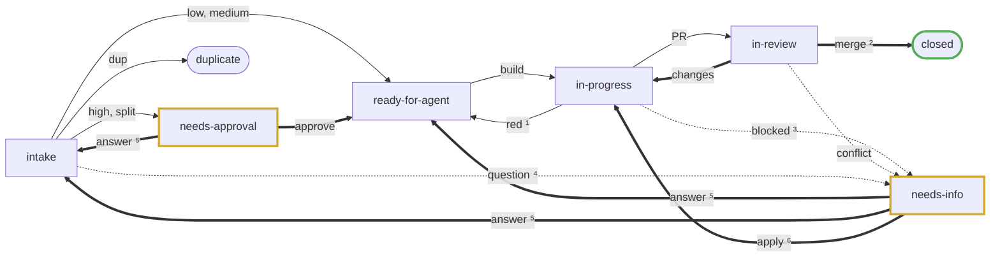
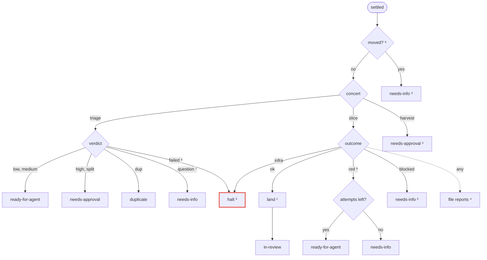
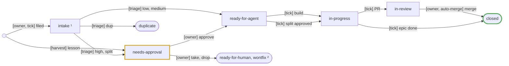
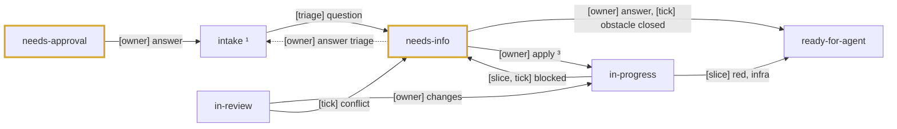

# Factory

How the tour manager takes a ticket from the forge to a merged PR. The Maestro Tour Manager ("tour manager") is maestro
in factory mode, and the name it signs on a ticket. A tick script drives it: each run reads the forge, routes whatever a
finished concert left, and starts at most one next action. The states are `state/` labels (`triage-labels.md`), and the
tick's transition table holds the same machine as data.

## Overview

A ticket's path. Bold edges are the owner's moves, gold states wait on the owner, green is done.

1. With attempts left, or an infra fault.
2. By the owner, or by auto-merge on low risk.
3. Or out of attempts.
4. Any verdict that asks the owner a question, whatever its risk.
5. A reply to triage's questions, or to a waiting spec, goes back to intake; any other answer, or a closed obstacle,
   goes to the queue.
6. A parked slice's result, applied (Rules: Moved during a run).

## Zoom 1: one tick

1. Halted by an infra fault or a failed triage, until its `maestro-tm:halt` issue closes.
2. A merged PR closes its issue through its `Closes #N`, a stacked PR whose blocker merged restacks onto `main` (Rules:
   Restack), closed blockers free tickets, an answer or a closed obstacle requeues a ticket, an approved split files its
   children, and an epic's last closed child closes it.
3. First match wins, in the order of the arrows: a concert to continue, a ready ticket whose blockers allow it, an
   intake issue, a harvest due.
4. Set the labels, edit the spec comment, post any question comment, and rewrite the closing line on a new version.

## Zoom 2: routing a settle

Red marks the halt.

1. In a workspace on `main`, or on the blocker's PR head when stacked: apply, describe, push `maestro-tm/i<n>`, open the
   PR to `main` or, while a blocker is open, to the blocker's branch, and arm auto-merge on a low one to `main`. A
   stacked slice whose blocker merged meanwhile restacks first; one that conflicts, or whose blocker closed unmerged,
   goes to `needs-info` (Rules: Restack).
2. With the agent's question, blocked by its obstacle issue.
3. File the obstacle and requeue the ticket; the attempt is kept.
4. New obstacles and gaps, as `needs-triage`.
5. One issue per lesson promotion.
6. A triage that fails, does not start or gives a malformed output. The ticket keeps its state, and closing the halt
   issue triages it again.
7. Any verdict with a question for the owner, whatever its risk.
8. The owner moved the ticket during the run: a slice is parked, a triage's verdict dropped (Rules: Moved during a run).
9. A slice whose last reviewed lane holds no patch fails with `the slice changed nothing`.

## Label reference

Each state is a `state/` label. A move replaces the label, since the scope is exclusive. The actors:

- **owner**: the human, or forge-bot acting for them.
- **tick**: the script, through forge-bot.
- **triage**, **slice**, **harvest**: the concerts the tick performs. The tick routes their outcome.

An edge in the diagrams names who causes the move; the tick sets the label unless the owner does it by hand.

| State             | Meaning                                             | Moved in by                         | Next                                                                     |
| ----------------- | --------------------------------------------------- | ----------------------------------- | ------------------------------------------------------------------------ |
| `needs-triage`    | Filed, not yet evaluated                            | owner, tick[^new], owner[^answer]   | `ready-for-agent`, `needs-approval`, `needs-info`, `duplicate`           |
| `needs-spec`      | Wanted, needs design before work                    | owner                               | `ready-for-agent`, `needs-approval`, `needs-info`, `duplicate`           |
| `needs-approval`  | Spec or split waits for the owner's go              | triage, harvest                     | `ready-for-agent`, `needs-triage`[^answer], `ready-for-human`, `wontfix` |
| `ready-for-agent` | Specified and queued for a slice concert            | triage, owner[^approve], tick[^red] | `in-progress`[^epic]                                                     |
| `in-progress`     | Being built: a slice concert, or an epic's children | tick, owner[^changes]               | `in-review`, `ready-for-agent`, `needs-info`, closed[^epic]              |
| `in-review`       | PR open, waiting on CI and review                   | tick                                | `in-progress`, `needs-info`, closed                                      |
| `needs-info`      | Waiting on an answer                                | triage, slice, tick                 | `ready-for-agent`[^answer], `needs-triage`[^answer], `in-progress`[^app] |
| `ready-for-human` | Owner builds it, the tour manager never takes it    | owner                               | closed                                                                   |
| `wontfix`         | Will not be actioned                                | owner                               | closed                                                                   |
| `duplicate`       | Repeats another issue, closed with a link           | triage                              | closed                                                                   |

[^new]: The tick files obstacles, gaps and an approved split's children as `needs-triage`.

[^approve]: On approving a spec (`needs-approval`) or answering (`needs-info`).

[^epic]:
    When the owner approves a split, moving it to `ready-for-agent`, the tick files the children and moves the epic
    here. It closes when its last child does.

[^red]: A red run with attempts left or an infra fault, or a closed obstacle (`needs-info`).

[^app]: The owner applying a parked slice's result (Rules: Moved during a run).

[^changes]: The owner requesting changes on the PR moves `in-review` back here. The tick then runs an encore.

[^answer]:
    The owner replying to triage's questions (`needs-info`) or answering or redirecting a waiting spec
    (`needs-approval`) sends the ticket to `needs-triage` to re-triage. Any other answer by the owner, or the tick
    seeing its obstacle closed, sends it to `ready-for-agent` with the concert to continue.

Moves forward, then moves back. Gold states wait on the owner, green is done.

1. `needs-triage` or `needs-spec`.
2. The owner may move any open issue here; the diagram draws it from `needs-approval` only.
3. A parked slice's result, applied.

Beside the state, an issue carries `kind/`, `risk/` and `area/` labels (`triage-labels.md`).

## Rules

- **Risk and tier.** `risk/low` is the `small` slice tier, `risk/medium` is `ordinary`, `risk/high` is `risky` (it sets
  a contract). Low builds, opens a PR and merges itself: once its PR to `main` is open, the tick arms the forge's
  auto-merge on it, rebase style, which waits on the required `check` status; the slice settling ok is the panel's pass.
  Medium builds and waits for the owner to merge its PR. High waits in `needs-approval` for the owner to approve the
  spec, then merges as medium does. The owner merges by rebase or fast-forward.
- **One concert at a time.** Parallel waves wait for 10 to 15 good runs.
- **Pick order.** Finish work first: an encore, then a build, then triage, then a harvest. A tick that routes a settle
  falls through and starts the next action.
- **Closing line.** The tour manager never edits the ask. Below it the body holds the `<!-- maestro-tm -->` marker and
  one line, `Tracked by Maestro Tour Manager · [spec vN](#issuecomment-<id>)`, written when the spec comment is created
  or its version changes. State, risk and area stay in the labels.
- **Spec comment.** One comment per issue, found by the `<!-- maestro-tm -->` marker on its first line, created on the
  tick's first write and edited in place after; the forge's edit history keeps the earlier versions. Headed `Spec vN`, N
  starting at 1 and rising with each routed triage, it holds, in order: What (a short paragraph and the commit subject),
  Steps (numbered), Touches, Acceptance (a checklist), Reasons and `Relates to` links, then the build lines (attempts,
  last failure, slice concert) and the last concert. A split shows its children in place of the spec, a duplicate its
  original. It ends with one bold line naming whose move it is: `Tour manager's move: <what runs or is queued>` while
  the tick owns the next transition, else `Your move: <how>`, each owner move out of the state the data leaves open.
  Agent text in it is made inert, so it can open or close no HTML comment. The tick trusts the first comment opening
  with the marker, whoever wrote it, so only maintainers write that marker.
- **Login.** Each pass reads the login of the account it acts as (forge-bot today) once, from `GET /user` with its
  token. No setting names it.
- **Question comments.** Each routed triage with questions posts a new comment, `<!-- maestro-tm-question -->` on its
  first line, then the questions numbered and how to answer: a reply mentioning `@<login>`. It is never edited, and the
  thread keeps it. Only a comment by the login counts as one; the marker from anyone else is ordinary text.
- **Data.** The spec comment ends in one hidden `<!-- maestro-tm-data {...} -->` JSON line, the tick's only state:
  `concert`, the last concert it routed; `triage`, the last ok triage, which a re-triage continues; `read`, the id of
  the newest comment a triage was fed; `version`, the spec's; `result`, that triage's output; `pending`, set while the
  result's labels are not yet applied; `filed`, an approved split's children; `slice`, the slice concert the last build
  started; `attempts`, the red runs spent; `failure`, the reason the last slice failed; `parked`, a slice concert routed
  but not applied; and `stack`, the blocker the last build stacked on, its PR and that PR's head commit, until the
  restack. A line the tick cannot read halts the tour manager. The slice concert to continue joins it with the build: an
  answered `needs-info` or a closed blocking obstacle sets it, and a red retry clears it.
- **Answers.** Any verdict that asks the owner a question goes to `needs-info`, never `needs-approval`. The owner
  answers by replying in a comment that mentions `@<login>`, such as `@forge-bot Q1: no, ok results only`, then moving
  the ticket to `needs-triage`; a waiting spec in `needs-approval` is answered or redirected the same way. A triage,
  first or encore, considers each comment but the spec comment whose id is above `read`, in id order, and is fed as
  `--issue` the ask, then only these:
  - a question comment, headed `## Question by the tour manager`;
  - any other comment mentioning `@<login>` as a whole word in any case, headed `## Reply by <author>`.

  It records the newest comment it considered as `read`, so a comment it ignored is never fed later. A failed triage
  clears `read`, so the next one considers those comments again. An encore with nothing changed is refused, which halts
  the tour manager.

- **Moved during a run.** A settle whose ticket is no longer where the run expects it (`in-progress` or
  `ready-for-agent` for a slice, intake for a triage) is not applied. A closed ticket is left alone. Otherwise the
  ticket moves to `needs-info`, the concert is marked routed, and a question comment asks the owner which way:
  - A slice is kept as `parked`, and the question offers `in-progress` (apply the parked result), `ready-for-agent`
    (build again) or `needs-triage` (re-triage). The next pass that finds the ticket in `in-progress` routes the parked
    concert as its settle; any other move clears `parked`.
  - A triage's verdict is dropped, since a triage is cheap and its verdict stale, and the question offers only
    `needs-triage`.
- **Encore.** A PR with changes requested, or a `ready-for-agent` ticket whose data names a concert to continue, runs an
  encore of that concert. With no concert to continue the build is a fresh perform.
- **Blockers.** A ticket is picked when every blocker (a forge dependency) is closed, or when every open one is
  `in-review` with its PR to `main`. It then stacks: its slice is cut at the head of the newest of those PRs
  (`-c target.base=<commit>`), lands on that commit and opens its PR against that blocker's branch. Two deep at most: a
  blocker whose PR is itself stacked keeps the ticket waiting. A stacked PR is not armed, since it would merge into the
  blocker's branch.
- **Restack.** Once no blocker of a stacked ticket is open and the blocker it stacked on merged its PR, the ticket's
  commit alone is copied onto `main` in a fresh workspace, force-pushed as `maestro-tm/i<n>`, and its PR retargeted to
  `main`, or opened anew when the forge closed it with its base branch, then armed when low. Sync does this for a ticket
  in review; a landing does it straight away when the blocker merged during the build. A copy that conflicts, or a
  blocker closed without merging, moves the ticket to `needs-info` with a question comment offering `ready-for-agent`
  (build again on `main`) or `needs-triage`.
- **Build.** A ready ticket is built when its triage left a spec and it is no split's epic: `.maestro/slice.ts` with the
  spec and the ask as `--request`, and its risk's tier as `--tier` and `--preset`. The ticket moves to `in-progress` as
  the perform starts.
- **Landing.** An ok slice lands in a fresh jj workspace `factory-i<n>` on `main` as fetched from `origin`, or on the
  commit it stacked on, at `$XDG_CACHE_HOME/maestro-factory/i<n>`: `maestro cs apply`, then `jj describe` with the
  spec's subject and `Closes #N`. It runs no check of its own: the slice's gate passed in its lane, and CI checks the PR
  against its base. A stacked slice whose blocker merged during the build restacks in the same workspace (Rules:
  Restack). Once the PR is open the ticket moves to `in-review` and the workspace is forgotten and removed. A landing
  that fails halts the tour manager and keeps the workspace; closing the halt issue lands the slice again in a fresh
  one.
- **Reports.** Each settled slice's obstacles and gaps are filed as `needs-triage` in the milestone, an obstacle as
  `kind/bug` and a gap as `kind/enhancement`, with `Found by #N` and a `<!-- factory-fingerprint <hex> -->` line: the
  first 12 hex of SHA-256 over the text lower-cased, whitespace runs folded to one space and trimmed. A text whose line
  an open issue carries is not filed again.
- **Attempts.** A red run, an empty slice included, spends an attempt and is retried with a fresh perform. After 2
  attempts the ticket goes to `needs-info`.
- **Blocked.** A blocked agent moves its ticket to `needs-info` with its question and spends no attempt. An obstacle
  becomes a `needs-triage` issue that blocks the ticket, and its closing frees the ticket. An infra fault halts the tour
  manager until its obstacle closes.
- **Splits.** Triage records its verdict in the spec comment: a spec, or a split with its child list. On the owner's
  approval of a split the tick files the children as `needs-triage`, in the epic's milestone with `Part of #N`, and
  moves the epic to `in-progress`. The epic closes when its last child does.
- **Duplicates and related issues.** A duplicate is closed at once as `state/duplicate` with a back-reference. A related
  issue gets `Relates to #N` in the spec comment and the PR body.
- **Tour and title.** A ticket's concerts run on tour `<version>.i<n>`, such as `v0.1.0.i142`, titled
  `factory: <issue title>`, the title cut with an ellipsis past 60 characters.
- **PRs.** One change per ticket, pushed by forge-bot over HTTPS as `maestro-tm/i<n>`, replacing what the branch held,
  with the subject from the spec and `Closes #N`. The PR, to `main` or to the blocker's branch while stacked, is titled
  with the subject, and its body holds `Closes #N`, the concert, its tokens, `Relates to` links, the spec's acceptance
  and the review's upheld findings. A restack force-pushes the branch and retargets the PR, or opens it again with the
  same body when the forge closed it.

## Setting up

A new environment starts with manual shakedown runs: first with the stub harness, then with a cheap model, each watched
by hand. The tick does not enforce them.
