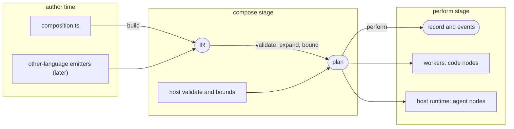
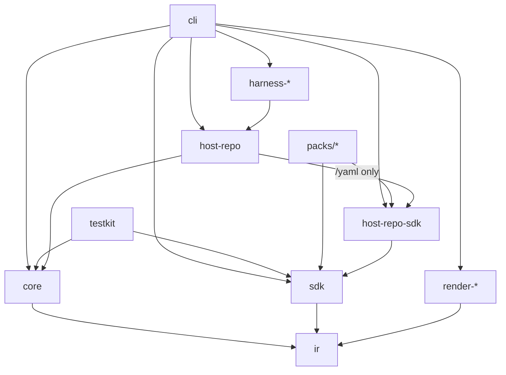
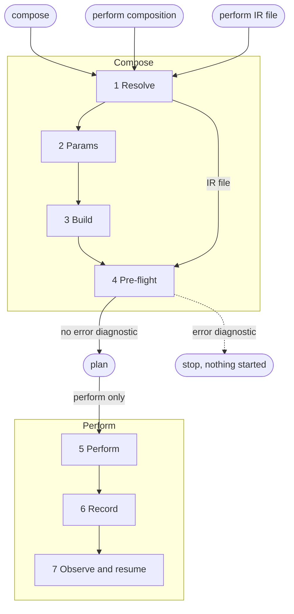
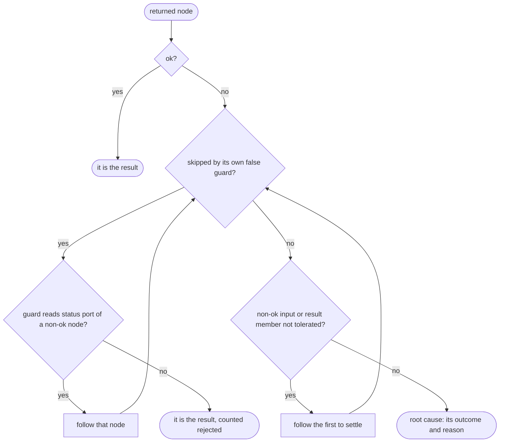
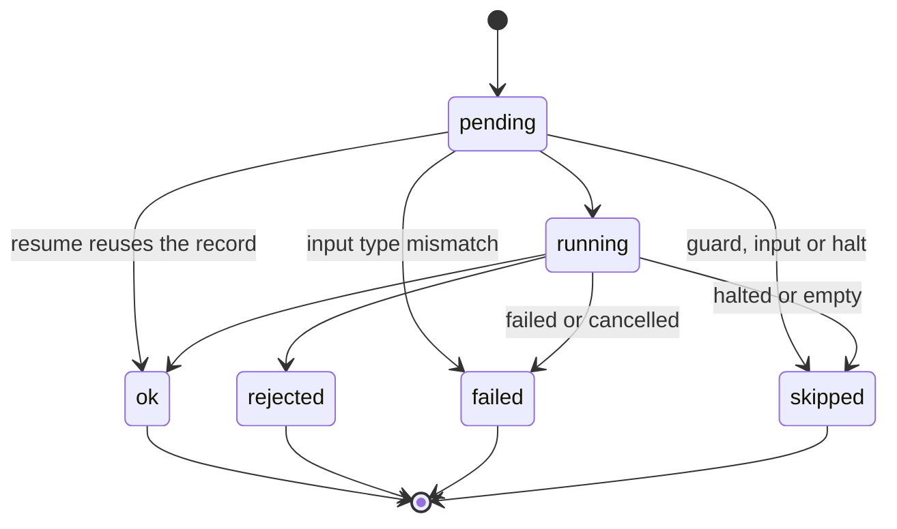

# maestro: architecture and system view

For engine contributors and host authors: how the packages fit, how a concert runs and is recorded, and how config
resolves. Read `requirements.md` for goals and ids (CORE-xx and so on), `rulings.md` for D-nn and R-nn, and
`GLOSSARY.md` for terms. It fixes responsibilities, boundaries and flows, and leaves module internals to the code and
the package READMEs.

## 1. Overview

maestro executes **compositions**. A composition is TypeScript code that, when built, yields a **graph**: typed nodes
joined by typed edges, serialized as a language-neutral **IR**. The **core** validates, bounds, schedules, records and
resumes graphs and knows nothing about what the nodes do. A **host** teaches the core new node kinds. The coding-agent
host adds nodes that run coding agents in isolated working copies. **Packs** carry compositions, prompts and code nodes
for a domain.

Three properties drive the design:

1. **Symbolic build.** Building never sees a value. Because the graph is data before anything runs, everything that can
   be checked, bounded or drawn is checked, bounded or drawn first.
2. **Domain-free core.** The core's vocabulary is graph, node, edge, outcome, artifact, concert. The word "agent" does
   not occur in it.
3. **Code where code is honest.** The graph holds structure. Data plumbing, parsing, merging and policy that need real
   code are first-class **code nodes** with typed ports, not hidden in the orchestration.

## 2. System context

The **operator** is a person or a **conductor**, an agent session that drives the CLI. **Harnesses** (pi, Claude Code)
are reached through the host's adapters, and model providers only through harnesses. The host reads a **target
repository** to cut lanes and a concert never writes to it (HOST-03). The filesystem holds config, the record store,
lanes and artifacts. Renderers consume the IR and events.

## 3. Layers and packages

A monorepo of separately versioned packages. Package names are workspace names and are never published.

| Layer            | Package          | Responsibility                                                                                                   |
| ---------------- | ---------------- | ---------------------------------------------------------------------------------------------------------------- |
| IR               | `ir`             | The IR and the formats maestro emits: schema, version, validators, plan and event shapes. No runtime.            |
| Core             | `core`           | Graph model, compose checks, executor, resume, record, config layering, events, worker protocol, host interface. |
| SDK              | `sdk`            | Authoring API: node constructors, Refs, types, subcompositions, stdlib.                                          |
| Test kit         | `testkit`        | Fake host, build and compose-time assertions, stub concert.                                                      |
| CLI              | `cli`            | Commands, derived input flags, output formats, exit codes, host and pack loading.                                |
| Repo host        | `host-repo`      | Agent and check node kinds, lanes, sandbox, harness adapter interface.                                           |
| Repo host SDK    | `host-repo-sdk`  | Typed constructors for the repo node kinds and lanes, output declarations, `seat()`.                             |
| Harness adapters | `harness-<name>` | One adapter per coding-agent runtime.                                                                            |
| Packs            | `packs/<id>`     | Compositions, Markdown prompts, schemas, code nodes, params.                                                     |
| Renderers        | `render-<form>`  | Static graph render, live view.                                                                                  |

Each package imports only what it sits above in the graph. `core` and `ir` never import a host, a pack or an adapter.
Biome import restrictions and a domain-word scan enforce this in `just check`.

Every package but `harness-*` and `packs/*` may also import `ir`; those edges are omitted.

Refs: DIST-03, D-31, CORE-12.

## 4. Lifecycle of a concert

**Compose** is steps 1 to 4 and spends nothing; **Perform** is steps 5 to 7 and starts a concert.

1. **Resolve.** The CLI loads layered config, every host the binary embeds (config has no `hosts` key), and the pack
   that owns the composition.
2. **Params.** A composition's declared params become CLI flags, validated before build. They are plain values; a Ref
   never feeds a param.
3. **Build.** The build function runs once with symbolic Refs and produces the graph. It is deterministic and
   side-effect free, with ambient state (environment, clock, randomness) frozen. The loader builds twice and compares
   the IR.
4. **Pre-flight.** Checks, code loading, expansion of groups sized by plain values, host `validate` and `bounds`, then
   the **plan**: diagnostics, counts, bounds and a renderable graph. The steps and their order are in the
   [compose README](../packages/core/src/compose/README.md#steps). Compose runs no author code.
5. **Perform.** The executor schedules node instances ([Execution model](#7-execution-model)), dispatching code nodes to
   workers and host nodes to their host.
6. **Record.** Events and results go to the record store as they happen, and the concert's result follows the
   [result rule](#result-rule).
7. **Observe and resume.** `ls`, `wait`, `watch` and renderers read the record and events. `resume` and `encore` are in
   [Resume and encore](#resume-and-encore).

Refs: D-12, D-13, D-16, D-17, D-19, CORE-06, CORE-09, SDK-11, SDK-12, NFR-02, ADR 0009.

## 5. The IR (contract)

The IR is the contract between authors and the engine: JSON, versioned, and self-describing enough that a renderer needs
nothing else. Its contents and wire format are in the [`@maestro/ir` README](../packages/ir/README.md#format).

Properties:

- **Fan-in is explicit**: a `collect` edge from a group's member-result port into a downstream node, or a reducer node
  marked `fanin`. A node with several distinct upstreams is a **barrier** and shows as a multi-edge join.
- **Lanes are not fan-in.** A host node takes exactly one lane. Results from several lanes reach the next node as
  values.
- **Stable ids.** Node ids derive from scope path and label, so renders, events and resume stay stable across builds of
  the same composition.
- **Byte-stable.** Same params, composed config and code give the same IR.
- **Language-neutral.** Nothing in the IR assumes TypeScript. A worker reference names a runtime, and v1 implements
  `ts`.

Refs: D-08, D-09, CORE-06.

## 6. Host interface

A host is a package the core loads, and the only way node kinds beyond the core's set exist. The core never inspects a
host's types or rules: it calls the hooks below and records what they return. ADR 0010 holds why.

The exports, from `@maestro/core/host`, `@maestro/core/node` and `@maestro/ir`, are listed in the `Host` TSDoc. Required
members sit flat on the host; a `?` marks an optional one.

| Member                | Called by                                                              | Gives                                 |
| --------------------- | ---------------------------------------------------------------------- | ------------------------------------- |
| `name`                | Core, always: it namespaces kinds, types, facts.                       |                                       |
| `kinds`, `types`      | Core, at compose and perform start.                                    |                                       |
| `config`              | Core, at config compose: a schema per namespace.                       |                                       |
| `paths?`, `deferred?` | CLI, for config paths and late bases.                                  | Key paths.                            |
| `needs?(graph)`       | CLI, for `rep`, from the example set.                                  | Config entries its nodes read.        |
| `kind.name`           | Core, at compose.                                                      |                                       |
| `kind.config`         | Core, at compose.                                                      | `HOST.config` diagnostics.            |
| `kind.ports(node)`    | Core, at compose, per node.                                            | The node's `in` and `out`.            |
| `kind.execute(...)`   | Core, per instance, when its inputs are ready.                         | `HostNodeResult`.                     |
| `kind.cancel(i)`      | Core, on cancel or halt: releases resources, killing the process tree. | Nothing; `execute` then settles.      |
| `validate(graph, s)`  | Core, at compose, once per graph, after core's checks.[^validate]      | `HOST.`-prefixed diagnostics.         |
| `bounds(node)`        | Core, at compose, per node of the host's kinds.                        | Named counts per instance.            |
| `environment(s)`      | Core, at perform start, once per concert.                              | Facts for code nodes' `env`.          |
| `param?(type, text)`  | CLI: reads a param of one of the host's `types`.                       | A value, or diagnostics.              |
| `resources?.release`  | CLI, for `prune`, on a settled concert.                                | Nothing.                              |
| `resources?.usage`    | Core, as a concert settles, and its encore's; CLI, for `ls` otherwise. | Bytes on disk.                        |
| `text?.*`             | CLI, for `watch`, `ls`, `ls --json`, `ls --help`.                      | Progress words, actor, notes, report. |

[^validate]:
    It sees the whole graph, where host rules live: the lane extension rule, the profile and checks a node names, bind
    validity.

**Setup, enrichment and naming.** `HostSetup`, the host's context and the naming rule are in the `Host`, `HostSetup` and
`HostContext` TSDoc. A host adds fields to the events and record of its node kinds, reports progress through
`context.emit`, and writes no log of its own: core stores both opaquely, keyed by node id and expansion path, progress
as a `progress` event.

Refs: CORE-10, CORE-12, CORE-19, D-23, ADR 0007.

## 7. Execution model

### Node instances and outcomes

A node instance is a node id plus an expansion path: one `[key]` per enclosing group, outermost first, where a `parMap`
or `parFind` contributes its item key and the other groups their iteration index (`[risk]`, `[risk][2]`, or empty
outside groups). It is shown merged into the id, as `parMap[risk]/skeptic`. Events and records use this identity.

A node instance is ready when all `data` and `collect` inputs are settled and its `control` edges allow it, and runs up
to the concurrency cap. A false `when` guard makes it `skipped`; compose resolves guards that depend only on known
values.

The outcomes are `ok`, `rejected`, `failed` and `skipped`:

- A dependent over an `ok` edge runs only after `ok`. A dependent over a tolerant edge, or one that reads only status
  ports (`ok` or `reason`) of that upstream, also runs after `rejected` and receives the reason, and its outputs when
  the rejection carried them. On a `loop` or `fold`, `tolerate` carries a `rejected` state or accumulator, `init`'s or
  `first`'s included, into the next step; without it the group ends on that one.
- `failed` and `skipped` are not tolerable. The dependent is `skipped` and its own dependents follow the same rule.
- A declared output an upstream did not produce, as when it rejected without outputs, is never a crash. A data read of
  it skips the reader, with that upstream as its cause, and a condition (a guard, a `cond` or a loop test) reading it
  reads not true. `failed` stays for crashes and broken contracts.

Refs: CORE-04, ADR 0006.

### Groups

A group's member value is the outputs of its body's one result, or a record of them by result name when the body returns
several.

- `parMap` instantiates its body once per item, in parallel up to the cap.
- `map` instantiates its body once per item, one at a time in item order.
- `find` instantiates the body per item in order and stops at the first member meeting the condition, else ends on the
  last member. This covers escalation over items. Escalation over models unrolls at build into `use` tries, one seat per
  profile, guarded by `when` and ending in `firstOk`.
- `parFind` runs every item at once. The first member to settle meeting the condition is the result and the others are
  cancelled as `skipped`, with the reason `cancelled: <instance> met the condition`; else it ends on the last member to
  settle.
- `fold` seeds an accumulator from the first item, through the body nodes its `first` lists, and steps it with each next
  item through the others, in order. The accumulator has the shape of a node's result. The fold ends on its last
  accumulator, and over no items it is `skipped`.
- `loop` carries typed state: an initial value, a step producing the next state, a test and a maximum. The state holds
  the previous node's outputs, `ok` and `reason`. The loop goes on while its test reads true, read at `start` before
  each step (`0 to N` steps) or at `end` on each step's result (`1 to N`). However it stops, by test or maximum, it ends
  with its last state's outcome, reason and outputs. This covers fix-until-green and review-revise loops.

In `find` and `parFind` a member or condition node that fails fails the group, as a failed test node fails a `loop`.

**Keying.** A `parMap` or `parFind` item with a primitive value is keyed by value and any other item by index, or by an
author-supplied key function. A duplicate key is a compose error when the list is known at build, and fails the group at
perform when the list is known only there, key function or not. Keys give readable instance ids for `ls` and lane refs.

**`onError`.** A `parMap` or `map` declares it. With `continue`, a non-ok member becomes a `Settled` value and the group
is `ok`. With `stop`, the worst member outcome becomes the group's, running members are cancelled and a `map` starts no
further item, so `results` hold the members that ran. `find`, `parFind`, `fold` and `loop` end on their condition, their
last member or their bound.

Refs: D-18, SDK-13, ADR 0006.

### Result rule

The result rule derives a concert's result from the node the composition returns, by this walk:

A tolerated rejection and a `Settled` input are tolerated. The root cause is the node with no such input. A concert that
fails before any node runs, is cancelled, or loses its process has a result with no node.

### Resume and encore

**Resume** keeps the concert's id and runs its stored IR. A recorded `ok` instance is reused when its key still matches:
a hash of the node definition, its code hash recomputed from the current code, and its input values with artifact
content hashes.

- The code hash covers the whole bundle, so any edit to the composition file reruns every code node, and each dependent
  reruns when its inputs changed. A resume whose recomputed code hashes differ from the recorded ones warns that the
  composition changed and goes on.
- Any other instance runs again, from `pending`. Nothing is reused across concerts.
- A concert whose process is still alive cannot be resumed.

**Encore** (`encore <concert>`) starts a new concert, its row recording `encoreOf`, that performs the earlier concert's
composition again. Every instance runs again and nothing is reused, and a resumed encore stays one.

- Params: the flags the earlier concert recorded, the encore's own overriding them.
- Config: the config files as they stand, then the earlier `-c`, then the encore's own. The encore's presets replace the
  earlier list whole when it gives any, else the earlier list stands.
- Refusal: each concert records a **fingerprint**, a digest of its IR, its config values and the host facts (the target
  revision and a digest of the profiles). An encore is refused before it is recorded when its fingerprint equals its
  concert's, or while its concert or another in its encore chain is running.
- Hosts: core passes `HostContext.encore` to each host instance and reads nothing of it.

Refs: CORE-09, ADR 0008, `rulings.md` "Resume".

### Lifecycle of a node instance

Cancelling a concert cancels running instances through their kinds' cancel hook, in reverse dependency order, and
settles them as `failed` with a cancellation reason. A code node that runs past the timeout its author set settles
`failed`. It has none by default.

## 8. Configuration

Params and config resolve by one ladder, highest precedence first:

1. The use site, for a subcomposition, or the CLI flag, for a root composition.
2. Each `-c <key>=<value>`, last first.
3. Each `--preset`, last first.
4. The workspace file, `.maestro/config.yaml`.
5. The user file, `$XDG_CONFIG_HOME/maestro/config.yaml`.
6. The example set, for `compose` only.
7. The declared default.

A profile's fields are the exception: per field, the command line (`--preset`, `-c`) beats the config files' `profiles`,
which beat the profile directory's `profile.yaml` (`rulings.md` "Profiles"). A resume applies the same order.

### Layers, presets and `-c`

Files are YAML; merge tags, presets and `-c` syntax are in the [CLI README](../packages/cli/README.md#config). A
composition's keys live under its pack id and then its composition id, and hosts keep pure-config namespaces.

- The record keeps each `--preset` and `-c` as typed, so keep secrets out of `-c`; put them in `.env`. A resume
  reapplies them but finds the record store by today's `dataRoot`, so a moved data root needs `-c dataRoot=` again.
- A relative path is relative to the workspace root, the directory holding `.maestro/`, in a workspace file, preset and
  `-c`, and to the user config directory in a user file and preset. A `-c` outside a workspace is relative to the cwd.

### Core keys

The core validates a closed schema for `concurrency`, `dataRoot`, `workspace`, `caps` and `limits`, each described in
`CoreConfig` and `ConcertLimits` in `packages/core/src/config/index.ts`; the CLI adds `packs` ([Packs](#13-packs)). The
host's namespaces (`target`, `profiles`, `seats`, `sandbox`) are in the
[host-repo README](../packages/host-repo/README.md#configuration).

### Who owns what

The core parses and layers config, validates the core keys and hands each other top-level namespace to the
**registrant** that owns it, a host or a pack, for validation at compose time. The schema that checks a key is always
the one of the code that runs.

- **Core.** The core keys, and **CLI.** `packs`.
- **Host.** `target`, `profiles` and its other namespaces.
- **Composition.** One param declaration in code covers CLI inputs and tunables, with defaults. A repair-loop
  subcomposition owns its maximum iteration count.
- **Pack.** Its id, holding its compositions' params, and no other namespace.

A key that no installed registrant claims is a compose error with a did-you-mean hint. A key claimed by an installed but
unused registrant is ignored.

Refs: CFG-01, CFG-02, CFG-04, CFG-05, CFG-06, D-17, D-19, D-24, HOST-12.

## 9. Workers and code nodes

A **code node** is the author's function, with typed inputs and typed outputs. It runs at perform, in a **worker** of
its declared runtime. v1 provides an in-process TypeScript worker. The **worker protocol** is specified so other
runtimes and out-of-process workers can follow:

- **Handshake.** Runtime name and version, supported IR version.
- **Invoke.** Node id, expansion path, input values and their port schemas, artifact references and context. The reply
  carries outputs and an outcome (`ok`, or `rejected` with a reason and optional outputs), or an error.
- **Cancel and timeout.** A worker must stop work and reply promptly. A code function gets `ctx.signal`, an
  `AbortSignal` aborted on cancel or timeout, to pass to `Bun.spawn({ signal })` or `fetch`. A process the function
  spawned without it outlives the node.
- **Logs.** A worker can emit log lines tagged with the node instance, stored in the record. A code function writes one
  with `ctx.log(line)`.
- **Isolation.** A worker is operator-trusted and not sandboxed by the core.

The in-process worker cannot stop a running function: a cancelled or timed-out invocation settles at once and its
function is abandoned. A synchronous function that never returns blocks the process, so long work belongs in a host.

Refs: CORE-14, NFR-05, ADR 0009.

## 10. Record and events

The **record store** is local and embedded: SQLite in WAL mode through `bun:sqlite`. Concerts may run concurrently with
no coordination beyond lane isolation. It holds:

- Concerts: the IR, the id of the performing process, where the code came from (workspace, module directory, file), tour
  and title, each `--preset` name in order, each `-c` as typed, the root's params the flags gave, the concert an encore
  repeats and its fingerprint, the `limits` of the latest attempt, and the disk it holds, measured as it settles and
  again when an encore of it settles.
- Node instances: outcomes with reasons, durations, metrics, artifact references and each leaf's wired inputs.
- Events.

No config is kept for reuse: a resume re-reads the config files.

- **Stale rows.** A resume marks the concert's instance rows **stale**. Each one it reuses or replaces stops being
  stale, and the metrics of a replaced attempt still count towards the concert's.
- **Dead process.** A concert whose process is gone while still `running` settles `failed`, by whichever reader finds
  it, so `wait` ends and resume can continue. Only `kill` checks that a live process is maestro, so a pid another
  program reused keeps the concert `running` until `kill` settles it.
- **Metrics** are named additive numbers per node instance. The engine sums each name per concert and attaches no
  meaning to a name, except the token sum `limits.tokens` bounds. v1 reports token counts only.
- **Events** are append-only, keyed by node id and expansion path, with the instance's state, timestamps, outcome and
  host enrichment. They are the single source for `watch` and renderers.
- **Scratch.** An instance's scratch directory is removed when it settles, except a failed code node's, which is kept
  and logged. What lasts is in artifacts, lanes and events.
- **Queries** the CLI needs: list concerts with filters, find one by id, list a concert's node instances, wait for a
  terminal state, read the result, set a tour, resume and remove.
- **Artifacts** are files under the concert's area, referenced by content hash and provenance (the node instance that
  produced them). Large values are artifacts, not inline.

### Data root

`$XDG_DATA_HOME/maestro` (default `~/.local/share/maestro`), unless config's `dataRoot` moves it.

| Path                 | Holds                                                                    |
| -------------------- | ------------------------------------------------------------------------ |
| `record.db`          | The record of concerts, node instances and events.                       |
| `concerts/<id>/`     | One concert's artifacts, at `artifacts/<path>`, and scratch directories. |
| `hosts/<host name>/` | A host's store, which the host creates on first write.                   |

Refs: CORE-19, D-23, D-26, NFR-07.

## 11. Rendering

A renderer needs only the IR (or plan) and events. [`@maestro/render-text`](../packages/render-text/README.md) holds
both forms.

- **Static.** `compose --graph` prints the plan as a Mermaid flowchart. Scopes and groups are plain subgraphs, not
  collapsible.
- **Live.** `maestro watch` folds the record's events into the authored shape, each node once, and a terminal browse
  opens a row's part of the record. Only the live view folds.

A richer viewer is out of scope.

## 12. The coding-agent host

The host carries the coding-agent concepts. The vocabulary is fixed in D-21 and `GLOSSARY.md`. Its package README,
[`@maestro/host-repo`](../packages/host-repo/README.md), is the home of everything below.

It registers the agent, check, changeset, commits and apply [node kinds](../packages/host-repo/README.md#node-kinds) and
runs each in a [lane](../packages/host-repo/README.md#lanes), an isolated, versioned working copy cut from a target
repository. What a concert leaves behind is a [changeset](../packages/host-repo/README.md#changesets) the operator
applies, never a write to the target's checkout (HOST-03).

An agent runs a [profile](../packages/host-repo/README.md#profiles-and-prompts) in the
[sandbox](../packages/host-repo/README.md#sandbox), a bubblewrap confinement (D-25). A
[harness adapter](../packages/host-repo/README.md#harness-adapters) drives the coding agent as a subprocess over its
JSON event stream (D-20, ADR 0001) and reports token usage to the core as metrics (D-23). The host owns the config
namespaces `target`, `profiles`, `seats` and `sandbox` ([Configuration](../packages/host-repo/README.md#configuration)),
and enforces its [validation rules](../packages/host-repo/README.md#validation-rules) at compose.

## 13. Packs

A pack is a directory, or a release tarball whose top directory is the pack id, holding a manifest and one pre-bundled
entry file that includes its own SDK copy. A pack contributes compositions (named `<id>.<name>`), prompts, schemas, code
nodes and params, and everything domain-specific lives here, such as the Gerrit comment parser and renderer, a catalogue
of review lenses or a knowledge directory. Hard-coded environment facts (a repository path, a change number, a commit
SHA) are inputs or round-folder data, never constants in a pack.

**Manifest.** `maestro-pack.json`:

| Field     | Holds                                                                                           |
| --------- | ----------------------------------------------------------------------------------------------- |
| `id`      | Lower case, a letter first, then letters, digits, `_` or `-`. Also the pack's config namespace. |
| `version` | The pack's version.                                                                             |
| `entry`   | The bundle file inside the pack directory.                                                      |
| `sdk`     | A semver range. A maestro whose SDK is outside it refuses the pack and says to rebuild.         |

The entry imports nothing but builtins and `@maestro/sdk`, and maestro refuses one that does. Nothing is resolved
through `node_modules`. Compose consumes only IR JSON, so a second SDK copy is harmless as long as nothing relies on
`instanceof` across copies.

**Discovery.** Every directory under `$XDG_DATA_HOME/maestro/packs/` is installed with no config, and the `packs` config
key lists others by path.

**Trust.** A pack is operator-trusted code: its code nodes run in maestro's process with the user's permissions, outside
the sandbox that confines agents and checks.

Refs: D-30, ADR 0002.

## 14. Distribution

- Bun is the runtime baseline. Distribution is public: the binary `maestro` and package tarballs are released on GitHub,
  nothing is published to a public registry, and the license is MIT.
- The executable is built with `bun build --compile`, embeds core, SDK, CLI and the agent host, and runs on Linux x64
  (glibc only), on modern Linux. Packs load as external bundles ([Packs](#13-packs)), which keeps the binary generic.
- The release embeds the SDK and host SDK bundles as assets, and the loader serves a bare composition file's
  `@maestro/sdk*` and `@maestro/host-repo-sdk` imports from them, so no `node_modules` is read.
- The IR carries a version so a newer core can still read older IR within the compatibility policy.

Refs: D-03, D-31, D-34, CORE-16, ADR 0003.

## 15. Key design decisions and alternatives

- **Authoring surface**: a code SDK that builds a graph, symbolically. Why: YAML needs an expression language the moment
  data plumbing appears, and creeps; imperative scripts cannot be checked before spend; code plus symbolic build gives
  typed plumbing and a checkable graph. Rejected: a YAML DSL with expressions, imperative scripts. Record: D-04, D-05.
- **Engine language**: TypeScript on Bun. Why: code nodes in TS make the engine and the author share a language and
  process, with strong generics for typed refs, and the harness SDK ecosystem is TypeScript. Rejected: a Rust engine
  with out-of-process chains, which would still need Node or Python for code nodes and lose its packaging advantage;
  keeping Python. Record: D-03.
- **Graph shape**: a static skeleton plus bounded regions. Why: compose needs bounds, so perform-time-shaped regions
  need a declared maximum. Rejected: fully dynamic graphs built at perform time. Record: CORE-05, D-23.
- **Lanes**: versioned handles checked by a host hook. Why: symbolic graphs have no program order, so versions put order
  in the data. Rejected: program order implying correctness. Record: HOST-02, HOST-11.
- **Core and agents**: the core is generic and agents are a host. Why: the core stays testable alone and other hosts can
  exist. Rejected: agents in the core. Record: D-06.
- **Outcomes**: four states with per-edge tolerance. Why: a gate's rejection differs from an infrastructure failure, and
  a red check is useful input to a repair. Rejected: pass and fail only. Record: CORE-04,
  [ADR 0006](adr/0006-outcomes-aggregate-by-one-rule.md).
- **Config**: namespaced pass-through with composition-declared schemas. Why: the core must not grow with every
  composition's needs. Rejected: one global schema. Record: D-07.
- **Adapters**: a sandboxed subprocess over each harness's JSON events. Why: an in-process agent cannot be confined by
  bubblewrap, and the subprocess contract is the same for every harness. Rejected: in-process harness SDKs. Record:
  D-20, [ADR 0001](adr/0001-sandboxed-subprocess-adapters.md).
- **Packs**: a pre-bundled directory or tarball, listed by path. Why: the compiled binary cannot resolve `node_modules`,
  and compose only consumes IR JSON, so a bundled SDK copy is harmless. Rejected: npm packages resolved through
  `node_modules`. Record: D-30, [ADR 0002](adr/0002-pack-bundles.md).
- **Resume**: content-hashed node instances. Why: correct under code or input change. Rejected: file-presence reuse; a
  result cache across concerts, which would hit only code nodes upstream of every agent node, since agent nodes are
  never reused. Record: [ADR 0008](adr/0008-code-nodes-name-exported-functions.md), `rulings.md` "Resume",
  [ADR 0015](adr/0015-concert-fork.md).

`docs/rulings.md` is the decision register.

## 16. Failure modes

| Mode               | Outcome                                                                                                     | Recovery                                                                                            |
| ------------------ | ----------------------------------------------------------------------------------------------------------- | --------------------------------------------------------------------------------------------------- |
| Compose error      | No agent starts. The CLI prints diagnostics and exits 1, a config or build fault; 2 for the command line's. | Fix what the diagnostics name.                                                                      |
| Node `failed`      | Dependents `skipped` unless a settling group or fan-in node got it as `Settled`.                            | `resume` runs it again.                                                                             |
| Node `rejected`    | Follows edge tolerance: the normal path for a red check or a negative review.                               | None when tolerated, else change the input or the code, then `resume`; a plain `resume` repeats it. |
| Host crash or kill | The record is consistent as of the last event. The host's cancel hook kills agent trees.                    | `resume` continues.                                                                                 |
| Worker error       | A code node that throws, or times out, settles `failed` with the error.                                     | Fix the code, then `resume`.                                                                        |
| Disk full          | The record store, artifacts and lane stores share the data root.                                            | Free disk, or move `dataRoot`.                                                                      |

## 17. Open design points

Deferred: a secret param type (D-33), cost accounting and prices, per-adapter compaction, extending a lane across
concerts, starting a concert from a finished one's results ([ADR 0015](adr/0015-concert-fork.md)), in-process SDK
adapters, arm64 and macOS, and licensing.
