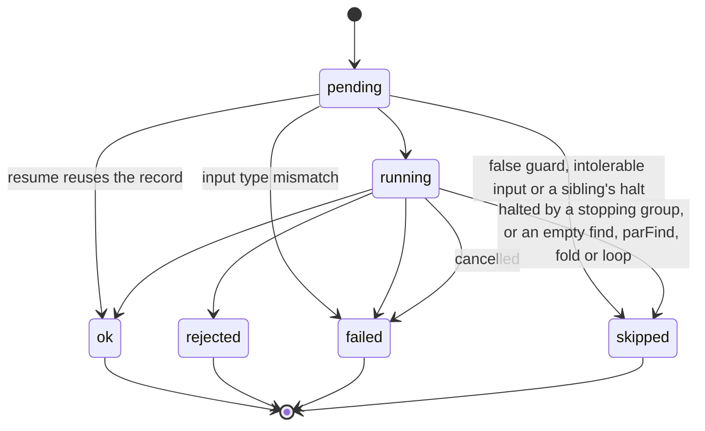

# maestro: architecture and system view

Status: draft 2, 2026-10-14. Read `requirements.md` first for goals, glossary and decisions (D-xx, CORE-xx and so on are
defined there). This document is a system-level view. It fixes responsibilities, boundaries and flows, and leaves module
internals to the implementation.

## 1. Overview

maestro executes **compositions**. A composition is TypeScript code that, when built, yields a **graph**: typed nodes
joined by typed edges, serialized as a language-neutral **IR**. The **core** validates, bounds, schedules, records and
resumes graphs and knows nothing about what the nodes do. A **host** teaches the core new node kinds. The coding-agent
host adds nodes that run coding agents in isolated working copies. **Packs** carry compositions, prompts and code nodes
for a domain.

```
 author time                         compose stage                         perform stage
 -----------                         -------------                         -------------
 composition.ts  --build-->  IR  --validate/expand/bound-->  plan  --perform-->  record + events
      ^                      ^                 ^                                |
      |                      |                 |                                v
   SDK (+ host SDKs)   other-language     host.validate/bounds            workers (code nodes)
                       emitters (later)                                   host runtime (agent nodes)
```

Three properties drive the design:

1. **Symbolic build.** Building never sees a value. Because the graph is data before anything runs, everything that can
   be checked, bounded or drawn is checked, bounded or drawn first.
2. **Domain-free core.** The core's vocabulary is graph, node, edge, outcome, artifact, concert. The word "agent" does
   not occur in it.
3. **Code where code is honest.** The graph holds structure. Data plumbing, parsing, merging and policy that need real
   code are first-class **code nodes** with typed ports, not hidden in the orchestration.

## 2. System context

Actors and external systems:

- The **operator** (a person or a conductor agent) drives the CLI.
- **Harnesses** (coding-agent runtimes such as pi and Claude Code) are driven by the coding-agent host through adapters.
- **Model providers** are reached only through harnesses.
- A **target repository** is read by the host to cut lanes. It is never written by a concert (HOST-03).
- The **filesystem** holds config, the record store, lanes and artifacts.
- **Renderers** consume the IR and the event stream.

```
 operator --CLI--> maestro CLI --> core engine --+--> workers (code nodes)
                                      |          +--> host: agent / check nodes --> harness adapters --> agents
                                      |                         |                              |
                                      v                         v                              v
                                record store + events     lanes (worktrees), sandbox     model providers
                                      |
                                      v
                                  renderers
```

## 3. Layers and packages

A monorepo of separately versioned packages (DIST-03). Package names are workspace names that are never published
(D-31).

| Layer            | Package          | Responsibility                                                                                                         | Knows about                                                                |
| ---------------- | ---------------- | ---------------------------------------------------------------------------------------------------------------------- | -------------------------------------------------------------------------- |
| IR               | `ir`             | The IR and the data formats maestro emits: schema, version, validators, plan and event shapes. No runtime.             | nothing                                                                    |
| Core             | `core`           | Graph model, compose checks, executor, resume, record store, events, config layering, worker protocol, host interface. | `ir`                                                                       |
| SDK              | `sdk`            | Authoring API: compositions, node constructors, Refs, types, subcompositions, stdlib. Emits IR.                        | `ir`                                                                       |
| Test kit         | `testkit`        | Fake host, build and compose-time assertions, stub concert.                                                            | `core`, `sdk`, `ir`                                                        |
| CLI              | `cli`            | Commands, derived input flags, output formats, exit codes, host and pack loading.                                      | `core`, `sdk`, `ir`, `render-*`, `host-repo`, `host-repo-sdk`, `harness-*` |
| Repo host        | `host-repo`      | Agent and check node kinds, lanes, sandbox, harness adapter interface, host config namespaces.                         | `core`, `ir`                                                               |
| Repo host SDK    | `host-repo-sdk`  | Typed constructors for the repo node kinds and lanes, output declarations, `seat()`.                                   | `sdk`, `ir`                                                                |
| Harness adapters | `harness-<name>` | One adapter per coding-agent runtime.                                                                                  | `host-repo`                                                                |
| Packs            | `packs/<id>`     | Compositions, prompts, schemas, code nodes, params.                                                                    | `sdk`, `host-repo-sdk`                                                     |
| Renderers        | `render-<form>`  | Static graph render, live view.                                                                                        | `ir`                                                                       |

Dependency rule: arrows only point down the table. `core` and `ir` never import a host, a pack or an adapter. CORE-12
and the graph are enforced by lints in `just check`: Biome import restrictions and a domain-word scan.

## 4. Lifecycle of a concert

The lifecycle has two stages (D-12). **Compose** is steps 1 to 4, ending with pre-flight, and spends nothing.
**Perform** is steps 5 to 7 and starts a concert.

- `compose <composition>` stops after step 4. By default it is an explicit validation step reporting diagnostics. It can
  save the IR to a file (D-13). With no params it uses the first example input set (D-19).
- `perform <composition>` runs compose first and continues only if pre-flight produced no error diagnostic.
- `perform <IR file>` skips the build (step 3), loads the IR, and still runs pre-flight before any node instance starts
  (NFR-02).

1. **Resolve.** The CLI loads layered config, every host the binary embeds (config has no `hosts` key), and the pack
   that owns the composition.
2. **Params.** A composition's declared params become CLI flags and are validated before build (D-17). They are plain
   values at build time. Node outputs and file contents are Refs, and a Ref never feeds a param (D-16).
3. **Build.** The composition's build function runs once with symbolic Refs and produces the graph. It is deterministic
   and side-effect free (CORE-06). Ambient state (environment, clock, randomness) is frozen (SDK-11). The loader builds
   twice and compares the IR (SDK-12).
4. **Pre-flight.**
   1. Serialize to IR and validate against the IR schema.
   2. Type-check every edge (CORE-02).
   3. Resolve config: each namespace goes to its owner's schema (CFG-02, CFG-05).
   4. Expand bounded groups whose cardinality is known from plain values. A group whose size depends on a node result
      stays as a bounded region. Compose runs no author code (ADR 0009).
   5. Run host `validate(graph, setup)` hooks (for example the lane double-extension rule).
   6. Compute bounds with host `bounds(node)`: maximum node instances and the hosts' named counts (such as agent runs)
      (D-23). There is no cost bound in v1.
   7. Emit the **plan**: diagnostics, counts, bounds and a renderable graph. Diagnostics of severity error stop here
      (NFR-02).
5. **Perform.** The executor instantiates node instances, schedules them by dependency, applies outcomes and edge
   tolerance, dispatches code nodes to workers and host nodes to their host, and writes events.
6. **Record.** Events and results go to the record store as they happen. A final result is derived by the result rule
   (CORE-04).
7. **Observe and resume.** `ls`, `wait`, `watch` and renderers read the record and events. `perform --resume` re-enters
   a concert at node granularity (CORE-09). `perform --encore` performs a concert's composition again as a new concert,
   linked to it (see Encore).

## 5. The IR (contract)

The IR is the contract between authors and the engine (D-09). It is JSON, versioned, and self-describing enough that a
renderer needs nothing else.

Contents, at the level of what it must carry:

- **Header.** IR version, composition id and version, pack id, build metadata (SDK version, source hash).
- **Scopes.** Named subgraphs created by subcomposition use, with their ports, so renderers can collapse them.
- **Nodes.** For each node: stable id (a path whose prefixes are its scopes and groups), kind, source location, typed
  ports (schemas), guard, kind-specific configuration (host kinds), and for code nodes a worker reference
  `{runtime, module, export, code hash}`.
- **Groups.** For `parMap`, `map`, `find`, `parFind`, `fold`, `loop`: the body subgraph (a template), the cardinality
  (`exact` or `up to N`), the source of its items or iteration state, the stop condition reference, and the members
  whose results the group delivers.
- **Edges.** From port to port, with kind `data`, `collect` or `control`, and for `control` the tolerance (`ok` only, or
  `ok` and `rejected`).
- **Result.** The node the composition returns, from which the result rule derives the concert result.
- **Provenance.** Optional compose-time additions: expansion and bounds. A plan is an IR plus these.

Properties:

- **Fan-in is explicit** (D-08): a `collect` edge from a group's member-result port into a downstream node, or a reducer
  node marked `fanin`. A node with several distinct upstreams is a barrier and shows as a multi-edge join.
- **Lanes are not fan-in.** A host node takes exactly one lane. Results from several lanes reach the next node as
  values.
- **Stable ids.** Node ids are derived from scope path and label so that renders, events and resume stay stable across
  builds of the same composition.
- **Byte-stable.** Same params, composed config and code give the same IR (CORE-06).
- **Language-neutral.** Nothing in the IR assumes TypeScript. A worker reference names a runtime, and v1 implements
  `ts`.

## 6. Host interface

A host is a package that the core loads. It is the only way node kinds beyond the core's set exist. A host supplies:

1. **Node kinds.** For each kind: name, configuration schema, input and output port schemas (possibly generic over the
   node's configuration), and `execute(instance, inputs, context)` returning outputs and an outcome. The instance holds
   its node, its expansion path and its id as `ls` shows it, such as `lens[risk]/skeptic`. Compose checks a node's
   configuration and its ports in the IR against its kind, and perform checks the outputs against the ports. Core never
   says run or build (CORE-12): the SDK builds, core composes and executes. A kind can declare its outputs include
   artifacts.
2. **Types.** Named types the host's ports use (for example a lane handle), with a way to serialize them into the IR.
   Compose rejects a type name that neither core nor an installed host owns.
3. **`validate(graph, setup)`.** A compose-time hook returning diagnostics. It sees the whole graph and its own kinds'
   nodes. This is where host rules live (the lane extension rule, the profile and checks a node names, bind validity).
4. **`bounds(node)`.** Bounds for a node instance as named counts, like metrics (CORE-19): core sums each name and
   config caps it by name, for the plan's size bound (D-23). The agent host counts agent runs under its own name.
5. **Environment.** `environment(setup)` gives host facts visible to code nodes through a typed context (for example the
   current target). The core's own context holds only the concert id, a clock value and the instance's scratch directory
   (ADR 0007).
6. **Config namespaces.** Schemas for the namespaces the host owns. A **setup** goes to `validate`, `environment`,
   `resources.release` and `resources.usage`, and to `execute` as `context.setup`. It holds the values of the host's own
   namespaces as compose checked them, the part of them the preset and `-c` layers set (`commandLine`, at its key
   paths), and its store, `<data root>/hosts/<host name>`, which the host creates on first write.
7. **Event enrichment.** Extra fields added to events and the record for its node kinds, when an instance settles, and
   progress events emitted while it executes, such as an agent's tool calls and thinking (CORE-10). The core stores them
   opaquely.
8. **Cancellation.** A way to cancel a running node instance and release resources (kill the process tree).
9. **Optional seams.** `param(type, text)` reads a param of one of its types from the text a flag or YAML gave it.
   `resources`, for a host that holds disk per concert, groups `release(concert, setup)`, which frees what it holds for
   a settled concert, and `usage(concert, setup)`, which reports its bytes on disk, for `prune` and `ls`. `text` groups
   `progress(event)`, which words one of the host's progress events, `actor(enrichment)`, which names who ran an
   instance, `notes(enrichment)`, which gives an instance's notes as headed lists of one-line entries for `ls`,
   `report(enrichment)`, which gives its full report as an opaque object for `ls --json`, and `reportFields`, which says
   what that report's fields mean for `ls --help`; the renderer styles the text. `needs(graph)` names the config entries
   the graph's host nodes read by name. ADR 0010 records the shape.

The core never inspects a host's types or rules beyond checking that each type name has an owner. It only calls these
hooks and records what they return.

### Host reference

What a host author writes against. ADR 0010 records why the shape is this one.

**Imports.** The contract spans three entry points and nothing else:

| Import               | Gives                                                                                                                               |
| -------------------- | ----------------------------------------------------------------------------------------------------------------------------------- |
| `@maestro/core/host` | `Host`, `NodeKind`, `HostInstance`, `HostSetup`, `HostContext`, `HostResources`, `HostText`, `HostNodeResult`, `Metrics`, `Bounds`. |
| `@maestro/core/node` | `Inputs`, `Outputs`, `NodeResult`: what a node takes and gives back.                                                                |
| `@maestro/ir`        | `HostNode`, `Ports`, `JsonSchema`, `Diagnostic`, `GraphIndex`, `Facts`, `HostEvent`, `Enrichment`, `Context`, `ArtifactRef`.        |

**Host members.** Required members sit flat on the host. Core calls each at a fixed stage and never inspects what it
returns beyond the check named.

| Member               | When core calls it                                                      | Returns                          |
| -------------------- | ----------------------------------------------------------------------- | -------------------------------- |
| `name`               | Always: it namespaces kinds, types and facts.                           |                                  |
| `kinds`, `types`     | At compose and at perform start: core reads the kind and type owners.   |                                  |
| `kind.name`          | At compose: the `<host>.<kind>` a node's `kind` names.                  |                                  |
| `kind.config`        | At compose: the schema a node's `config` is checked against.            | `HOST.config` diagnostics.       |
| `config`             | At config compose: one schema per namespace the host owns.              |                                  |
| `validate(graph, s)` | At compose, once per graph, after core's own checks.                    | Diagnostics, `HOST.`-prefixed.   |
| `bounds(node)`       | At compose, per node of one of the host's kinds.                        | Named counts per instance.       |
| `environment(s)`     | At perform start, once per concert.                                     | Facts for code nodes' `env`.     |
| `kind.ports(node)`   | At compose, per node.                                                   | The node's `in` and `out`.       |
| `kind.execute(...)`  | Per node instance, when its inputs are ready.                           | `HostNodeResult`.                |
| `kind.cancel(i)`     | When the concert is cancelled or a halt stops a running instance.       | Nothing; `execute` then settles. |
| `param?(type, text)` | The CLI only, to read a param of one of the host's `types` from text.   | A value, or diagnostics.         |
| `resources?.release` | The CLI only, for `prune`, on a settled concert.                        | Nothing.                         |
| `resources?.usage`   | The CLI only, for `ls`, per concert.                                    | Bytes on disk.                   |
| `text?.progress(e)`  | The CLI only, for `watch`, per progress event of the host's kinds.      | A word and detail, or generic.   |
| `text?.actor(e)`     | The CLI only, for `watch` and `ls`, on enrichment or an event's fields. | Who ran the instance, or none.   |

The setup each hook gets, `HostSetup`, is item 6 above and ADR 0010.

**Naming.** A host named `h` prefixes its node kinds (`h.agent`) and types (`h.lane`) with `h.`. Config namespaces are
not prefixed (`target`, `profiles`). Core refuses two hosts that register one kind, and a type name no installed host
owns.

**Logging.** A host writes no log of its own. It reports progress through `context.emit(event)`, a JSON object core
stores by node id and expansion path as a `progress` event, opaquely.

## 7. Execution model

- **Node instances.** A node instance is a node id plus an expansion path: one `[key]` per enclosing group, outermost
  first, where a `parMap` or `parFind` contributes its item key and the other groups their iteration index (`[risk]`,
  `[risk][2]`, or empty outside groups). It is shown merged into the id, as `parMap[risk]/skeptic`. Events and records
  use this identity.
- **Scheduling.** A node instance is ready when all `data` and `collect` inputs are settled and its `control` edges
  allow it. The executor runs ready instances up to the concurrency cap.
- **Outcomes.** `ok`, `rejected`, `failed`, `skipped`.
  - A dependent over an `ok` edge runs only after `ok`. A dependent over a tolerant edge, or one that reads only status
    ports (`ok` or `reason`) of that upstream, also runs after `rejected` and receives the reason.
  - `failed` and `skipped` are not tolerable. The dependent is `skipped` and its own dependents follow the same rule.
  - A declared output an upstream did not produce, as when it rejected without outputs, is never a crash. A data read of
    it skips the reader, with that upstream as its cause, and a condition (a guard, a `cond` or a loop test) reading it
    reads not true. `failed` stays for crashes and broken contracts.
  - A `parMap` or `map` declares `onError`. With `continue`, a non-ok member becomes a `Settled` value and the group is
    `ok`. With `stop`, the worst member outcome becomes the group's, running members are cancelled and a `map` starts no
    further item (ADR 0006). `find`, `parFind`, `fold` and `loop` end on their condition, their last member or their
    bound.
- **Groups.**
  - A group's member value is the outputs of its body's one result, or a record of them by result name when the body
    returns several.
  - `parMap` instantiates its body once per item, in parallel up to the cap. An item with a primitive value is keyed by
    value and any other item by index, or by an author-supplied key function. Duplicate primitive or index keys of a
    list known at build are a compose error. Duplicates a key function gives fail the group at perform, since the
    function runs only there (D-18, SDK-13). `parFind` keys its items the same way. Keys give readable node instance ids
    for `ls` and lane refs.
  - `map` instantiates its body once per item, one at a time in item order.
  - `find` instantiates the body per item in order and stops at the first member meeting the condition, else ends on the
    last member. This covers escalation over items. Escalation over models unrolls at build into `use` tries, one seat
    per profile, guarded by `when` and ending in `firstOk`. `parFind` runs every item at once: the first member to
    settle meeting the condition is the result and the others are cancelled as `skipped`, with the reason
    `cancelled: <instance> met the condition`, else it ends on the last member to settle. In either, a member or
    condition node that fails fails the group.
  - `fold` seeds an accumulator from the first item, through the body nodes its `first` lists, and steps it with each
    next item through the others, in order. The accumulator has the shape of a node's result, as a loop's state does.
    The fold ends on its last accumulator, and over no items it is `skipped`.
  - `loop` carries typed state: an initial value, a step producing the next state, a test and a maximum. The state holds
    the previous node's outputs, `ok` and `reason`, the shape of a node's result. The loop goes on while its test reads
    true, read at `start` before each step (`0 to N` steps) or at `end` on each step's result (`1 to N`). A test node
    that fails fails the loop. Whatever else stops it, its test or its maximum, it ends with its last state's outcome,
    reason and outputs. This covers fix-until-green and review-revise loops.
- **Guards.** A `when` guard that is false makes the node `skipped`. Compose resolves guards that depend only on known
  values.
- **Result.** The result rule starts at the returned node. An `ok` node is the result. Otherwise it follows the node's
  non-`ok` inputs, and a group's result member, that the graph does not tolerate (a tolerated rejection or a `Settled`
  input), the first to settle when several did, to a node with no such input: the root cause, with its outcome and
  reason. A node skipped by its own false guard is the result, and counts as rejected, unless the guard reads the status
  port of a node that is not `ok`: the rule follows that node.
- **Resume.** Re-entering a concert keeps its id and runs its stored IR. A recorded `ok` instance is reused when its key
  still matches: a hash of the node definition, its code hash recomputed from the current code, and its input values
  with artifact content hashes. The code hash covers the whole bundle, so any edit to the composition file reruns every
  code node, and dependents rerun when their inputs changed (ADR 0008); a resume whose recomputed code hashes differ
  from the recorded ones warns that the composition changed and goes on. Any other instance runs again. A concert whose
  process is still alive cannot be resumed. Nothing is reused across concerts.
- **Encore.** `perform --encore <concert>` starts a new concert, its row recording `encoreOf`, that builds the earlier
  concert's composition with the param flags it recorded, the encore's own overriding them, under the config files as
  they stand, with the earlier `-c` and the encore's own on top and the encore's `--preset` in place of the earlier one.
  A fingerprint of the IR, the config values and the host facts, which give the target revision and a digest of the
  profiles, is recorded with each concert; an encore whose fingerprint equals its concert's, or while its concert or
  another in its encore chain is running, is refused before it is recorded. Core passes `HostContext.encore` to each
  host instance and reads nothing of it, and each `HostInstance` carries the kinds of the groups around it and the id of
  its composition. A resumed encore stays one. Every instance runs again: nothing is reused.
- **Cancellation and timeouts.** Cancelling a concert cancels running instances through their kinds' cancel hook, in
  reverse dependency order, and settles them as `failed` with a cancellation reason. An instance that never started has
  no record. A code node that runs past the timeout its author set settles `failed`. It has none by default.

### Lifecycle of a node instance



A resume runs every instance that is not a reusable `ok` again, from `pending`.

## 8. Configuration

Params and config resolve, highest precedence first (CFG-04, D-17): the use site for a subcomposition or the CLI flag
for a root composition, then each `-c <key>=<value>` flag, last first, then preset, workspace and user YAML, then, for
`compose`, the example set (D-19), then the declared default. A profile's fields are the exception: the command line
(`--preset`, `-c`) beats the config files' `profiles`, which beat the profile directory's `profile.yaml`, field by field
(see `docs/rulings.md`). A preset is `<name>.yaml` in the workspace's `.maestro/presets/`, else in
`$XDG_CONFIG_HOME/maestro/presets/`, the workspace's winning the name whole. A composition's YAML keys live under its
pack id and then its composition id. Hosts keep pure-config namespaces. Files are YAML. A relative path value in a
workspace file, a workspace preset or a `-c` is relative to the workspace root, the directory that holds `.maestro/`,
and in a user file or preset to the user config directory. The core:

- parses and layers them,
- validates the closed **core config** schema (CFG-01),
- hands each other top-level namespace to the registrant that owns it for validation at compose time (CFG-02),
- reports each value's source layer in the composed config view (CFG-06).

Who owns what:

- **Core.** Concurrency, caps by name, the data root and the workspace's name.
- **Host.** `target`, `profiles` and other host namespaces (HOST-12).
- **Composition.** One param declaration in code covers CLI inputs and tunables, with defaults. For example a
  repair-loop subcomposition owns its maximum iteration count. The core has no limits concept.
- **Pack.** Its id, holding its compositions' params, and no other namespace.

Unclaimed keys (D-24): a key that no installed registrant claims is a compose error with a did-you-mean hint. A key
claimed by an installed but unused registrant is ignored.

## 9. Workers and code nodes

- A **code node** is the author's function, with typed inputs and typed outputs. It runs at perform, in a **worker** of
  its declared runtime.
- v1 provides an **in-process TypeScript worker**. The **worker protocol** is specified so other runtimes and
  out-of-process workers can follow: a node invocation carries node id, expansion path, input values and their port
  schemas (`in`), artifact references and context. The reply carries outputs and an outcome (`ok`, or `rejected` with a
  reason and optional outputs), or an error. Workers support cancellation and timeouts. The in-process worker cannot
  stop a running function: cancel and timeout abort `ctx.signal`, and a cancelled or timed-out invocation settles at
  once and its function is abandoned. A synchronous function that never returns blocks the process. Long work belongs in
  a host.
- **No compose-time evaluation.** Compose runs no author code (ADR 0009). Every code node may read the clock and the
  concert id from its context.

## 10. Record and events

- The **record store** is local and embedded. SQLite in WAL mode through `bun:sqlite` is the store (D-26). Concerts may
  run concurrently with no coordination beyond lane isolation, and the concurrency cap is per concert. The schema is new
  (D-02). It holds concerts with their IR, the id of the process performing them, where their code came from (workspace,
  module directory, file), tour and title, the `--preset` name and each `-c` as typed, which a resume reapplies, the
  root's params the flags gave, the concert an encore repeats and its fingerprint; node instances, outcomes with
  reasons, durations, metrics, artifact references and events. No other config is stored: a resume re-reads the config
  files.
- A resume marks the concert's instance rows **stale**. Each one it reuses or replaces stops being stale, and the
  metrics of a replaced attempt still count towards the concert's.
- A concert whose process is gone while it is still `running` settles `failed`, by whichever reader finds it, so `wait`
  ends and resume can continue from it. Only `kill` checks that a live process is maestro, so a pid another program
  reused keeps the concert `running` until `kill` settles it.
- An older record store is upgraded on open, one forward step per schema version in one transaction, and a step only
  adds. A newer one, or one older than the first step, is refused.
- A leaf instance's row keeps its **wired inputs** (`instances.inputs`, JSON) when it starts: each input port the node
  does not hold in `literals`, with its resolved value, such as a fan-out item, a loop round's carried value or a
  collected input. An artifact is its reference (path and content hash), never its content. A leaf with no wired ports
  keeps `{}`. NULL means not recorded: an instance from before the upgrade, and every group, loop and scope row. A
  resume that reuses an instance keeps the row. Literals stay readable through the IR and `art`.
- **Metrics** (CORE-19, D-23) are named additive numbers per node instance. The engine sums each name per concert and
  attaches no meaning to a name. v1 reports token counts only.
- **Events** are append-only, keyed by node id and expansion path, with the instance's state, timestamps, outcome and
  host enrichment. They are the single source for `watch` and renderers (NFR-07).
- An instance's scratch directory is removed when it settles, except a failed code node's, which is kept and logged.
  What lasts is in artifacts, lanes and events.
- **Artifacts** are files on disk under the concert's area, referenced by content hash and provenance (which node
  instance produced them). Large values are artifacts, not inline.
- **Queries** needed by the CLI: list concerts with filters, find a concert by id, list node instances of a concert,
  wait for a terminal state, read the concert result, set a concert's tour, resume a concert and remove one.

## 11. Rendering

A renderer needs only the IR (or plan) and events:

- **Static.** Nodes by kind, scopes collapsible, `data` edges solid, `control` edges dashed, `collect` edges drawn as
  barriers with the fan-in reducer shown. Groups show their cardinality (`3`, `up to 14`) and, when compose expanded
  them, the expansion.
- **Live.** The authored shape with node-instance state folded from events: each node once, nested by scope and group in
  IR order. A loop shows its latest round with a strip of each round's state, a `parMap` or `parFind` body node one row
  for all its items with a strip of theirs, a fan-out its items against its cardinality. A container is open while it
  holds running work or, once settled, the last failure. A node that never started is `pending`, and `not reached` once
  its round, group or concert is done; a stdlib helper shows only while running, rejected or failed. A `now` line names
  the latest running instance, a `last` line the latest failed one. `[` and `]` step the cursor's loop, `map`, `find` or
  `fold` between its iterations. Past the terminal's height, settled rows hide from the top, then pending ones from the
  bottom, as count lines, and the running rows, the last failure and their ancestors stay. Edges are
  `compose --graph`'s. Browsed on a terminal, a row opens an inspector on its part of the record: a summary (context,
  state, metrics and, with artifacts, a `maestro art` hint) and its events, tailing while it runs.

The first renderer targets text (ASCII or Mermaid) in the plan output; `maestro watch` draws the live form. A richer
viewer is out of scope.

## 12. The coding-agent host

This host carries the concepts that sssf entangled with its engine. The vocabulary is fixed in D-21 and `GLOSSARY.md`.

**Node kinds**

- **Agent node.** Inputs: a task prompt (text, staged by the host, no argument-length limit), a profile by name and the
  seat it fills, a lane input, typed output declarations (a JSON file with a schema, or Markdown), `attachments` and the
  named checks it may run. The profile gives the runtime (harness, model, thinking level), the instructions, the limits,
  the context policy, the read-only binds and its own attachments, bound at `/in/<name>` (see Profiles). It may take a
  `session` to continue, `verdict` marks a verdict agent, and `encore: false` starts it fresh in an encore. Outputs: the
  declared files as typed artifacts, the report object, outcome and reason from its envelope, metrics (token counts),
  the staged text as an artifact, its latest `session`, and the resulting lane version. `rejected` means a verdict
  agent's verdict is negative. `failed` means the run did not complete, or the agent is blocked (ADR 0012).
- **Check node** (D-22). Runs deterministic commands in a lane: one named check of the target, every named check (all
  failures reported), or an inline `{ run, hint?, timeout }`. Each line runs through `sh -c` in the sandbox, in order,
  and the first failing line stops its check. Exit 0 is `ok`; 3, 124 (also a timeout), 127 and 137 (SIGKILL) are
  `failed`; any other non-zero exit is `rejected`, the reason naming the check and the line number. Every line sees
  `MAESTRO_LANE_BASE`, the commit its lane was cut from, which overrides a configured `env` entry of that name. It also
  makes an empty directory under its scratch, outside the lane, binds it writable into every line's sandbox and names it
  in `MAESTRO_CHECK_OUTPUT`, which a configured `env` cannot override. The directory as the check left it, possibly
  empty, is the `output` artifact, kept whether the check passed or failed (ADR 0011). Logs, holding each line and its
  output, are an artifact. It is its own host kind and not a code node, because it runs untrusted target commands and
  needs the sandbox, lane staging, kill and logs. Code nodes are trusted and run in process.
- **Changeset node.** Takes one lane version and outputs its patch series as an artifact: a directory holding `base`,
  the target commit the lane chain was cut from, and the patches as `0001.patch`, `0002.patch` and on. It opens no lane
  and spends no extension.
- **Commits node.** Config `revs`, git revisions of the target: `A..B`, `C^!`, or a bare `B` from `target.base`, else
  the target's `HEAD`. It takes no inputs, so it runs as the concert starts and a resume reuses it. It resolves `revs`
  with `git rev-parse` and records a version of refs only, its content the one head and its base the one merge base of
  the head and the commit `revs` excludes, opening no lane. A revision git cannot resolve, a range with no commit in it,
  and anything but one linear series (two heads, several bases, a merge) are `failed`.
- **Apply node.** Takes a lane input (`fresh`, `fork` or `extend`) and one changeset on its `changeset` input port, and
  applies it with a strategy, `3way` by default or `clean` (HOST-14). A clean apply is `ok` with the new lane version. A
  conflict is `rejected`, the reason naming the files, with a version holding the markers for an agent to extend and
  resolve; under `clean` nothing is applied and the version is the lane as it was. A changeset that is not one, or one
  the store cannot apply, is `failed`.

**Attachments and agent-run checks**

- An attachment is a named artifact input of an agent, each with a required `hint` that says when to read it. It is
  mounted read-only at `/in/<name>` and listed in the frame with its hint as written, and its content hash is in the
  resume key. A bind is not (ADR 0011).
- An agent that names checks gets a `check <name>` command on its `PATH`, staged read-only; one that names none gets no
  `check` command. It runs the named check in `/lane` under the check's timeout, if any, and sets the check's `env`
  inside that command alone, never in the rest of the agent's sandbox, sets `MAESTRO_CHECK_OUTPUT` to a fresh writable
  directory outside the lane, discarded with the run like its log, prints the tail of the output, and ends `ok`,
  `rejected` or `failed` by the exit classification above. The frame lists each as `check <name>` with the check's
  `hint`, never its command, and says to run them rather than write new ones (HOST-15). Pre-flight refuses an agent
  given a check with no `hint`; a check only check nodes run needs none. The agent's sandbox gets the read-only and
  writable binds of those checks, which bind paths cannot be scoped to one command.

**Staging, outbox and envelope**

- The staged system-prompt file holds the profile's instructions, when it has any, then the host's **frame**: a
  `# Your run` heading and the sections `## Working copy`, `## Checks`, `## Attachments`, `## Context` and `## Reply`,
  in that order, each left out when it has nothing to say. Working copy says a write lane is left uncommitted and a read
  lane is changed in nothing, then how the shell is set up; Context, only under a `handoff` policy, says a full context
  ends the session in a handoff and how many sessions the task allows; Reply is the output contract. The file is
  appended to the harness's own system prompt, never replacing it. A fresh start's user message is the task alone, on
  stdin. The exact staged text is the `staged` output artifact, a directory holding `prompt.md` (the user message),
  `instructions.md` (the system-prompt file), `correction-N.md` (each correction turn's message) and `session-N.md` (the
  message that opens session N after a handoff).
- Declared outputs are files the agent writes in its **outbox**, a per-instance directory at `/out` outside the lane.
  The host reads only regular files there and checks each against its schema. The contract tells the agent to write
  every declared file, a verdict agent even when it rejects. A missing file or a schema violation is `failed`.
- The agent's final reply is its **envelope**. A work agent's is `{ report, blocked? }`. A verdict agent's is
  `{ report, outcome: ok | rejected, reason? }`, with the reason required when rejected, or `{ report, blocked }`. The
  report is `{ summary, gaps?, obstacles?, lessons? }`: a one-line summary, then only what the record cannot show, an
  empty list left out. It is the `report` output and rides the enrichment too, so a blocked or failed agent keeps it.
  The contract states only the fields of the agent's kind. A malformed envelope, such as a work agent's with an
  `outcome`, a verdict agent's with neither, or one both blocked and giving a verdict, gets at most two correction turns
  in the same session, then `failed`. A blocked agent ends `failed` with the reason `blocked: <cause>` and no outputs,
  its declared files unread. A rejection with declared files missing or invalid ends `rejected` with its reason and no
  outputs.
- A profile takes optional `limits: { timeout, tokens }`, none by default; config tunes them per field. `timeout` is a
  duration or whole milliseconds, counted as wall clock from the first turn's start, retry waits included; `tokens` is a
  whole number of at least 1, the running total of the harness's usage events as `tokensOf` sums them. Both cover every
  turn, correction and retry of the instance. A bad value is refused at compose. Passing one cancels the agent through
  its cancel path and ends it `failed` with a reason naming the limit, such as
  `passed its token limit of 20M (21.3M spent)` or `passed its timeout of 45m`, its partial kept as for any failed
  agent.
- A profile takes an optional context policy (AT-07), `context: { strategy, at, max }`: `strategy` is `handoff` or
  `compact`, `at` a prompt size in tokens or a `"<n>%"` share of the model's window, 1 to 99, and `max` a whole number
  of at least 1, required for `handoff`. Without one the harness compacts on its own terms. Pre-flight turns a
  percentage into tokens, rounded down, of the window kept for the profile's harness and model, and refuses, naming the
  profile, the field and the harness:
  - a percentage of a model whose window is not kept; the fix is `maestro agent show <profile> --probe`, or `at` in
    tokens;
  - a capped `compact` on a harness that reports no compaction;
  - a `compact` `at` outside claude's compaction window of 100000 to 1000000 tokens;
  - `compact` on pi of a model whose window is not kept;
  - an `at` in tokens, or a percentage once turned into tokens, not below the window kept.

  The window is kept per harness and model as the profile names it, in `windows.json` of the host store, outside the
  record, which pre-flight cannot read. `agent show --probe` and every agent turn keep the window the harness reports:
  claude's `result` line under `modelUsage`, pi's through its reporter extension. Pre-flight never probes, so it spends
  nothing. Each model call's prompt size, input and cache read and write together, reaches the record as a `context`
  progress event `{ used }`, the window as a `window` event `{ tokens }`, and each compaction as a `compaction` event.

- Under `handoff`, a model call whose prompt reaches `at` cancels the turn, unless the turn settles with its result
  first, which then stands. One more turn in the same session asks for a handoff note at `/session/handoff.md`; `at`
  does not apply to it, and a passed limit or a cancel ends the agent before it. A handoff turn that fails, or leaves no
  note, fails the agent; a note there before the turn is removed, and one that is not a regular file is none. A fresh
  session then takes the task, its user message `# Handoff` (session k of up to `max`+1, the note in `<handoff-note>`,
  its claims to verify), then `# Task` and the task as first given. A reset past `max` fails the agent, naming
  `profiles.<name>.context.max`. Each session's end is a `session` progress event `{ id, index, ended, reason? }`,
  `ended` being `handoff`, `settled` or `failed` with its reason. The fresh session gets its own last turn, and an agent
  continuing a session counts only its own resets. Claude's compaction is off under `handoff`; pi's stays at its
  near-full default, so `at` must sit below it, and a compaction is recorded as a fault, never failing the agent.
- Under `compact`, `at` sets the harness's compaction point: claude's `--autocompact`, and on pi `compaction.enabled`
  and a `compaction.reserveTokens` of the window less `at` in the `settings.json` of the agent dir maestro owns. A high
  `at` leaves pi a small `reserveTokens`, which also bounds the summary of its compaction. A compaction past `max` fails
  the agent. Limits cover every session, handoff turn and compaction of the instance.

**Sessions**

- A session is a value of type `repo.session`: `<concert id>.<node instance id>` of the agent that started it, with
  `#<k>` after it for session k a handoff started. An agent with no `session` input mints one under `sessions/` in the
  host store; one given a session continues it in place. Each outputs its latest session, the last a handoff started if
  any.
- Compose refuses a session that crosses harnesses, naming both nodes, profiles and harnesses, and one that two agents
  continue, or that an agent inside a `parMap` or `parFind` body takes from outside it: a session has one runner at a
  time. An agent a sequential `loop` or `fold` repeats may continue one, as its iterations run in order.
- A continuing agent's user message opens with what changed since the session's last turn, then the task under `# Task`.
  Each line is unchanged or says what changed:
  - `Task`;
  - `Attachments`, by content hash, each changed, new or dropped; a changed one's earlier copy is bound at
    `/in/previous/<name>`;
  - `Working copy`, the commits it stood on then and now, with the `git diff` between them;
  - `Contract: changed`, present only when the frame's `## Reply` section differs.

  The system prompt is staged anew for every turn. The host keeps the last turn in the session's home once it settles,
  unless a cancel or a limit cut it short, so a resumed concert compares against the last completed one. No attachment,
  of the graph or of a profile, may be named `previous`. A fresh session's message is the task alone.

- An agent's enrichment carries `sessionDir`, the session's host directory `sessions/<id>/harness`, where the harness
  writes its transcript (claude under `claude/projects/`, pi directly in it). A session lasts until its concert is
  pruned; continuing a pruned one fails the agent, naming the session and the node that started it.
- The host keeps, per concert under `latest/` in the target store, each agent instance's latest session, after any
  handoff, by instance id. In an encore an agent with no `session` input continues its counterpart's session from there:
  the instance of the same node at the same keys in the concert the encore repeats, in a `loop` its last iteration, so
  an item of any other group matches the one at its key, its position or `parMap` key, and an extra item has none. An
  agent continues its own session input over any counterpart, and one whose seat says `encore: false` starts fresh. When
  the counterpart's session is gone, was pruned, runs on another harness or has no settled turn, or no counterpart is
  kept, the agent starts fresh and its enrichment's `encoreFresh` says why. An encore cuts fresh lanes: it continues
  sessions, not lanes (D-27). `prune` frees a concert's `latest/` entry with it.

**Lanes**

- A lane is an isolated working copy cut from a target at a base. Every node's lane output is an immutable version.
  Lanes live in the host store, under `<data root>/hosts/repo/<target id>/`, the target id being the first 16 hex digits
  of the SHA-256 of the target's realpath.
- `fresh(base)` makes a new lane. `fork(v)` copies the state at version `v`. `extend(v)` continues the lane from `v` and
  yields the next version. `read(v)` sees `v` with its writes discarded, yields no version and spends no extension. A
  version may be extended at most once and forked or read any number of times. A node whose lane input is not a `read`
  outputs its lane version. A commits node's version has no working copy, so it is forked or read, never extended.
- A lane belongs to its node instance. A failed or cancelled instance drops its lane, and when a resume runs the
  instance again it takes back whatever an earlier run left, its sealed version included. A retried extension re-opens
  the version it extended, from that version's content. An agent that fails, is blocked or is cancelled after changing a
  lane it does not `read` first keeps those changes as a changeset directory (`base` and patches, no message) under
  `partials/` in the target's store, named as `partial` in its enrichment: no version, output or lane ref, so nothing
  takes it as a lane and a re-run starts from its input. A later failed run of the instance replaces it, and
  `maestro cs show|apply --node <instance> --partial` reads it for manual recovery.
- A concert leaves a **changeset** (a patch series) attached to the record only by ending in a changeset node.
  `maestro cs` takes the `result` node's changeset, else the last `ok` instance's changeset. Applying or committing it
  is a separate, operator-owned step: `maestro cs apply --commit` commits it with the changeset's `message`, when the
  composition gave one. The target's checkout, refs and commits are never written by the host (HOST-03); the user's
  `cs apply --commit` writes them.
- Prepare runs in every working copy checked out from a commit: `fresh`, `fork`, `read` and a re-opened extension, for
  every kind. An in-place `extend` keeps its ignored files and git state, so prepare runs once per working copy. The
  ignored files it makes are never sealed. Any other change it makes fails the node, naming the files.
- `target.sparse` lists cone-mode directories, relative to the repository root, or is `{ patterns: [...] }`, a non-empty
  list of gitignore-style patterns applied in non-cone mode (`/*`, `!/b/`, `/b/keep.txt` leaves the root files and
  `b/keep.txt`). The host narrows every working copy it checks out to them before prepare runs, and a sealed version
  still holds the full tree. If narrowing fails, the node fails and leaves no lane.
- A **lane ref** param, written `<concert id>.<node instance id>`, lets a concert fork, read or make into a changeset a
  version left by an earlier concert (D-27, HOST-13). There is no cross-concert extension. Lanes stay on disk until
  `prune`, and `ls` shows their disk use.

**Configuration**

- A code node sees `target`, `base`, `sparse`, `revision` and `profiles` as `env.repo`: `base` and `sparse` are `null`
  when unset, `revision` is the commit `base` names, `null` when unresolved, and `profiles` a digest over the files of
  every profile the roots hold. `env.repo` is empty without a target.
- The host owns four namespaces: `target` (`repo`, the default `base`, the named `checks`, `prepare` and `sparse`),
  `profiles` (a profile's name to the fields that tune it, below), `seats` (a seat's key to the profile it runs, below)
  and `sandbox` (`readOnly` paths bound into every agent, check and prepare). `roles` is refused: profiles replace it.
- A **profile** is a directory whose `profile.yaml` holds its `runtime` (`harness`, `model`, optional `thinking`),
  `instructions` and `attachments` as paths inside the directory, and `limits`. It is found in the workspace's
  `.maestro/profiles/`, the user's `$XDG_CONFIG_HOME/maestro/profiles/` and a pack bundle's `profiles/`, by a bare name
  or `<pack>/<name>`. The highest root holding the name wins whole and the others are its shadows. `profiles.<name>` in
  config tunes it, and sets `readOnly`, which the file cannot. A seat names one profile, defaulting to its own name;
  `seats.<composition id>/<seat>` in config rebinds it to another, by the id of the innermost composition holding the
  seat; resolution happens at pre-flight and again on a resume. A concert recorded before profiles is refused: perform
  it anew.
- A check is a shell line or a list of them, or the long form `{ run, hint, timeout, readOnly, writable, env }`: what an
  agent is told the check covers, a duration such as `10m`, absolute host paths bound read-only or read-write at their
  own paths, and environment variables for that check. A check that needs a toolchain, a cache or a lock file shared
  across lanes names it there.
- A fresh lane takes its node's `base`, else `target.base`, else is cut from the target's `HEAD`. A check with no
  `timeout` has no limit and runs until it ends or the concert is killed, in the agent's `check` command as on the node.
- `target.prepare` takes a check's shape and sets a lane up, with a dependency sync or the like (HOST-16). Its lines run
  as a check's do, before the node's own work, and each emits a `prepare` progress event, `{ kind, line, of, run }`, as
  it starts, and again with `ended` (how it ended) and `tail` (the last lines of its output) when it ends. A failing
  line's reason ends with the last non-blank line of its output, as
  `target.prepare line 1 exited 7: registry unreachable`; a check line's reason does the same. Its lines see
  `MAESTRO_LANE_BASE` as a check's do, overriding a configured `env` entry of that name. Any line that does not exit 0
  fails the node, never rejects it. Prepare is environment, not input, so neither it nor its binds enter the resume key
  (ADR 0011).

**Sandbox**

- The agent process is confined: writable only in its lane's directory, its outbox, its session directory and the
  writable binds of the checks it may run, read-only for declared binds and attachments, no secrets in its environment
  beyond what the harness needs, and none written to logs. The backend is bubblewrap behind a pluggable interface, and
  the initial port targets Linux x64 only (D-25).
- Sandbox policy is host config. A node can add read-only binds. Config or a check node may name writable binds; an
  agent node never does (ADR 0011).
- An agent can reach its own harness's credentials, such as Claude's token and pi's `auth.json`.
- Prepare runs in a check's sandbox. No sandbox can write a lane's git directory (ADR 0005).

**Harness adapters**

- An adapter starts an agent session for a runtime, feeds it the prompt, streams events (text, thinking, tool calls with
  their input and call id, each tool result's size and call id, usage), reports the agent's final reply, and supports
  cancel. Tool results are streamed as sizes only, never their text. In the harness's output, secrets the sandbox is
  given are masked before the adapter parses it: Claude's token, and the credential values in pi's `auth.json`. The host
  reads declared outputs from the agent's outbox, not the adapter. It is a sandboxed subprocess driving the harness's
  JSON event stream (D-20). An in-process SDK is deferred, because an in-process agent cannot be confined by bubblewrap.
  The first adapter is pi (`pi -p --mode json`) and the second is Claude Code. The built-in `stub` harness writes a
  placeholder for each declared output and replies with an ok envelope of the agent's kind.
- An adapter also streams the harness's startup report as an `environment` event: what it loaded, each part by name, a
  part it does not report left out. Claude's is its `system/init` line; pi's comes from a maestro-owned extension the
  adapter loads with `--extension` beside `--no-extensions`. The host records it with the agent's other events, and
  never enforces it. `maestro agent show --probe` starts a profile's agent as a concert would and stops it once it has
  that report and the model's window, to check the report against the adapter's declared baseline (GLOSSARY: Probe) and
  keep the window. Claude reports its window only when a turn ends, so its probe runs one short turn.
- The baseline names an agent's tools: claude launches with `--tools Bash,Read,Write,Edit` and pi with
  `--tools read,bash,edit,write`, so a tool a harness release adds to its defaults never reaches an agent. A probe
  faults each tool loaded beyond that list and each one in it not loaded.
- pi runs on an agent dir maestro owns, `sessions/<id>/harness/agent`, through `PI_CODING_AGENT_DIR`. It holds
  `auth.json`, a link to the user's (`$PI_CODING_AGENT_DIR/auth.json` when set, else `~/.pi/agent/auth.json`), bound
  read-write in the sandbox so a token refresh writes through, and under a `compact` policy maestro's own
  `settings.json`. Nothing else of the user's pi dir reaches an agent: no `SYSTEM.md`, `APPEND_SYSTEM.md`,
  `settings.json` or `models.json`. Without a user `auth.json` pi starts and reports no key. Each agent's owned dir
  holds its own `auth.json.lock`, so concurrent agents and the user's pi do not lock each other when refreshing a token;
  a lost write means logging in again.
- Adapters report token usage to the host. The host reports it to the core as metrics on the node instance (D-23).

**Host validation rules**

- Lane rule (HOST-02): no version extended twice, whether by two nodes or by one node once per group iteration, and no
  extension of a lane ref or of a commits node's version.
- Session rule: one runner at a time and one harness per session (see Sessions).
- Every profile, harness and check a node names exists, the message listing those that do.
- Every bind, read-only or writable, is absolute, exists and is not inside a lane. A writable bind also neither contains
  nor lies inside the lanes or the target repository. An agent names only checks config has.

The classics pack's review compositions take their models from the profiles in config. Picking different model families
for a lens and its skeptic is guidance in its README, not a check.

## 13. Packs

A pack is a directory or release tarball with a `maestro-pack.json` manifest and one pre-bundled entry file that
includes its own SDK copy (D-30). The config lists packs by path, every directory under `$XDG_DATA_HOME/maestro/packs/`
is one too, and nothing is resolved through `node_modules`. Compose consumes only IR JSON, so a second SDK copy is
harmless as long as nothing relies on `instanceof` across copies. A pack contributes compositions, prompts, schemas,
code nodes and params. Everything domain-specific lives here: for example the Gerrit comment parser and renderer, a
catalogue of review lenses, a knowledge directory. Hard-coded environment facts (a repository path, a change number, a
commit SHA) are inputs or round-folder data, never constants in a pack.

## 14. Distribution

- Bun is the runtime baseline (D-03). Distribution is internal (D-31): the binary `maestro` and package tarballs are
  released from a private forge, nothing is published to a public registry, and the license is `UNLICENSED`.
- The executable is built with `bun build --compile`, embeds core, SDK, CLI and the agent host, and runs on Linux x64
  (glibc only), on modern Linux (D-34). Packs load as external bundles (section 13), which keeps the binary generic.
- The release embeds the SDK and host SDK bundles as assets, and the loader serves a bare composition file's
  `@maestro/sdk*` and `@maestro/host-repo-sdk` imports from them, so no `node_modules` is read.
- Slice 0 checks five things (D-32): the compiled binary runs on modern Linux, `bun:sqlite` WAL works inside it, it
  loads an external pack bundle and calls its code node, Bun spawns bubblewrap plus pi and streams the JSON events, and
  a binary built on a modern host runs on RHEL 8 as a best-effort probe. The first four gate the port. The fifth does
  not gate, and releases build on a modern host (D-34).
- The IR carries a version so a newer core can still read older IR within the compatibility policy (CORE-16).

## 15. Key design decisions and alternatives

| Decision          | Chosen                                                | Alternatives considered                             | Why                                                                                                                                                                                                                                                              |
| ----------------- | ----------------------------------------------------- | --------------------------------------------------- | ---------------------------------------------------------------------------------------------------------------------------------------------------------------------------------------------------------------------------------------------------------------- |
| Authoring surface | Code SDK that builds a graph, symbolically            | YAML DSL with expressions; imperative scripts       | YAML needs an expression language the moment data plumbing appears, and creeps. Imperative scripts cannot be checked before spend. Code plus symbolic build gives typed plumbing and a checkable graph (D-04, D-05).                                             |
| Engine language   | TypeScript on Bun                                     | Rust engine with out-of-process chains; keep Python | Code nodes in TS make the engine and the author share a language and process, with strong generics for typed refs. The harness SDK ecosystem is TypeScript. A Rust binary would still need Node or Python for code nodes, losing its packaging advantage (D-03). |
| Graph shape       | Static skeleton plus bounded regions                  | Fully dynamic graphs built at perform time          | Compose needs bounds. Perform-time-shaped regions are allowed only with a declared maximum.                                                                                                                                                                      |
| Lanes             | Versioned handles checked by a host hook              | Program order implies correctness                   | Symbolic graphs have no program order. Versions put order in the data.                                                                                                                                                                                           |
| Core and agents   | Core is generic, agents are a host                    | Agents in the core                                  | Keeps the core testable alone, and lets other hosts exist (D-06).                                                                                                                                                                                                |
| Outcomes          | Four states with per-edge tolerance                   | Pass and fail only                                  | Rejection by a gate differs from infrastructure failure, and a red check is useful input to a repair (CORE-04).                                                                                                                                                  |
| Config            | Namespaced pass-through, composition-declared schemas | One global schema                                   | Core must not grow with every composition's needs (D-07).                                                                                                                                                                                                        |
| Adapters          | Sandboxed subprocess over each harness's JSON events  | In-process harness SDKs                             | An in-process agent cannot be confined by bubblewrap, and the subprocess contract is the same for every harness (D-20).                                                                                                                                          |
| Packs             | Pre-bundled directory or tarball, listed by path      | npm packages resolved through `node_modules`        | The compiled binary cannot resolve `node_modules`, and compose only consumes IR JSON, so a bundled SDK copy is harmless (D-30).                                                                                                                                  |
| Resume            | Content-hashed node instances                         | File-presence reuse; a result cache across concerts | Correct under code or input change. A cross-concert cache would hit only code nodes upstream of every agent node, since agent nodes are never reused. Concert fork replaces it (`rulings.md`).                                                                   |     |

## 16. Failure modes

- **Compose error.** No agent starts. The CLI prints diagnostics and exits with a usage-category code.
- **Node `failed`.** Dependents `skipped` unless a settling group or a fan-in node received it as `Settled`. The concert
  result follows the result rule.
- **Node `rejected`.** Follows edge tolerance. This is the normal path for a red check or a negative review.
- **Host crash or kill.** The record is consistent as of the last event. `resume` continues. Agent process trees are
  killed by the host's cancel hook.
- **Worker error.** A code node that throws settles as `failed` with the error. A timeout is `failed`.
- **Disk full.** Hosts with a small system partition are common. The record store, artifacts and lane stores live under
  a configurable data root, by default in the user's XDG data home.
- **Stale reuse.** Resume recomputes each code hash from the current code, which covers the whole bundle: any edit to
  the composition file reruns every code node, and so does each dependent whose inputs changed.

## 17. Open design points

No open question blocks the initial port. `requirements.md` section 9 maps every earlier question to the decision that
resolved it. Deferred: a secret param type (D-33), cost accounting and budgets, per-adapter compaction, extending a lane
across concerts, starting a concert from a finished one's results (`rulings.md` "Concert fork"), in-process SDK
adapters, arm64 and macOS, and licensing.
