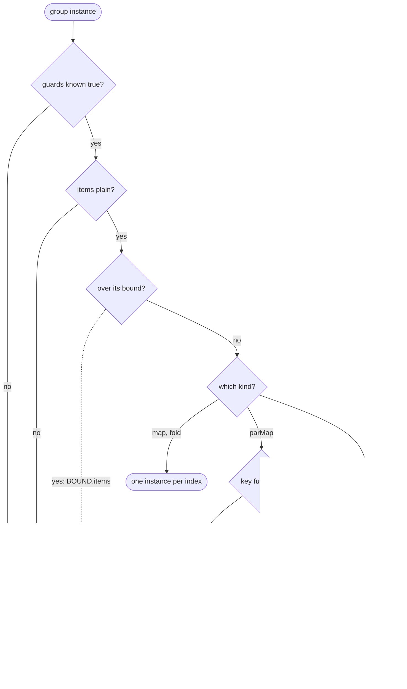

# compose

For engine contributors: what `compose(input)` checks, in which order, and which step emits which diagnostic.

`compose(input)` implements pre-flight
([architecture: Lifecycle of a concert](../../../../docs/architecture.md#4-lifecycle-of-a-concert), CORE-07). It spends
nothing: it checks an IR against its config and hosts, expands the groups whose items are plain values and bounds the
result. It calls no author code, writes nothing and starts no host node (NFR-02, ADR 0009). It returns
`{ ok: true, plan }`, or `{ ok: false, diagnostics }` when any check gives an error. The plan is `Plan` of
`@maestro/ir`, described in its [README](../../../ir/README.md#plan). Two hosts that register one node kind make
`compose` throw before step 1, as `perform` does.

## Input

| Field      | Holds                                                                                             |
| ---------- | ------------------------------------------------------------------------------------------------- |
| `ir`       | IR that `parseIr` accepted.                                                                       |
| `config`   | The layered config: its values, and each value's source (`../config`).                            |
| `roots`    | The directories each host's setup names.                                                          |
| `core`     | The config schemas the engine owns, by top-level key.                                             |
| `packs`    | Each installed pack's claims: its id, then its compositions' ids, then each one's param names.    |
| `hosts`    | The installed hosts.                                                                              |
| `loadCode` | Resolves a worker reference to its function (ADR 0008), once per reference per compose.           |
| `caps`     | Caps by name: `instances` caps the node-instance total, any other name the total of a host count. |

No value gets its schema defaults. `format` is an annotation only: neither compose nor perform validates it.

## Steps

Errors from expansion and a host's `validate` do not stop compose; the bounds' `BOUND.cap` errors are added only when no
error came before.

1. Checks, in this order; an error stops compose here, before anything is loaded:
   - edge types, artifact markers and type owners;
   - config, each diagnostic at the file and line that set the key (D-24);
   - host nodes against their kinds: the kind, the `config` and the ports
     ([architecture: Host interface](../../../../docs/architecture.md#6-host-interface)).
2. Loading, through `loadCode`, of every function the IR names: each code node's worker and each `parMap` or `parFind`
   key function, once per reference. One that does not load is a `SCOPE.export` error (ADR 0008), and compose stops
   here, before anything is called.
3. [Expansion](#expansion).
4. Each host's `validate(graph, setup)`. Its codes get the `HOST.` prefix. One that throws or rejects gives a
   `HOST.validate` error naming the host.
5. The plan's bounds, from the expansion, against `caps`.

### Expansion

Enclosing groups first, one group instance at a time. A group instance expands only when every guard on it is known true
and its items are plain values: a literal, or an enclosing group's item.

Dotted edges are errors; the group instance then stays a region.

- A group sized by a node result, or whose guard a node result feeds, is such a region (CORE-05).
- A `parFind` over plain items is checked for duplicate keys by `itemKey` too, and stays a region.
- A `parMap` with a key function expands to a count of its items, as the key function is called only at perform.
- When the IR's own bounds, with every group at its declared bound, pass a cap, expansion checks the bounds so far after
  each group instance. A group instance not yet reached counts nothing, so the bounds so far only grow. Expansion stops
  at the first cap they pass, with a `BOUND.cap` error that says "may reach at least".

## Diagnostics

The prefixes are catalogued in
[sdk-spec 13.3 Diagnostics catalogue](../../../../docs/sdk-spec.md#133-diagnostics-catalogue-core-17).

| Code            | Step           | When                                                                                       |
| --------------- | -------------- | ------------------------------------------------------------------------------------------ |
| `TYPE.edge`     | checks         | An edge's source and target schemas disagree.[^types]                                      |
| `TYPE.marker`   | checks         | An `x-maestro-type` the artifact walker cannot reach.                                      |
| `TYPE.owner`    | checks         | An `x-maestro-type` name neither core (`CORE_TYPES`) nor an installed host owns.           |
| `CFG.unclaimed` | checks         | A config key nothing installed claims, at any level.[^claims] Hints a near name.           |
| `CFG.schema`    | checks         | A config namespace is off the schema of core or a host whose kinds the IR uses.[^pack]     |
| `CFG.claim`     | checks         | A pack's id is a namespace core or an installed host already claims.                       |
| `HOST.kind`     | checks         | A node kind no installed host registers.                                                   |
| `HOST.config`   | checks         | A host node's `config` is off its kind's `config` schema.                                  |
| `HOST.ports`    | checks         | A host node's `in` or `out` differs from its kind's `ports(node)`.[^ports]                 |
| `SCOPE.export`  | load           | `loadCode` could not load a function the IR names: a code node's or a key function.[^load] |
| `SCOPE.key`     | expand         | Two items of a `parMap` or `parFind` instance share a key.[^keys]                          |
| `BOUND.items`   | expand         | A group instance has more known items than its bound.                                      |
| `HOST.validate` | validate       | A host's `validate()` threw or rejected.                                                   |
| `HOST.*`        | validate       | A host's `validate` finding.                                                               |
| `BOUND.cap`     | expand, bounds | A total of the plan's bounds, or of its bounds so far while expanding, is over its cap.    |

[^claims]:
    A top-level key belongs to core, an installed host or an installed pack. Under a pack's id, a key names one of its
    compositions, and under that, one of its params (D-17). A key only an unused host claims is ignored (D-24).

[^pack]: Or a pack's value, or a composition's under it, is not a mapping.

[^load]: The hint is the load error's message after its first line, when it has one.

[^types]:
    The `x-maestro-type` names, then the JSON `type` (an `integer` fits a `number`), then `items` and shared
    `properties`. Enums, `required`, extra properties and annotations are ignored, and only a `core.json-file` compares
    what a marked subschema says of its content. A `data` edge into a fan-in input is checked as the IR README's
    [fan-in edge rule](../../../ir/README.md#outcomes-and-settled) says. The check is loose because equality would
    reject an enum into `Text` and an `Int` into `Float`; perform checks each node's inputs against its `in` before it
    starts.

[^ports]:
    By port name, then by the edge rule on each shared port: values flow from the IR's `in` into the kind's, and from
    the kind's `out` into the IR's. A `ports(node)` that throws is a `HOST.ports` error too. A node with a `HOST.config`
    error gets no ports check.

[^keys]:
    Keys come from `itemKey` ([Expansion paths](../../../ir/README.md#expansion-paths)), so an item keyed by its index
    and a primitive item with that value collide too. The hint is to give the group a key function, whose duplicate keys
    fail it at perform.
