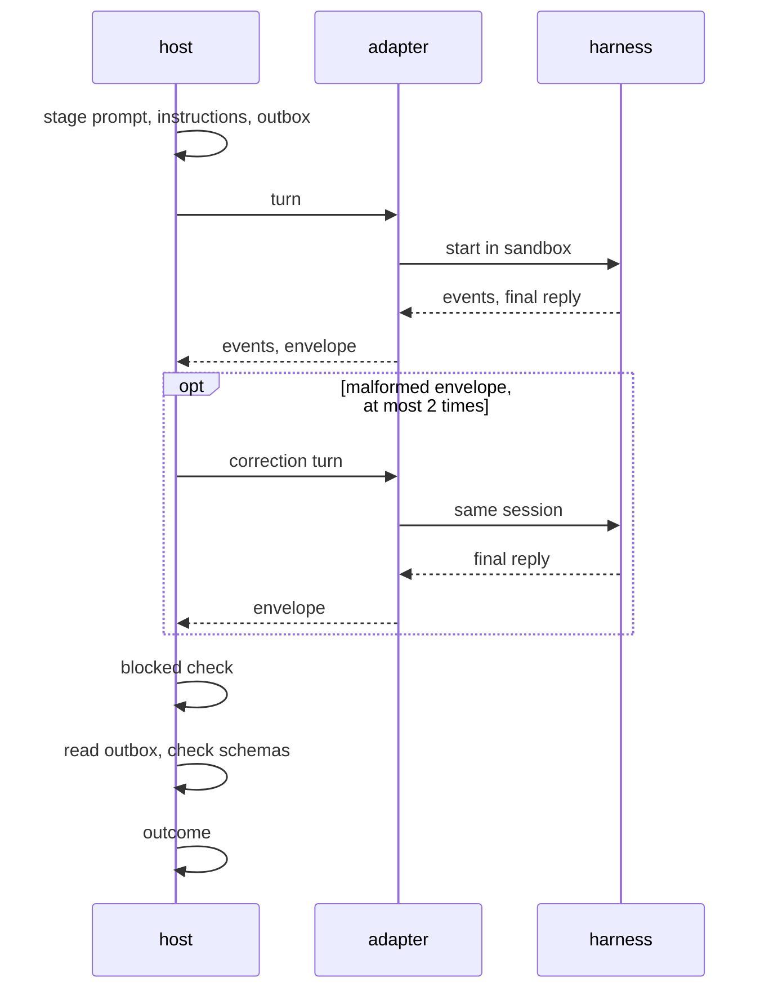
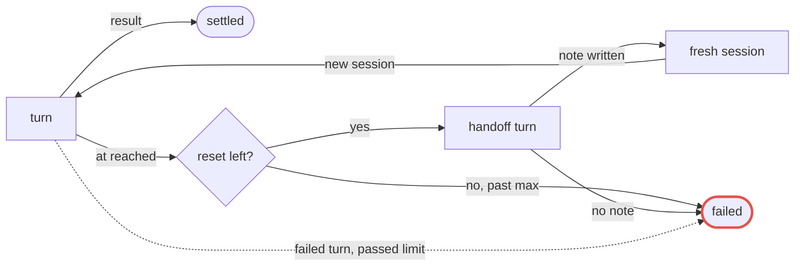
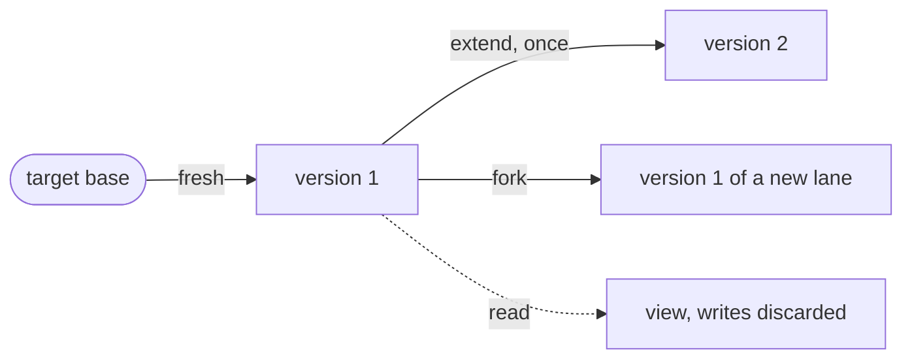

# @maestro/host-repo

The repo host: the coding-agent concepts that run in lanes cut from a target repository. Read it to learn what an agent,
a check or a lane does at run time, what the host config keys mean, and how a profile, a sandbox and a harness fit
together. The host interface it implements is in [architecture](../../docs/architecture.md#6-host-interface); how an
author writes these nodes is in [sdk-spec](../../docs/sdk-spec.md). The vocabulary is fixed in D-21 and
[GLOSSARY](../../GLOSSARY.md).

The host contributes:

- the node kinds `repo.agent`, `repo.check`, changeset, commits and apply;
- lanes, versioned working copies cut from a target, and the changesets that leave them;
- the sandbox every agent, check and prepare line runs in, and the harness adapters that drive a coding agent in it;
- profiles, named agent setups a seat draws on, and the config namespaces `target`, `profiles`, `seats` and `sandbox`.

## Node kinds

### Agent node

| Input         | Meaning                                                                         |
| ------------- | ------------------------------------------------------------------------------- |
| task          | text staged by the host, with no argument-length limit                          |
| profile, seat | the profile by name and the seat it fills                                       |
| lane          | `fresh`, `fork`, `extend` or `read` (see Lanes)                                 |
| outputs       | typed declarations: a JSON file with a schema, or Markdown                      |
| `attachments` | named artifacts, each with a required `hint`, mounted read-only at `/in/<name>` |
| checks        | the named checks it may run                                                     |
| `session`     | optional: continue a session (see Sessions)                                     |
| `verdict`     | marks a verdict agent                                                           |
| `encore`      | `false` starts it fresh in an encore                                            |

Outputs: the declared files as typed artifacts, `report`, outcome and reason from its envelope[^outcome], `metrics`,
`staged` (the staged text), its latest `session` and the resulting lane version.

[^outcome]:
    `rejected` is a verdict agent's negative verdict. `failed` is a run that did not complete, or a blocked agent (ADR
    0012).

The profile gives the agent its runtime (harness, model, thinking level), instructions, limits, context policy,
read-only binds and own attachments. An attachment's content hash is in the resume key, and a bind is not (ADR 0011).

### Check node

Runs deterministic commands in a lane: one named check of the target, every named check (all failures reported), or an
inline `{ run, hint?, timeout }` (D-22). It is not a code node: it runs untrusted target commands in the sandbox.

- Each line runs through `sh -c` in the sandbox, in order, and the first failing line stops its check.
- Every line, of a check or of prepare, sees `MAESTRO_LANE_BASE`, the commit its lane was cut from, which overrides a
  configured `env` entry of that name.
- `MAESTRO_CHECK_OUTPUT` names a writable directory outside the lane, which a configured `env` cannot override. As the
  check left it, possibly empty, it is the `output` artifact, kept whether the check passed or failed (ADR 0011).
- Logs, holding each line and its output, are an artifact.

| Exit                     | Outcome    |
| ------------------------ | ---------- |
| 0                        | `ok`       |
| 3, 124, 127, 137[^exits] | `failed`   |
| any other non-zero exit  | `rejected` |

A rejection's reason names the check and the line number. A line's failing reason ends with the last non-blank line of
its output.

[^exits]: 124 is also a timeout, 127 a command not found, 137 a SIGKILL.

### Changeset node

Takes one lane version and outputs its patch series as a changeset directory (see Changesets). It opens no lane and
spends no extension.

### Commits node

Config `revs`, git revisions of the target: `A..B`, `C^!`, or a bare `B` from `target.base`, else the target's `HEAD`.
It takes no inputs, so it runs as the concert starts and a resume reuses it. It records a version of refs only, opens no
lane, and `failed` on a revision git cannot resolve, a range with no commit in it, or anything but one linear series.

### Apply node

Takes a lane input (`fresh`, `fork` or `extend`) and one changeset on its `changeset` input port, and applies it with a
strategy, `3way` by default or `clean` (HOST-14).

A clean apply is `ok` with the new lane version. A conflict is `rejected`, the reason naming the files, with a version
holding the markers for an agent to extend and resolve; under `clean` nothing is applied. A changeset that is not one,
or one the store cannot apply, is `failed`.

## Agent run

The host stages the run and reads the outbox itself, once every turn and correction has ended. The harness process is
what the sandbox confines; the adapter runs on the host and only builds the sandbox spec.



## Staging, outbox and envelope

### Staging

The staged system-prompt file holds the profile's instructions, when it has any, then the host's **frame**, headed
`# Your run`, then the sections below in this order, each left out when it has nothing to say.

| Section           | Says                                                             |
| ----------------- | ---------------------------------------------------------------- |
| `## Working copy` | the lane's write state, what git allows, the shell[^wc]          |
| `## Checks`       | each check as `check <name>` with its `hint`[^frame-checks]      |
| `## Attachments`  | each attachment, a file or a directory, with its hint as written |
| `## Context`      | only under a `handoff` policy[^frame-context]                    |
| `## Reply`        | the output contract                                              |

[^wc]: A write lane is left uncommitted, a read lane changed in nothing; git writes fail by design.

[^frame-checks]: Never the command itself; the agent runs them and writes no new ones (HOST-15).

[^frame-context]: A full context ends the session in a handoff; the section gives the sessions the task allows.

The file is appended to the harness's own system prompt, never replacing it. A fresh start's user message is the task
alone, on stdin. The `staged` artifact holds the exact text: `prompt.md`, `instructions.md`, `correction-N.md` for each
correction turn and `session-N.md` for the message that opens session N after a handoff.

### Outbox

Declared outputs are files the agent writes in its **outbox**, a per-instance directory at `/out` outside the lane. The
host reads only regular files there and checks each against its schema. The contract tells the agent to write every
declared file, a verdict agent even when it rejects. A missing file or a schema violation is `failed`.

### Envelope

The agent's final reply is its **envelope**.

| Agent   | Envelope                                                           |
| ------- | ------------------------------------------------------------------ |
| work    | `{ report, blocked? }`                                             |
| verdict | `{ report, outcome, reason? }`, or `{ report, blocked }`[^verdict] |

[^verdict]: `outcome` is `ok` or `rejected`, and the reason is required when rejected.

- The report is `{ summary, gaps?, obstacles?, lessons? }`: a one-line summary, then only what the record cannot show.
  It rides the enrichment too, so a blocked or failed agent keeps it.
- A malformed envelope, such as a work agent's with an `outcome`, a verdict agent's with neither, or one both blocked
  and giving a verdict, gets at most two correction turns in the same session, then `failed`.
- A blocked agent ends `failed` with the reason `blocked: <cause>` and no outputs, its declared files unread (ADR 0012).
- A rejection with declared files missing or invalid ends `rejected` with its reason and no outputs.

### Agent-run checks

An agent that names checks gets a `check <name>` command on its `PATH`, staged read-only; one that names none gets none.
It runs the check in `/lane` under the check's timeout, sets the check's `env` inside that command alone, gives it a
fresh `MAESTRO_CHECK_OUTPUT` discarded with the run, prints the tail of the output and ends by the exit table above.
Pre-flight refuses an agent given a check with no `hint`. The agent's sandbox gets the checks' binds, which bind paths
cannot scope to one command.

## Context policy

A profile takes an optional `context: { strategy, at, max }` (AT-07). Without one the harness compacts on its own terms.

| Field      | Meaning                                                                                |
| ---------- | -------------------------------------------------------------------------------------- |
| `strategy` | `handoff` or `compact`                                                                 |
| `at`       | a prompt size in tokens, or a `"<n>%"` share of the model's window, 1 to 99            |
| `max`      | a whole number of at least 1, required for `handoff`: the most resets (or compactions) |

### Handoff

Red is a failure, dotted the move that ends in one; the labels say the same.



- A model call whose prompt reaches `at` cancels the turn, unless the turn settles with its result first, which then
  stands. A passed limit or a cancel ends the agent before the handoff.
- One more turn in the same session asks for a handoff note at `/session/handoff.md`; `at` does not apply to it. A
  handoff turn that fails, or leaves no regular file there, fails the agent.
- A fresh session then takes the task: `# Handoff` (session k of up to `max`+1, the note in `<handoff-note>`, its claims
  to verify), then `# Task` as first given.
- A reset past `max` fails the agent, naming `profiles.<name>.context.max`. An agent continuing a session counts only
  its own resets. Each session's end is recorded as a `session` progress event.
- Claude's compaction is off under `handoff`. pi's stays at its near-full default, so `at` must sit below it; a
  compaction is recorded as a fault, never failing the agent.

### Compaction

Under `compact`, `at` sets the harness's compaction point: claude's `--autocompact`, and on pi a `reserveTokens` of the
window less `at`, which a high `at` leaves small and which also bounds the compaction's summary. A compaction past `max`
fails the agent.

### The window and pre-flight

Pre-flight turns a percentage into tokens, rounded down, of the window kept for the profile's harness and model, and
refuses, naming the profile, the field and the harness:

- a percentage, or `compact` on pi, of a model whose window is not kept; the fix is
  `maestro agent show <profile> --probe`, or `at` in tokens;
- a capped `compact` on a harness that reports no compaction, or a claude `at` outside its compaction window of 100000
  to 1000000 tokens;
- an `at` not below the window kept.

`agent show --probe` and every agent turn keep the window the harness reports. Pre-flight never probes, so it spends
nothing (ADR 0014). Prompt size, the window and each compaction reach the record as progress events.

## Sessions

A session is a value of type `repo.session`: `<concert id>.<node instance id>` of the agent that started it, with `#<k>`
after it for session k a handoff started. An agent with no `session` input mints one under `sessions/` in the host
store; one given a session continues it in place. Each outputs its latest session, the last a handoff started if any.

- Compose refuses a session that crosses harnesses, one that two agents continue, and one an agent inside a `parMap` or
  `parFind` body takes from outside it: a session has one runner at a time. An agent a sequential `loop` or `fold`
  repeats may continue one.
- An agent's enrichment carries `sessionDir`, the session's host directory `sessions/<id>/harness`, where the harness
  writes its transcript. A session lasts until its concert is pruned; continuing a pruned one fails the agent.

### What a continuing agent is told

A continuing agent's user message opens with what changed since the session's last turn, then the task under `# Task`.
Each line is unchanged or says what changed:

| Line                | Says                                                                   |
| ------------------- | ---------------------------------------------------------------------- |
| `Task`              | the task, changed or not                                               |
| `Attachments`       | by content hash, each changed, new or dropped[^previous]               |
| `Working copy`      | the commits it stood on then and now, with the `git diff` between them |
| `Contract: changed` | present only when the frame's `## Reply` section differs               |

[^previous]:
    A changed one's earlier copy is at `/in/previous/<name>`, so no attachment, of the graph or of a profile, may be
    named `previous`.

The system prompt is staged anew for every turn. The host keeps the last completed turn in the session's home, so a
resumed concert compares against it. A fresh session's message is the task alone.

### Sessions across an encore

In an encore an agent with no `session` input continues its counterpart's session: the instance of the same node at the
same keys in the concert the encore repeats, in a `loop` its last iteration. An agent's own session input wins over any
counterpart, and a seat saying `encore: false` starts fresh. With no usable counterpart session the agent starts fresh
and its enrichment's `encoreFresh` says why. An encore cuts fresh lanes: it continues sessions, not lanes (D-27).

## Lanes

A lane is an isolated working copy cut from a target at a base. Every node's lane output is an immutable version. Lanes
live in the host store, under `<data root>/hosts/repo/<target id>/`. They stay on disk until `prune`, and `ls` shows
their disk use.



`fresh(base)` makes a new lane from the node's `base`, else `target.base`, else the target's `HEAD`. `fork(v)` copies
version `v`, `extend(v)` continues the lane from it and yields the next version, and `read(v)` sees `v` with its writes
discarded, yielding no version.

A version may be extended at most once (HOST-02) and forked or read any number of times. A node whose lane input is not
a `read` outputs its lane version. A commits node's version has no working copy, so it is forked or read, never
extended.

A lane belongs to its node instance. A failed or cancelled instance drops its lane, and a resume takes back whatever an
earlier run left, its sealed version included.

### Partials

An agent that fails, is blocked or is cancelled after changing a lane it does not `read` first keeps those changes as a
changeset directory (no message) under `partials/` in the target's store, named as `partial` in its enrichment. It is no
lane version, so a re-run starts from its input; a later failed run replaces it, and
`maestro cs show|apply --node <instance> --partial` reads it for manual recovery.

### Lane refs

A **lane ref** param, written `<concert id>.<node instance id>`, lets a concert fork, read or make into a changeset a
version left by an earlier concert (D-27, HOST-13). There is no cross-concert extension.

## Changesets

A concert leaves a **changeset** (a patch series) attached to the record only by ending in a changeset node. The
changeset is a directory: `base`, the target commit the lane chain was cut from, then `0001.patch`, `0002.patch` and on,
one commit each, subject the lane version that wrote it, and a `message` file when made with one. An empty changeset
holds `base` alone.

- `maestro cs` takes the `result` node's changeset, else the last `ok` instance's, or the one a flag picks: another
  instance, or a failed, blocked or cancelled agent's kept work.
- Applying or committing is a separate, operator-owned step. The target's checkout, refs and commits are never written
  by the host (HOST-03); the user's `cs apply` writes them. It refuses an empty changeset.

Flags and exit codes are in the [CLI README](../cli/README.md) and `--help`.

## Profiles and prompts

A **profile** is a named agent setup, and a seat names one. A composition sets no model: a seat names a profile, and
config gives the profile its runtime (ADR 0013).

### Fields

A profile is a directory whose `profile.yaml` holds:

| Field          | Holds                                              |
| -------------- | -------------------------------------------------- |
| `runtime`      | `harness`, `model`, optional `thinking`            |
| `instructions` | a path inside the directory                        |
| `attachments`  | paths inside the directory, attached to every call |
| `limits`       | `{ timeout, tokens }`                              |
| `context`      | the context policy above                           |

`readOnly` paths are set only in config, as `profiles.<name>.readOnly`, never in the file.

`model` is an alias such as `sonnet` or a full id on `claude`, `provider/model` on `pi`, and any string on `stub`;
`thinking` passes as `--effort` on `claude` and `--thinking` on `pi`, and `stub` ignores it. maestro passes both through
unchecked: confirm an id with the harness's own CLI.

### Lookup

A profile is found by a bare name or `<pack>/<name>`, in these roots, highest first. The highest root holding the name
wins whole, and the others are its shadows.

1. the workspace's `.maestro/profiles/<name>/`
2. the user's `$XDG_CONFIG_HOME/maestro/profiles/<name>/`
3. a pack bundle's `profiles/`, named `<pack>/<name>`

`profiles.<name>` in config tunes it. Per field, `-c` and `--preset` beat the config files' `profiles`, which beat the
profile's own `profile.yaml`, so `--preset stub` always means no spend. A seat names one profile, defaulting to its own
name; `seats.<composition id>/<seat>` in config rebinds it to another. Resolution happens at pre-flight and again on a
resume.

`maestro agent ls` lists every profile and the root that wins it, and `maestro agent show` prints what one resolves to
and the layer behind each value. Its `--probe` is under Harness adapters.

### Limits

A profile takes optional `limits`, none by default; config tunes them per field.

| Limit     | Value                                                                                          |
| --------- | ---------------------------------------------------------------------------------------------- |
| `timeout` | a duration or whole milliseconds, wall clock from the first turn's start, retry waits included |
| `tokens`  | a whole number of at least 1, the running total of the harness's usage events                  |

Both cover every turn, correction, handoff turn, compaction and retry of the instance. A bad value is refused at
compose. Passing one cancels the agent and ends it `failed` with a reason naming the limit, such as
`passed its timeout of 45m`, its partial kept as for any failed agent.

### Prompts

An agent reads five layers, in this order, each with one home; no layer restates another's text.

| Layer       | From                              | Holds                                                                     |
| ----------- | --------------------------------- | ------------------------------------------------------------------------- |
| Frame       | the host                          | working copy, checks, attachment list, output schema                      |
| Profile     | `profiles/<name>/instructions.md` | who the agent is, how it works and what it never does, true in every call |
| Area        | a preset's profile `attachments`  | what is true of one area or run, added to a profile                       |
| Task        | one Markdown file per call        | what this call asks, its inputs by name, its outputs, its bar             |
| Attachments | code nodes                        | the run's data, never instructions                                        |

`maestro art show <id> <instance> staged/prompt.md` shows what an agent was told.

A task file is one `.md` file per call, named for its `label`, in `.maestro/<id>/prompts/` beside a bare file or
`src/prompts/` in a pack. Import it as text: `import task from "./prompts/build.md" with { type: "text" }`. The
attribute is mandatory, or Bun imports Markdown as HTML. For `tsc`, declare the type once:
`declare module "*.md" { const text: string; export default text; }`.

A fragment shared by several tasks starts with `_` (`_gate.md`); where a call picks between texts, each is the label
plus a plain suffix (`reviewer-again.md`). A JSON shape example is a fenced `json` block with its field rules as prose
under it, so a formatter does not reflow it.

## Configuration

The host owns four namespaces, and a code node sees its target as `env.repo`.

| Key                             | Holds                                                          |
| ------------------------------- | -------------------------------------------------------------- |
| `target.repo`                   | absolute path of the repository lanes are cut from             |
| `target.base`                   | optional default `base`; else the target's `HEAD`              |
| `target.checks`                 | the named checks                                               |
| `target.prepare`                | lines that set a lane up, in any form a check takes            |
| `target.sparse`                 | directories, or `{ patterns }`, a lane checks out              |
| `profiles.<name>`               | the fields that tune a profile[^profiles]                      |
| `seats.<composition id>/<seat>` | the profile a seat runs[^seats]                                |
| `sandbox.readOnly`              | host paths bound read-only into every agent, check and prepare |
| `sandbox.path`                  | host directories first on every sandboxed `PATH`[^path]        |

[^profiles]: Over its `profile.yaml`; `profiles."*"` covers every profile a layer does not name.

[^seats]: Rebinds the seat's own profile, by the id of the innermost composition holding the seat.

[^path]:
    Each is bound read-only. It is machine-specific, so it belongs in the user config. `PATH` is `sandbox.path` in
    order, then `/usr/bin:/bin`; a check's or prepare's own `env.PATH` wins over it.

Layers, presets, `-c` and the core keys are in [architecture](../../docs/architecture.md#8-configuration); the
[CLI README](../cli/README.md#config) shows `-c` examples. A relative path key is relative to the workspace root in the
workspace file, to the user config directory in a user file, and to the cwd for a `-c` outside a workspace. Quote a YAML
value that would read as another type or break the line: `"true"`, `"3"`, a line holding `: ` or ` #`.

```yaml
target:
  prepare:
    run: bun install --frozen-lockfile
    cache: { path: ~/.bun/install/cache, at: /cache, env: BUN_INSTALL_CACHE_DIR }
  checks:
    build:
      run: cargo build
      hint: the release build
      timeout: 20m
      writable: [/home/me/.cargo/registry]
      readOnly: [/opt/sdk]
      env: { CARGO_TERM_COLOR: never }
```

`env.repo`: a code node sees `target`, `base`, `sparse` (`null` when unset), `revision` (the commit `base` names, `null`
when unresolved) and `profiles`, a digest over the files of every profile the roots hold. It is empty without a target.

Pre-flight refuses a node that names a profile, harness or check that does not exist, the message listing those that do;
an agent names only checks config has.

### Checks

A check is a shell line, a list of them, or the long form `{ run, hint, timeout, readOnly, writable, env }`:

| Field      | Holds                                                                      |
| ---------- | -------------------------------------------------------------------------- |
| `run`      | the line or lines                                                          |
| `hint`     | what an agent is told the check covers; required for a check an agent runs |
| `timeout`  | a duration such as `10m` (ms, s, m, h or d)[^timeout]                      |
| `readOnly` | absolute host paths bound read-only at their own paths                     |
| `writable` | absolute host paths bound read-write at their own paths                    |
| `env`      | environment variables for that check                                       |

[^timeout]: None means no limit, in the agent's `check` command as on the node.

A toolchain, cache or lock file shared across lanes goes in `readOnly` or `writable`. Each line runs in its own `sh -c`,
so shell variables and `cd` do not carry to the next; the exit codes are in Check node. A check judging only the change
runs `git diff $MAESTRO_LANE_BASE`, which misses an agent's new untracked files (`git add` is denied in its sandbox):
list them with `git ls-files --others --exclude-standard`.

### Prepare and sparse

`target.prepare` takes a check's shape and sets a lane up, with a dependency sync or the like (HOST-16). It runs in the
sandbox, network included, in every working copy checked out from a commit, before the node's own work: `fresh`, `fork`,
`read` and a re-opened extension, for every kind. An in-place `extend` keeps its ignored files and git state, so prepare
runs once per working copy.

- Its lines run as a check's do, each emitting a `prepare` progress event. A line that does not exit 0 fails the node,
  never rejects it, the reason ending with the line's last output, as
  `target.prepare line 1 exited 7: registry unreachable`.
- What it makes must be ignored by the repository's `.gitignore`, and is never sealed; any other change fails the node,
  naming the files.
- Prepare is environment, not input, so neither it nor its binds enter the resume key (ADR 0011).
- The long form alone takes `cache: { path, at, env }`: the host directory `path` (absolute, or `~/`), overlaid at `at`
  (not in `/lane`) with writes that die with the sandbox, and `env` set to `at` for its lines. It is mounted only when
  `path` exists and the installed bwrap can overlay (0.10 or later); otherwise prepare runs without it. The cache is
  trusted as it stands, because a package manager may not re-verify its entries.

`target.sparse` lists cone-mode directories, relative to the repository root, or is `{ patterns: [...] }`, a non-empty
list of gitignore-style patterns applied in non-cone mode: `/*`, `!/b/`, `/b/keep.txt` leaves the root files and
`b/keep.txt`. The host narrows every working copy it checks out to it before prepare runs, so checks and agents see
nothing else, and a sealed version still holds the full tree. If narrowing fails, the node fails and leaves no lane.

## Sandbox

The agent process is confined:

- writable only in its lane's directory, its outbox, its session directory and the writable binds of the checks it may
  run;
- read-only for declared binds and attachments;
- no secrets in its environment beyond what the harness needs, and none written to logs;
- able to reach its own harness's credentials, such as Claude's token and pi's `auth.json`.

The backend is bubblewrap behind a pluggable interface, on Linux x64 only (D-25). Prepare runs in a check's sandbox.

- Sandbox policy is host config. A node can add read-only binds. Config or a check node may name writable binds; an
  agent node never does (ADR 0011).
- Every bind, read-only or writable, is absolute, exists and is not inside a lane. A writable bind also neither contains
  nor lies inside the lanes or the target repository.
- No sandbox can write a lane's git directory (ADR 0005).

## Harness adapters

An adapter starts an agent session for a runtime, feeds it the prompt, streams events, reports the final reply and
supports cancel. The adapters are pi, Claude Code and the built-in `stub` harness below. An adapter drives the harness
as a sandboxed subprocess over its JSON event stream (D-20, ADR 0001); an in-process agent cannot be confined by
bubblewrap.

- Events: text, thinking, tool calls, usage, and each tool result as a size only, never its text.
- Secrets the sandbox is given, Claude's token and the credential values in pi's `auth.json`, are masked in the
  harness's output before the adapter parses it.
- Claude's harness reads its token from `CLAUDE_CODE_OAUTH_TOKEN`, as [INSTALL](../../INSTALL.md#1-requirements) sets
  out. The release binary reads no `.env` or `bunfig.toml` from the cwd; a run through `bun` from the repository still
  does.
- Nothing of the user's pi dir but `auth.json` reaches an agent.

### Environment report and probe

An adapter also streams the harness's startup report as an `environment` event: what it loaded, each part by name. The
host records it and never enforces it.

`maestro agent show --probe` starts a profile's agent as a concert would and stops it once it has that report and the
model's window, to check the report against the adapter's declared baseline and keep the window. A mismatch is a fault
of inspection, never of a concert. It marks each part `✓`, `✗` or `?` (not reported) and exits 1 on a fault. It spends a
startup, and on claude one short turn.

The baseline pins the tools an agent gets, so a tool a harness release adds never reaches one. A probe faults each tool
loaded beyond it and each one in it not loaded.

## Stub harness

The built-in `stub` harness rehearses a composition with no spend: it proves config, profiles, lanes and checks before
any agent runs. Select it with a preset that gives every seat the `stub` runtime, so `--preset stub` means no spend:

```yaml
profiles:
  "*": { runtime: !replace { harness: stub } }
```

- A stub agent changes nothing and replies with an ok envelope of the agent's kind; checks run for real. A check needing
  an agent's change stays red; one already green on the target passes.
- It writes a placeholder for each declared output: the smallest value meeting the schema, `"stub"` for text. A schema
  beyond the keywords it reads fails the agent, naming the output.
- Instructions and prompt are staged as for a real run. A profile on `stub` needs no `model`.

Environment variables rehearse a branch a placeholder never takes. A resume needs them set again.

| Variable                   | Effect                                                                        |
| -------------------------- | ----------------------------------------------------------------------------- |
| `MAESTRO_STUB_OUTPUTS`     | a directory scripting what agents deliver[^outputs]                           |
| `MAESTRO_STUB_DELAY`       | each turn waits that long before it settles[^delay]                           |
| `MAESTRO_STUB_ENVIRONMENT` | a JSON object whose parts replace what the stub reports loading[^environment] |

[^outputs]:
    A stub agent copies `<dir>/<instance id>/<file>` for each declared output, else `<dir>/<node id>/<file>`, else
    writes the placeholder. The instance id is as `maestro ls <id>` prints it, such as `loop[0]/review`; the node id
    drops the `[n]` indices and serves every round. A `verdict` file found the same way holds `ok` or
    `rejected <reason>`, absent `ok`. An `events.jsonl` found the same way holds harness events emitted first, one JSON
    object per line, such as `{"type":"tool","id":"t1","name":"Bash","input":{"command":"ls"}}`,
    `{"type":"tool_result","id":"t1","bytes":120,"error":false}` or `{"type":"context","used":18000}`. The host
    validates a scripted file like any output; a missing directory or other text fails the stub agent.

[^delay]: A duration such as `2s` or `500ms`; unset, it answers at once. It applies to scripted events too.

[^environment]:
    Such as `{"mcp":["github"]}`, to rehearse a fault for `agent show --probe` or `--concert`; `null` leaves a part
    unreported, and `window` reports a model's window.

## Validation rules

The host checks these at compose, naming the offending node, profile or path:

- Lane rule (HOST-02): [Lanes](#lanes).
- Session rule: [Sessions](#sessions).
- Existing profiles, harnesses and checks, and an agent naming only checks config has: [Configuration](#configuration).
- Binds: [Sandbox](#sandbox).
- A check an agent runs has a `hint`: [Agent-run checks](#agent-run-checks).
- `roles` in config, and an agent node naming a `role` (an IR or concert built before profiles), are refused
  (HOST.legacy): profiles replace them; perform the composition anew.

The classics pack's review compositions take their models from the profiles in config. Picking different model families
for a lens and its skeptic is guidance in its README, not a check.
