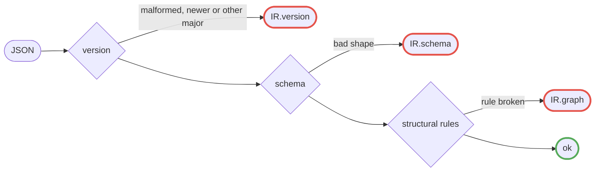

# @maestro/ir

For anyone who emits IR in any language, implements an engine or renderer over it, or imports the package's shared
contracts. Read it for the IR format, the plan and event formats, and the helpers every consumer shares.

The IR is the language-neutral, versioned JSON form of a graph. It is the contract between emitters (the TypeScript SDK,
or any other language) and the engine. ir also holds the data formats maestro emits and what the SDK, core and renderers
must all see, since the SDK imports nothing else and renderers import ir alone. It depends on nothing beyond Ajv. ir
fixes only the formats: how compose computes a plan and how perform produces events are not fixed here.

Contents:

- `ir.schema.json`: the published JSON Schema (draft 2020-12), usable with any validator.
- `src/`: `parseIr`, `IR_VERSION`, `irSchema`, the TypeScript types and the shared contracts below. `src/index.ts` is
  the export list.
- `fixtures/`: golden hand-written IR files, each accepted by `parseIr`, with its worker modules beside it. A
  `plans/<name>.json` is the plan compose gives the IR of that name, which the renderers' tests read.
- `test/read_ir.py`: an independent reader (Python standard library only), which proves the format is readable without
  maestro code.

```ts
import { parseIr } from "@maestro/ir";

const result = parseIr(JSON.parse(text));
if (!result.ok) console.error(result.diagnostics); // [{ code, severity, message, hint, path }]
```

`parseIr` never throws on bad input. It runs three checks in order and returns the first failure's diagnostics:



Red nodes are the failing exits, each returning `error` diagnostics.

`Diagnostic` is the one diagnostic type of ir, the SDK and core: `code`, `severity`, `message` and `hint` (the next
step), plus optional `node`, `scope`, `source` and `path` (a JSON Pointer). Without those four it is about the whole IR.
Every diagnostic `parseIr` returns is an `error` with a hint and a path, and one whose path points into a node with a
string `id` also names that node in `node`.

Refs: CORE-17.

## Versioning

`irVersion` is `"<major>.<minor>"`. This package reads `1.0` and `1.1`, and emits `1.1`.

- **Minor** changes are additive and optional: a new optional field, or a new value where readers already reject the
  unknown. IR written for `1.n` keeps its meaning under every later `1.m`. A breaking change to the node config of a
  host that ships with maestro also bumps the minor, and that host refuses a node of the older shape by name.
- **Major** changes are anything else: a removed or renamed field, a new required field, a changed meaning, a new node
  or edge kind.
- A reader that supports `M.n` accepts `M.0` to `M.n`, and nothing else. It rejects another major, and a newer minor,
  with an `IR.version` diagnostic and a hint. Both checks come before the schema check, so IR of another major gets one
  clear error.
- A 1.1 IR cannot be read by a 1.0 maestro, and the hint tells the operator to upgrade maestro. The rationale is in
  [ADR 0004](../../docs/adr/0004-ir-flat-graph-and-version-policy.md).
- The schema's `irVersion` enum lists exactly the versions this package reads. It is bumped together with `IR_VERSION`,
  and a test checks that the two agree.
- Any change to the IR updates the schema, the fixtures, `IR_VERSION` and the [Changelog](#changelog).

Refs: CORE-16, ADR 0004, D-30.

## Format

### Document and ids

| Field         | Content                                                                                             |
| ------------- | --------------------------------------------------------------------------------------------------- |
| `irVersion`   | See [Versioning](#versioning).                                                                      |
| `composition` | `id`, `version`, `pack`, optional `doc`.                                                            |
| `emitter`     | `name` and `version` of what produced the IR, optional `sourceHash`. Hand-written IR uses `"hand"`. |
| `scopes`      | One per subcomposition use: `id`, `composition` and its `ports` with schemas.                       |
| `nodes`       | Flat list. Nesting is by id.                                                                        |
| `edges`       | Flat list, port to port.                                                                            |
| `result`      | `{ "node": id }`, the node the build returned, where the result rule starts.[^result]               |

Nodes and scopes share one id space. An id is a path of `[A-Za-z0-9_-]` segments joined by `/`. Anything inside a scope
or a group has the id `<enclosing id>/<segment>`, so every proper prefix of an id is a declared scope or group node, its
parent is the id minus the last segment, and that last segment is its name. Scopes are for renderers and diagnostics and
do not change execution. Groups do.

Every schema inside the IR is a JSON Schema document that the IR treats as opaque, except for the `x-maestro-type`
annotation that names artifacts and host types ([Type markers and ArtifactRef](#type-markers-and-artifactref)). Edge
type checks are pre-flight's job, not this package's.

Refs: D-09, IR-01, CORE-02.

### Nodes

Common fields: `id`, `kind`, `source` (`file`, `line`, `column`), `in` and `out` (port name to schema), and `literals`
(port name to a plain value).

| Kind            | Own fields                                                                                    |
| --------------- | --------------------------------------------------------------------------------------------- |
| `code`          | `worker` `{runtime, module, export, codeHash}`, optional `fanin`[^fanin], `timeout`[^timeout] |
| `assert`        | `message`, `onFail` (`rejected` or `failed`). The condition is an input port.                 |
| a group kind    | See [Groups](#groups).                                                                        |
| `<host>.<kind>` | Any kind with a dot is a host kind, with an optional opaque `config` object.                  |

A worker's `module` is relative to the IR file's directory, and a test checks each fixture worker module's hash.
`codeHash` takes one of two forms, and the schema pairs each with its module both ways:

- `sha256:` plus 64 lowercase hex digits, the hash of the module file's bytes. The same form as an artifact's
  `contentHash`.
- `maestro:stdlib@<semver>` (`major.minor.patch`, optional pre-release and build parts), only on the reserved module
  `maestro:stdlib`, and that module takes no other form. The version is the building SDK's and informational.

Every node also has two implicit outputs, its status ports `ok` and `reason`, whose schemas are `IMPLICIT_OUT`. They,
and `outcome`, may not be declared in `out`. `outputValue(settled, outputs, port)` reads any port of a settled node,
implicit or declared.

Refs: D-16, D-08, ADR 0008.

### Groups

A group's body is the nodes whose nearest enclosing group is the group. The body is a template that is instantiated per
item or iteration. What a group does when it runs is in
[architecture: Execution model](../../docs/architecture.md#7-execution-model). Every group has:

- `members`: result name to body node id. A member's value is its one entry's outputs, or a record of each entry's
  outputs by result name when it has several. A `parMap` and a `map` may have several. A `find`, a `parFind` and a
  `loop` take exactly one, because their ports mirror that member's outputs, and a `fold` exactly `first` and `step`.
  Allowing more later is a minor change.
- `cardinality`: `{ "exact": n }` or `{ "upTo": n }`.
- `inner`: ports the body reads, in addition to `in` and `out`.

| Kind      | `in`                | `inner`                        | `out`        | Own fields                   |
| --------- | ------------------- | ------------------------------ | ------------ | ---------------------------- |
| `parMap`  | `items`[^items]     | `item`                         | `results`    | `items`, `key`, `onError`    |
| `map`     | `items`[^items]     | `item`                         | `results`    | `items`, `onError`           |
| `find`    | `items`[^items]     | `item`                         | member[^out] | `items`, `cond`              |
| `parFind` | `items`[^items]     | `item`                         | member[^out] | `items`, `key`, `cond`       |
| `fold`    | `items`[^items]     | `item`, `index`, state[^state] | member[^out] | `items`, `first`, `tolerate` |
| `loop`    | initial state[^out] | `index`, state[^state]         | member[^out] | `test`, `tolerate`           |

Field shapes and rules:

- `items` is either a literal array on the node or an `items` input port fed by an edge, never both.
- A `parMap` over literal items, and any group over an empty literal list, is `exact` with the item count. Every other
  group is `upTo`, equal to the item count for literal items. A `fold`, `find` or `parFind` over no items settles
  `skipped`.
- `key` is an optional worker reference for an author key function of a `parMap` or `parFind`.
- `onError` is `stop` or `continue`, and has no default.
- `cond` is a body port `{node, port}` holding a boolean, read on each member.
- A `fold`'s `first` lists the body nodes that run on item 0, with inner `item` and `index` 0, its `first` member among
  them. The other body nodes run on each next item, with inner ports holding the previous accumulator's outputs, `ok`
  and `reason`, and the item and its index. No `first` node reads an accumulator port, no other body node reads a
  `first` node, and both members have the same outputs. A body node's id may put `first` or `step` after the fold's id,
  a phase segment that needs no declared scope. The fold ends on its last accumulator, or on one that is not `ok` unless
  `tolerate: "rejected"` carries it.
- `test` is `{ at, port }`, `port` holding a boolean. A `loop` fails when its test node failed. Where `test` is read
  decides what `port` may be:
  - at `start` it is read before each step, and is a state port of the loop or a body port. A body port's node and the
    body nodes that node reads run first. They may not read the member, so a test at `start` reads only the loop state.
  - at `end` it is a body port, read after each step.
- `tolerate: "rejected"` on a `loop` or `fold` lets rejected state, including the initial state, carry into the next
  iteration.
- A `loop`'s inner state ports hold the previous iteration's member outputs, `ok` and `reason` (absent when `ok`), or
  for the first iteration its inputs, `ok` unless a node feeding it rejected, the first such to settle giving its
  `reason`.

Refs: CORE-05, D-18, ADR 0006.

### Edges

Every input port is fed exactly once, by a `data` or `collect` edge or by a literal.

| Kind      | From                        | To             | Meaning                                                                       |
| --------- | --------------------------- | -------------- | ----------------------------------------------------------------------------- |
| `data`    | `{node, port}`              | `{node, port}` | A value or artifact flows.                                                    |
| `collect` | `results` (`parMap`, `map`) | `{node, port}` | The settled member results flow: explicit fan-in.                             |
| `control` | `{node, port}`              | `{node}`       | A guard: the target runs only if the port is true, else it is skipped.        |
| `control` | `{node}`                    | `{node}`       | Ordering. May carry `tolerate: "rejected"`, which admits a rejected upstream. |

A dependent starts only after every upstream it has an edge from is `ok`, unless its edges from that upstream tolerate
`rejected`. `tolerates(node, edges)` is this rule for every edge from one upstream into `node`. They tolerate it when:

- one is a control edge whose own `tolerate` says so, or any other edge into a `loop` whose `tolerate` says so;
- or each reads a status port, `ok` or `reason`.

An output a node declares but did not produce, as when it rejected without outputs, is never a crash. A data edge from
it skips its reader, with that node as the cause. A guard, a `cond` or a loop `test` that reads it reads not true.

The edge source decides which ports a group exposes. Seen from inside its body, a group exposes `inner`. From anywhere
else, it exposes `out` and the implicit outputs.

Refs: CORE-03, CORE-04, D-08.

### Structural rules and diagnostics

Enforced by `parseIr` after the schema:

1. Ids are unique across nodes and scopes (`SCOPE.duplicate`).
2. Every proper prefix of an id is a declared scope or group node, or a fold's id and phase segment.
3. Every edge endpoint, port, literal, member, `cond`, `test` and result node resolves (`IR.ref`).
4. An edge never leaves a group body: only the group's `out` ports reach outside it.
5. Every input port is fed exactly once.
6. `collect` edges start only at a `parMap` or `map`'s `results` port, and that port feeds nothing else.
7. Group ports, `members`, `first`, `cond`, `test`, `items` and `cardinality` follow the [Groups](#groups) rules.
8. The result node is not inside a group body.
9. Edges form no cycle. An edge into a body counts as an edge into its group.

Violations of rule 2 and rules 4 to 9 are `IR.graph`. Shape violations are `IR.schema`, and version problems are
`IR.version`.

### Outcomes and Settled

A node settles `ok`, `rejected`, `failed` or `skipped` (`Outcome`). A settled value is `Settled<T>`:

```ts
type Settled<T> =
  | { outcome: "ok"; value: T }
  | { outcome: "rejected" | "failed"; value?: T; reason: string }
  | { outcome: "skipped"; value?: T; reason?: string };
```

`worstOutcome(outcomes)` is the one rule wherever several outcomes collapse into one: `failed` > `rejected` >
`skipped` > `ok`, and an empty input is `ok`. It decides a member with several results and a `parMap` or `map` with
`onError: "stop"`. `firstOk` with no `ok` input first counts `skipped` inputs as `rejected`, then takes the worst.

`settledSchema(T)` is the JSON Schema of `Settled<T>`, closed to `outcome`, `value` and `reason`:

- `ok` requires `value` and has no `reason`.
- `rejected` and `failed` require `reason`, and `value` is optional.
- `skipped` has both optional.

T sits at `properties.value`. Port schemas describe the delivered value, so:

- a `parMap` or `map`'s `results` port, and every input fed by a `collect` edge, declare an array whose `items` is
  `settledSchema(T)`,
- a fan-in node's input fed by a `data` edge declares `settledSchema(T)`.

The golden fixtures declare them with T `{ "type": "object" }`, a member's value. The outcome constants equal
`settledSchema`'s output, which a test checks.

A `data` edge into a fan-in input checks the upstream port's schema against the input's `properties.value` subschema,
not against the whole `Settled` schema.

Refs: CORE-04, ADR 0006.

### Type markers and ArtifactRef

The `x-maestro-type` annotation names an artifact or host type on any subschema of a schema in the IR:

```json
{ "type": "array", "items": { "x-maestro-type": "core.file" } }
```

- **Namespaces.** A name is `<namespace>.<type>`, the pattern host node kinds use (`$defs/qualifiedName` in
  `ir.schema.json`). Core owns `core.file`, `core.dir`, `core.json-file` and `core.markdown` (`CORE_TYPES`). Each host
  owns the names it lists in its `types`. Compose rejects a name that neither core nor an installed host owns.
- **Registration.** Ajv's strict mode rejects unknown keywords, so whatever compiles port schemas calls
  `registerMaestroType(ajv)`. A name outside the pattern then fails to compile.
- **Matching.** A marked type matches only the same name. A `core.json-file` also compares its content schema. Unmarked
  values match by schema. An artifact never feeds a value port: a reader node turns it into one.
- **Content versus reference.** A marked artifact subschema's other keywords describe the file's content. The runtime
  value is an `ArtifactRef`, the reference to the file. The SDK's artifact port types, the worker protocol and the
  record all use it.

```ts
type ArtifactRef = {
  path: string;
  contentHash: string;
  producer?: { node: string; expansion: string };
};
```

- `path` is relative to the concert's artifact area. It uses forward slashes, has no leading `/`, and has no empty, `.`
  or `..` segment. It names a file or, for `core.dir`, a directory.
- `contentHash` is `sha256:` plus 64 lowercase hex digits. How a directory is hashed is the executor's, behind the same
  form.
- `producer` is the node instance that wrote the artifact: the node id and its [expansion path](#expansion-paths). It is
  absent only for an artifact from outside the concert, such as a param.

`artifactRefSchema` is its JSON Schema, closed to these fields and enforcing the path, hash and expansion rules. Every
boundary that reads a reference parses it against this one definition. `ARTIFACT_TYPES` are the names whose runtime
value is an `ArtifactRef`: every core type. `artifactsAsRefs(schema)` replaces each subschema one of them marks with
`artifactRefSchema`, so a validator checks a port's runtime value rather than the file's content. The marker walkers are
under [Marker walkers](#marker-walkers).

Refs: ADR 0007.

## Emitted formats

### Plan

compose produces the plan. It is JSON, and `Plan` in `src/plan.ts` is its type. In V1 it is output only: perform takes
the IR, not a plan, so the plan carries no format version.

| Field         | Holds                                                                     |
| ------------- | ------------------------------------------------------------------------- |
| `ir`          | The IR, unchanged.                                                        |
| `expansion`   | Group id, then the group instance's expansion path, then its `Expansion`. |
| `bounds`      | `PlanBounds`, below.                                                      |
| `diagnostics` | Warnings only, each an ir `Diagnostic` (`src/types.ts`).                  |

Expansion paths are in the format of [Expansion paths](#expansion-paths), and `""` outside groups. A `parMap` or
`parFind` item's key is its `itemKey`, or at perform a key function's.

An `Expansion` is either:

- `{ keys }`: the instance's iteration keys in order.
- `{ exact }`: a `parMap`'s iteration count, when its key function names the iterations at perform.
- `{ upTo }`: a region with its bound.

`PlanBounds`:

| Field       | Holds                                                                                     |
| ----------- | ----------------------------------------------------------------------------------------- |
| `instances` | The node-instance total, groups included, as a `Cardinality`: `{ exact }` or `{ upTo }`.  |
| `nodes`     | Instances per node id.                                                                    |
| `counts`    | Each name a host's `bounds(node)` reports, times the node's instances, summed over nodes. |

A count is exact only when every group above it is a `parMap` whose items compose knows.

A plan for a `parMap` over two topics, then a loop, with a host that counts one `calls` per node and `ir` cut short:

```json
{
  "ir": { "irVersion": "1.1", "nodes": [], "edges": [] },
  "expansion": {
    "topics": { "": { "keys": ["alpha", "beta"] } },
    "loop": { "": { "upTo": 2 } }
  },
  "bounds": {
    "instances": { "upTo": 8 },
    "nodes": {
      "topics": { "exact": 1 },
      "topics/slug": { "exact": 2 },
      "topics/draft": { "exact": 2 },
      "loop": { "exact": 1 },
      "loop/step": { "upTo": 2 }
    },
    "counts": { "calls": { "upTo": 4 } }
  },
  "diagnostics": []
}
```

Refs: D-23.

### Events

`ConcertEvent` is one entry of a concert's event stream: the `NodeInstance` it is about (`node` and `expansion`), `seq`
(orders all events of a store and is the cursor to read after), `at` (epoch milliseconds) and an `EventBody`, told apart
by `type`:

| `type`     | Carries                                       | Means                                               |
| ---------- | --------------------------------------------- | --------------------------------------------------- |
| `running`  |                                               | The instance started.                               |
| `settled`  | `outcome`, optional `reason` and `enrichment` | It settled.                                         |
| `reused`   |                                               | A resume kept its `ok` record from before.          |
| `progress` | `event` (a `HostEvent`)                       | Its host emitted `event`, stored as given.          |
| `log`      | `line`                                        | Its worker wrote `line`, or its cancel hook failed. |

`HostEvent` and `Enrichment` are open JSON records that the host owns and the engine stores as given.

Refs: CORE-10.

## Package API

### Graph index

`indexGraph(ir)` returns the lookups the structural rules use (nodes, scopes, parents, ancestors, enclosing groups,
group bodies and edges by id), with `isGroup(node)` and `boundOf(cardinality)`, a group's most iterations.

### Expansion paths

A node instance is a node id plus its expansion path: one `[key]` per enclosing group, outermost first, and empty
outside groups. A `parMap` or `parFind` contributes its item's key, any other group its iteration index, so the path of
a node in a `loop` inside a `parMap` reads `[risk][2]`. The runtime meaning is in
[architecture: Execution model](../../docs/architecture.md#7-execution-model).

- `itemKey(item, index)` is a `parMap` or `parFind` item's key: a string, number, boolean or `null` item is keyed by its
  value, any other item by its index. Each character outside `[A-Za-z0-9_.-]` becomes `_`. Keys that come out equal are
  duplicates, so `3` and `"3"` collide; the caller reports them. `firstDuplicate(keys)` finds the first repeat.
- `formatExpansion(keys)` builds the path and throws on a key outside that alphabet. `parseExpansion(path)` returns the
  keys, or `undefined` for anything else. A key may be empty (`[]`), as `itemKey("")` is.
- `formatInstance(instance, groups)` merges an instance into one name, each key right after its group's id within the
  node id, given the node's enclosing groups: `lens/skeptic` in the parMap `lens` shows as `lens[risk]/skeptic`.

Refs: D-18.

### Marker walkers

`findMarked(schema, value)` returns each marked subschema whose value is present, never descending into a marked
subschema, and follows `properties`, `additionalProperties`, `items`, `prefixItems` and local `$ref`s; `schemaMarkers`
and `unreachableMarkers` list every marker and those `findMarked` cannot reach. An unreachable marker is a compose
error, a `TYPE` diagnostic in pre-flight, not a silent gap.

### Code-function contract

`src/code-function.ts` is the code-function contract, kept in one module so it can leave ir in one step:

- `Context`: what core gives every node instance, and `CodeContext`: `Context` plus `env`, `signal` and `log(line)`.
- `TS_RUNTIME`: `"ts"`, the runtime name of the in-process TypeScript worker.
- `Rejection`: a code function's negative verdict, `{ outcome: "rejected", reason, outputs? }`, which
  `reject(reason, outputs?)` builds. `outputs`, when given, are the node's full outputs, checked against its `out` like
  an `ok` node's. No node declares an `outcome` or `reason` port, so a rejection never reads as outputs.

Refs: ADR 0007, ADR 0008, CORE-14.

[^result]: The result rule is in [architecture: Execution model](../../docs/architecture.md#7-execution-model).

[^fanin]:
    A `fanin` node (a reducer) runs once every upstream has settled and receives each `data` input as `Settled`
    ([Outcomes and Settled](#outcomes-and-settled)).

[^timeout]:
    Whole milliseconds, from 1 to `MAX_TIMEOUT` (the longest timer delay), that an instance may take before it settles
    `failed`. None when absent.

[^items]: Unless `items` is a literal.

[^out]: The member's outputs. A `loop`'s initial state has the shape of its member's outputs.

[^state]: The previous iteration's member outputs, `ok` and `reason`.

## Changelog

- **1.1**: the `repo.agent` node config is `{ profile, seat, lane, verdict?, encore?, checks?, attachments?, out? }`. It
  lost `role`, `limits` and `readOnly`, and the node lost its `identity` input port. A 1.0 agent node is refused at
  pre-flight (ADR 0004, ADR 0013). Its `report` output became an object, `{ summary, gaps?, obstacles?, lessons? }`. Its
  lane input lost `resume`: the node outputs `session`, of the host type `repo.session`, and takes an optional `session`
  input to continue one.
- **1.0**: first version.
