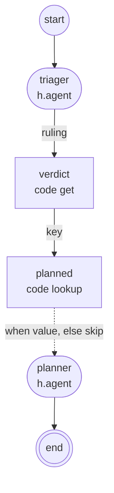
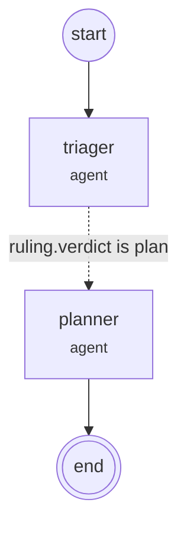

# @maestro/render-text

For anyone changing how a plan or a running concert is drawn as text, and for readers of `maestro watch` or
`compose --graph` output. A `Plan`, or the IR and the record's events, goes in and a string comes out; the package
imports `@maestro/ir` alone and needs no terminal. Architecture's [Rendering](../../docs/architecture.md#11-rendering)
summarises both forms.

| Entry point                    | Gives                                                                     |
| ------------------------------ | ------------------------------------------------------------------------- |
| `@maestro/render-text`         | The static forms: `summary`, `listing`, `render`, `flow`                  |
| `@maestro/render-text/live`    | A concert drawn as it goes: frame, browsable view, helpers, closing block |
| `@maestro/render-text/press`   | Raw input turned into navigation                                          |
| `@maestro/render-text/inspect` | One row's part of the record, and the view that shows it                  |

## Static forms

| Export          | Returns                                                                                                        |
| --------------- | -------------------------------------------------------------------------------------------------------------- |
| `summary(plan)` | One line, such as `fanout: up to 16 node instances`                                                            |
| `listing(plan)` | Each node with its kind, instance count and expansions, then the bounds and any warnings                       |
| `render(plan)`  | A Mermaid flowchart of the whole graph, as [Drawing rules](#drawing-rules) draws it                            |
| `flow(plan)`    | A Mermaid flowchart of the authored flow (experimental), as [Flow drawing rules](#flow-drawing-rules) draws it |

### Drawing rules

`render` draws every node and edge. Guards and ordering edges are the IR's `control` edges: `render` draws both dashed,
`flow` draws guards dashed and ordering edges solid.

| Element                      | Drawn as                                                                 |
| ---------------------------- | ------------------------------------------------------------------------ |
| Scope or group               | A subgraph titled by its relative path[^scope]                           |
| Code node                    | `[ ]`, its worker export shown only when it differs from the node's name |
| Fan-in code node             | `[/ /]`, the reducer behind a `collect`                                  |
| Assert                       | `{ }`                                                                    |
| Host node                    | `([ ])`                                                                  |
| Group header                 | `[[ ]]` inside the subgraph that names its id[^header]                   |
| Loop region                  | Its steps, `0 to N` or `1 to N`[^loop]                                   |
| `start`                      | `-->` to each top-level node that waits on nothing outside it[^start]    |
| Result node                  | `-->` to `stop`, drawn `end`                                             |
| `data` edges                 | `-->`, `<from> to <to>` per port, a same-named port once                 |
| `collect` edge               | `==>`, the barrier before the fan-in                                     |
| Guard on output `p`          | `-.->` `when p, else skip`; when false the node is skipped               |
| Ordering edge                | `-.->` `after`, with `tolerates rejected` when it does                   |
| Loop body result to its next | `-.->` `next`                                                            |
| Test read                    | `-.->` `test`, to the node it reads[^test]                               |
| Group member to its header   | `-.->`, the header delivering the group's outputs                        |
| Several outgoing edges       | A bar after the node, `@{ shape: fork }`                                 |
| Several incoming edges       | A bar before the node, `@{ shape: join }`                                |

[^scope]: A node inside is named by its id's last segment.

[^header]: Its kind and expansion, one line per path when several, or its cardinality when nothing expanded.

[^loop]: `0 to N` when the loop tests the state first, `1 to N` when it tests each step's result.

[^start]: A group waits on what feeds its body.

[^test]: The body node a loop's `test`, or a `find`'s or `parFind`'s `cond`, reads.

Every edge counts toward the bars, guards and ordering edges included, except a group's reads of its own body and the
dashed `next`, `test` and member edges, which are drawn direct. Each bar is declared inside its node's subgraph. Bars
need Mermaid 11.3 or later. A key list is cut at 40 characters. The plans the tests draw are ir's `fixtures/plans`.

A plan whose `planner` is guarded on the triager's ruling being `plan`, drawn by `render`:



### Flow drawing rules

`flow` draws less than `render`.

| Element                    | Drawn as                                                                    |
| -------------------------- | --------------------------------------------------------------------------- |
| Stdlib code node           | Contracted away[^contract]                                                  |
| Edge into or out of a body | Drawn between the entries at the level where its ends are siblings[^body]   |
| Plain edge                 | Dropped when a longer path implies it[^plain]                               |
| Guard                      | `-.->` labelled with the condition the contracted helpers compute[^cond]    |
| `collect` edge             | `==>`, always kept; any other edge is `-->`                                 |
| `start`                    | `-->` to each top-level entry no edge enters                                |
| Result                     | The result's top-level entry `-->` `end`                                    |
| Fork or join bar           | Where two or more non-guard edges leave or enter an entry; guards go direct |
| Scope or group             | A subgraph titled by its name[^title]                                       |
| Loop or fold               | One dashed back edge from its body's last sink to its first root[^back]     |
| Node                       | Its name over the last segment of its kind                                  |
| Assert                     | A decision, `{ }`                                                           |

[^contract]:
    Each `maestro:stdlib` node's in-edges are joined to its out-edges, each joined edge drawn as its out-edge is.

[^body]: An edge between a group and its own body is dropped.

[^plain]:
    A `data` or ordering edge, also dropped when a guard or `collect` edge joins the same pair; no edge names its ports.
    A guard is always kept.

[^cond]:
    A `get` reads a path (`ruling.verdict`), a `not` prefixes `not`, a `lookup` says `is` and the keys that map to
    `true`, and a guard with no helper behind it says its port (`ok`).

[^title]:
    A group adds its kind and size: `scouts · parMap ×3`, `≤N` when its count is a bound, `×N..M` across its paths, and
    `fixes · loop ≤2 rounds`, the name left out when it is the kind.

[^back]: A loop's is `next while <test>`, a fold's `next`.

The plan above through `flow`: `verdict` and `planned` are contracted, and their guard condition is read off them.



## Live view

`@maestro/render-text/live` draws a concert from the IR and the record's events, as `maestro watch` shows it.
`seen(prior, events)` folds events into each instance's state, the latest event winning.

### Frame

`frame(ir, seen, view, agents)` is the plain view: a header, `now`, `last`, the rows and a footer of counts and tokens.

```text
● fixtures.fanout-fanin-loop  "greeting"  kswoykny   running  1m04s
now   ● topics[b] › draft   1m02s   tool bash {"command":"ls"}
last  ! topics[c] › draft   failed   flaky
▾ ✓ topics      parMap     ok       12s    3/3 items · 1 running · 1 ok · 1 failed
  ▸ ● draft ×3  fake.task  running  1m03s  c !  a ✓  b ●
▸ ○ refine      scope      pending         refine-until-done
── 1 running · 1 ok · 1 failed ──────────────────────────────────────────────────────────
```

`last` is the latest `failed` instance; a later `rejected` one never takes its place.

The rows draw the authored shape, each node once:

- A loop shows its latest round, with a strip of each round's state (`⟲ 2/3   1✗ 2●`).
- Under a `parMap` or `parFind` a node is one row for all its items; a fan-out counts them, `n/≤N` for an `upTo` one.
- A container is open (`▾`) while it holds running work, and once the concert settled while it holds the last failure;
  else it folds (`▸`).
- A scope's state is the worst outcome of its rows.
- A stdlib helper shows only while running, rejected or failed. A node that never started is `pending`, and
  `not reached` once its round, group or concert is done.

Lines are cut at `columns - 1` cells, color after the cut. Past `rows - 1` lines, settled rows hide from the top, then
pending ones from the bottom, each stretch as one `… <counts>` line; the running rows and the last failure stay.

### Browsing and keys

`browse(ir, seen, view, agents, nav)` draws the same graph to drive with keys, and
[Browsing a concert](../cli/README.md#browsing-a-concert) holds the `maestro watch` side. `nav` sets what is shown:

- A row opened or closed by hand stays so, and the rows above the cursor open.
- A pinned round is shown in place of the latest, marked `(history)`.
- Following, the cursor goes to the latest started running instance, once settled to the last failure.
- The cursor keeps 2 rows from the viewport's edge while rows remain beyond it.

| Key                    | Tree                                                                                           | Inspector                         |
| ---------------------- | ---------------------------------------------------------------------------------------------- | --------------------------------- |
| `k` `j`, up and down   | Move the cursor a row                                                                          | Scroll the events a line          |
| `u` `d`, PgUp and PgDn | Move a viewport                                                                                | Scroll a viewport                 |
| `g` `G`, Home and End  | Go to the first or last row                                                                    | `g` to the top, `G` to the newest |
| `h`, left              | Close an open row, else step to its container's row                                            | Back to the tree                  |
| `l`, right             | Open a closed row, else step to an open row's first member                                     |                                   |
| space                  | Open a closed row, close an open one                                                           |                                   |
| `[` `]`                | Step the round of the `loop`, `map`, `find` or `fold` the cursor is in; stay put at either end |                                   |
| `e`                    | Go to the last failure, its path opened and its rounds pinned                                  |                                   |
| `f`                    | Toggle follow; turned on it drops the pinned rounds and keeps the folds                        |                                   |
| `enter`                | Open the inspector on the cursor row, tailing                                                  | Back to the tree                  |
| `esc`                  |                                                                                                | Back to the tree                  |
| `q`                    | Quit                                                                                           | Back to the tree                  |
| Ctrl-C                 | Quit                                                                                           | Quit                              |

A move on the tree turns follow off: the cursor and viewport keys, `h` `l` stepping, `[` `]` and `e`. In the inspector a
scroll that reaches the newest line tails again; any other scroll stops tailing.

### Inspector

`@maestro/render-text/inspect` shows the part of the record that belongs to one row: a title and summary, which gives a
settled agent's own one-line `summary`, then its events, which `navigated` draws in place of the tree when `nav.inspect`
is set.

### Helpers

| Export                      | Returns                                                                      |
| --------------------------- | ---------------------------------------------------------------------------- |
| `agentText(actor, metrics)` | The agent column: the actor, then `compact` tokens as `15.5k tok`            |
| `shortId(id)`               | A concert's short id; the derivation is the [CLI README](../cli/README.md)'s |
| `closingBlock(...)`         | How a settled concert ended, in one label column                             |

## Glyphs and color

A glyph and a state word name each state, so the text reads the same without color. Color, when `view.color` is set,
goes on after the cut. A control character in shown text appears as its escape.

| Glyph | State            | Color  |
| ----- | ---------------- | ------ |
| `●`   | running          | cyan   |
| `✓`   | ok               | green  |
| `✗`   | rejected         | yellow |
| `!`   | failed           | red    |
| `○`   | pending          | dim    |
| `–`   | not reached      | dim    |
| `-`   | skipped          | dim    |
| `▾`   | container open   |        |
| `▸`   | container folded |        |
| `⟲`   | loop round       |        |
